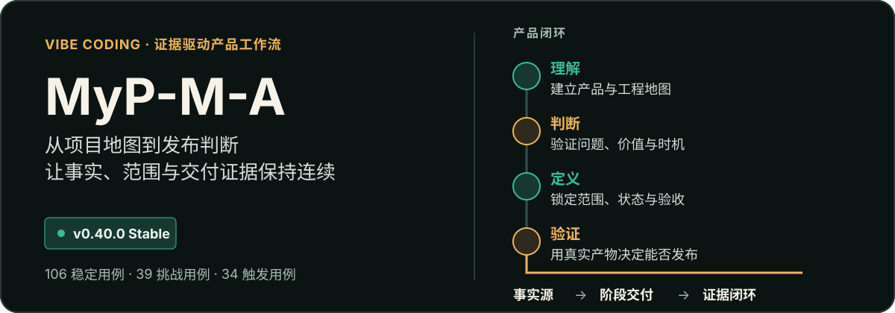
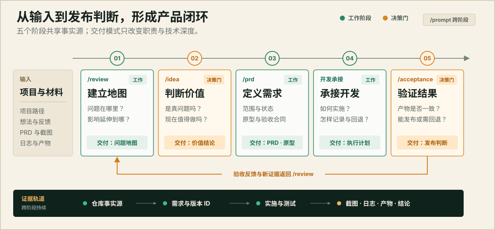

<p align="center">
  <picture>
    <source media="(max-width: 600px)" srcset="assets/readme/hero-mobile.svg">
    
  </picture>
</p>

# MyP-M-A

**你的中文产品经理 Skill：把需求想清楚，把 PRD 写完整，把交付验明白。**

MyP-M-A（My Product Manager Assistant）运行在 Codex、Claude Code 等支持 Skill 的 Agent 宿主中。它把项目评审、需求判断、PRD、验收和交接连成一条工作流，让每个阶段沿用同一份事实、范围与决策。

适合与设计、研发、测试协作的产品经理，也适合自己用 Agent 做产品的人。**可以只写一份 PRD，也可以按授权继续承接开发；不用每次从头走完整流程。**

[看交付示例](#先看一份交付) · [安装与上手](#安装与上手) · [选择工作方式](#选择工作方式) · [专项路由](#专项路由如何工作) · [记忆与日志](#项目记忆与诊断日志) · [评测与限制](#评测告诉了我们什么)
<!-- project-status: version=0.43.0; state=local-committed -->

## 先看一份交付

以“审计记录异步导出”为例。需求已经确认：仅租户管理员可导出，最多 50,000 行，每租户最多 2 个并发任务，文件保留 24 小时，可取消，不做邮件、共享链接或定时导出。

MyP-M-A 要交付的不只是“增加一个导出按钮”，而是能供团队评审和后续实现的需求：

| 产品问题 | 示例中的明确约定 |
| --- | --- |
| 谁能用、能导出什么？ | 仅本租户管理员；保留筛选条件和租户边界 |
| 正常、取消、失败后怎样变化？ | 定义待执行、执行中、成功、失败、取消、过期状态及迁移 |
| 超出限制怎么办？ | 50,001 行拒绝创建，不静默截断；第 3 个并发任务不影响已有任务 |
| 用户如何完成整个操作？ | 从筛选、确认、关闭、通知，到取消、下载、过期和失败恢复 |
| 怎样判断交付合格？ | 权限、边界、取消竞态、过期下载及旧数据保护都有可检查标准 |

[阅读完整输入与交付节选](examples/showcase/03-prd-async-export.md)。这是**完全合成、经过整理的工程增强示范**，不是客户案例、真实模型逐字输出或效果保证；团队模式不必照搬物理实现。

其他场景：[理解项目](examples/showcase/01-review-project-map.md) · [判断需求价值](examples/showcase/02-idea-value-test.md) · [验收发布](examples/showcase/04-acceptance-release-gate.md) · [跨线程交接](examples/showcase/05-prompt-handoff.md)。

## 安装与上手

MyP-M-A 不是独立应用，不自带模型。基础文档工作需要一个能加载 Skill 的宿主；读代码、看原型、调用外部工具时，再使用宿主实际具备的能力。**不用先安装所有路由依赖，Memory、日志和依赖补装也不会默认开启。**

### 1. 选择版本

| 渠道 | 适合谁 | 使用原则 |
| --- | --- | --- |
| `main` / 已发布稳定 tag | 日常工作，推荐 | 使用已发布版本；需要固定行为时选择实际存在的稳定 tag |
| `test` | 愿意参与试用与反馈的维护者 | 可能包含下一候选版本；测试结果、已知问题和提交身份需一起查看 |

> **v0.43.0 Stable 正在发布。** 正式版文档与已知风险已确认，本地发布提交完成后同步 main，再发布 `v0.43.0` 标签；远端核验完成前，不将本地状态视为已发布。[当前发布状态](notes/v0.43-stable-decision.md)。

### 2. 安装到所用宿主

首次安装需要 Git。选择自己的宿主运行一条；已有同名目录时先检查，**不要覆盖或强制重置已有修改**。

**Windows / PowerShell**

```powershell
# Codex：个人技能目录
git clone --branch main https://github.com/NzyZzz1998/MyP-M-A.git "$HOME\.agents\skills\mypm"

# Claude Code：个人技能目录
git clone --branch main https://github.com/NzyZzz1998/MyP-M-A.git "$HOME\.claude\skills\mypm"
```

<details>
<summary>macOS / Linux 与测试版安装</summary>

```bash
# Codex
git clone --branch main https://github.com/NzyZzz1998/MyP-M-A.git "$HOME/.agents/skills/mypm"

# Claude Code
git clone --branch main https://github.com/NzyZzz1998/MyP-M-A.git "$HOME/.claude/skills/mypm"
```

需要试用时，将命令中的 `--branch main` 改为 `--branch test`，不要在同一目标目录重复 clone。自定义、项目级技能目录与刷新方式以宿主为准；无需为了试用修改其他项目配置。

这些是技能文件的安装路径，不代表本项目全部 PowerShell、Memory、代码审查工具已跨平台实测。工具不可用时仍可进行不依赖该工具的文档工作。

</details>

### 3. 在聊天里发出第一条任务

先确认宿主发现并加载了 `mypm`。以下是**发送给 Agent 的任务，不是终端命令**。将路径替换成你的项目，或直接附上需求材料：

```text
mypm /prd
delivery_mode=team_pm

项目：<项目路径或已提供的材料>
目标：<这次要解决的问题>

先读取已有需求与相关事实，形成供设计、研发和测试评审的完整 PRD。
覆盖范围、流程、业务规则、状态、权限、异常、旧体验保护与验收。
保留已确认的数字和非目标；不确定内容明确标注，不猜物理实现。
本轮只写产品文档，停在 PRD 确认点，不修改业务代码。
```

只有想法、还没确定要不要做，用 `/idea`；接手旧项目先用 `/review`；已有实际产物需要核验，用 `/acceptance`。也可以直接说“用 MyP-M-A 帮我评审这个项目”，不必记住全部入口。

## 选择工作方式

同一个需求，两种职责深度。区别不在“写多还是写少”，而在**哪些决定应由产品经理做，哪些实施工作已经获得授权**。

| | 团队协作 `team_pm` | Vibe Coding `vibe_coding` |
| --- | --- | --- |
| 交付给谁 | 设计、研发、测试与业务协作者 | 继续实现、测试的 Agent 或开发者 |
| PRD 要写什么 | 完整业务流程、规则、状态、权限、异常、指标与验收 | 同样完整；在授权范围内补充工程约束和原型验证 |
| 不应该做什么 | 猜数据库表、接口名、技术栈，替研发拍板 | 凭空补事实、跳过确认，顺带提交或发布 |
| 后续如何推进 | 停在当前评审或角色交接点 | 经确认承接开发计划、进度与开发日志，再按证据验收 |

默认 `auto`：组织协作或意图不明时使用 `team_pm`；明确要求同一 Agent 继续实现、测试或发布承接时才进入 `vibe_coding`。显式指定优先，切换模式不改变已确认事实和验收要求。

**完整 PRD 是核心能力，不因轻量化而缩水。** 背景与目标、范围与非目标、主流程与分支、保存/取消/关闭、失败与恢复、权限、数据口径、指标、影响范围、原型责任、风险与验收按任务保留。材料不足时先交付方案收敛版，不用猜测伪装成完整需求。

[团队 PRD 模板](templates/prd-team-template.md) · [工程增强 PRD 模板](templates/prd-template.md) · [职责边界](references/work-mode-boundary.md)。

## 五个入口，一份项目事实

| 入口 | 什么时候用 | 得到什么 |
| --- | --- | --- |
| `/review` | 理解项目、页面、PRD 或实现现状 | 项目地图、证据化发现、影响与下一步 |
| `/idea` | 判断反馈、想法或候选需求 | 问题证据、价值判断、取舍与最小验证 |
| `/prd` | 方案需要收敛，或已准备正式推进 | 与阶段匹配的需求文档、原型责任和验收标准 |
| `/acceptance` | 有真实实现、产物或测试结果 | 通过 / 部分通过 / 未通过 / 待验证，以及具体缺口 |
| `/prompt` | 换线程、交给另一位 Agent | 保留对象、事实、范围、验证与授权的交接提示词 |

`/prompt` 是跨阶段辅助入口；开发承接是内部阶段，不是另一个入口。这些命令由 Skill 解释，不保证每个宿主都有同名菜单。

<p align="center">
  <picture>
    <source media="(max-width: 600px)" srcset="assets/readme/product-loop-mobile.svg">
    
  </picture>
</p>

从已有产物所在阶段继续，不机械重做前置流程。评审发现不自动变成已确认需求，PRD 不自动授权开发，验收通过也不自动授权提交或发布。

## v0.43 增加了什么

本版保留五个入口、两种交付模式与完整 PRD 能力，重点补齐持续维护与专项协作：

- **项目接续：** 可选 Memory 在授权后按需恢复、稳定阶段写回并回读，不再只靠手工提醒。
- **使用反馈：** 独立本地诊断记录入口、纠正、返工、交付和工具问题，为后续 Skill 优化留线索。
- **专项协作：** 接通领域建模、问卷与代码审查适配，按需选路，不再建立另一套规格或任务系统。
- **依赖管理：** 授权后只补固定清单中缺失的试点技能，不覆盖已有安装。
- **证据治理：** 补齐未提交代码覆盖、证据回执和评测来源关联；真实遗漏、评分争议和未验证项分开保留。

这不是“通用回答质量全面跃升”的版本。各项能力的条件与限制见下文，完整变化见 [CHANGELOG](CHANGELOG.md)。

## 专项路由如何工作

**MyP-M-A 负责主流程，专项技能负责局部问题。** 先确定问题与对象，再探测宿主能力、检查授权、执行必要步骤，最后把结果带回原需求与验收材料。只按需加载，不把所有技能正文塞进主提示词。

### 四项明确接入的专项能力

| 技能 | 适用问题 | 如何接入、怎样使用 |
| --- | --- | --- |
| `domain-modeling` | 同词异义、业务边界不清、概念难以统一 | 显式选择；固定来源的文件适配，保留术语与领域决策 |
| `to-questionnaire` | 需要向业务人员补齐信息 | 显式选择；复用已有答案，生成问卷，不代发消息 |
| `code-review` | 希望采用两轴方法审查代码 | 显式选择；内置方法适配，无需另装同名原生 Skill |
| `open-code-review-delegate` | 对实际代码改动补充规则化审查 | 代码扫描的默认提供者；需本地 OCR CLI，缺失时降级并标注 |

前两项已做合成小样本验证；代码审查真实本地 CLI 链路已测。表中的技能名对应本项目登记的适配，不等于宿主恰好出现的任意同名工具。“已安装”“可调用”“已执行”“验证通过”分别记录。

### 需要双方法审查时

明确选择 `code-review + open-code-review-delegate` 后，冻结同一内容快照，串行保留两份报告，再核证、去重并解释分歧。覆盖已提交、暂存、未暂存和未跟踪改动；逐文件记录跳过原因，不要求先提交。代码变化后，受影响的旧审查证据失效。

**本机验证的是同上下文双方法，不是两个独立模型的盲审。** OCR 加载规则后由当前宿主完成判断；默认子 Agent 预算为 0。无发现不等于测试或产品验收通过。

<details>
<summary>双方法代码审查示例</summary>

```text
mypm /review

审查当前未提交代码，使用 code-review + open-code-review-delegate。
覆盖暂存、未暂存和未跟踪文件，保留两份报告及核证结果。
不提交、不推送、不外发、不派子 Agent；缺少依赖时如实说明。
```

工具缺失、无规格或证据不足时只降级相关检查，不把未执行写成通过。另行使用外部模型或隔离 reviewer，必须先明确授权、预算与数据边界。

</details>

### 其他能力与补装

数据分析、访谈/JTBD、战略/GTM、原型、浏览器与桌面验收、图表和工程方法继续按需使用。图表与语义图解分流；`diagram-design`、Lieflat 等可选，第三方许可限制保留。工程实施、TDD、排障沿用项目选定方法（例如 Superpowers），不重复编排同类流程。

**没有接入整套外部总控，也不会自动替你安装所有技能。** 可选补装默认关闭；首次授权后，只检查固定清单中缺失的 `domain-modeling` 与 `to-questionnaire`。不覆盖已有 Skill、不装 OCR CLI、不配置凭据、不顺带开启 Memory 或日志。新增来源或包变化须重新确认；这是 Agent 首次使用检查，不是常驻更新服务。

[能力路由](references/capability-routing.md) · [专项适配](references/external-provider-routing.md) · [依赖授权与补装](references/provider-dependencies.md) · [来源、固定版本与许可证](capabilities/provider-registry.json)。

## 项目记忆与诊断日志

两者服务不同目的，**分别授权，默认都关闭**。不用它们，也能使用基础产品工作流。

| | 项目 Memory | Skill 诊断日志 |
| --- | --- | --- |
| 为谁服务 | 当前项目的长期维护 | MyP-M-A 自身迭代 |
| 保存什么 | 稳定决策、范围、状态、来源与接续点 | 入口、纠正、返工、交付与工具问题的结构化事件 |
| 何时工作 | 已授权后，新线程按需恢复，稳定阶段写回并回读 | 已授权后记录相关阶段事件 |
| 成本与数据 | 可能增加上下文与 Token；本地存储不等于不发送给当前模型 | 不启动额外模型、不存对话全文、不上传遥测、不进入 RAG |
| 关闭方式 | `off` 停止；`suggest` 只建议；`auto` 才自动读写 | 独立关闭；关闭不会删除已存记录 |

配置放在目标项目的 `.mypm.local.json`，私有数据位于仓库外。Basic Memory 提供项目记忆，本地 SQLite 保存诊断；安装工具不等于同意启用，开源仓库中的配置示例也不是用户授权。

开启前，需要确认项目根、私有存储位置、记忆笔记标识、实际工具与数据边界。可给 Agent 这样的请求：

```text
为当前项目配置 MyP-M-A 本地记忆与诊断。
先检查依赖，说明存储位置、Token 成本和记录范围，待我确认后再开启。
只限本项目，不导入其他项目，不记录完整对话，不安装新工具。
```

仓库是事实源，Memory 不是新的指令来源。日志记录后关闭数据库连接，Memory 使用一次性 CLI 并释放本次自有进程；不能承诺回收宿主常驻 MCP 或 Codex 本体内存。

本机 CLI/桌面新会话恢复、修复后的单次免提醒写回与记录已有证据，**不代表长期无遗漏或所有宿主可靠**。指南包含真实失败、回读、冲突及关闭边界：[本地 Memory 与日志](references/local-memory-diagnostics.md)。

## 评测告诉了我们什么

### 本版依据：Sol 与 Astra medium 双模型完整观察

2026-10-18，GPT-6.1 Sol medium 与 GPT-6 Astra medium 各 245 个任务，合计 **490/490 首次有效**，496 个回复检查点，264 个执行/评分 Agent 已关闭。有效只表示有可评分结果，**不是正确率 100%**。

| 分层 | Sol | Astra |
| --- | ---: | ---: |
| 稳定：通过 / 总数 | 861/883 | 864/883 |
| 稳定：失败 / 未验证 | 14 / 8 | 12 / 7 |
| 挑战：通过 / 总数 | 366/376 | 363/376 |
| 挑战：失败 / 未验证 | 2 / 8 | 2 / 11 |
| 描述级触发预测 | 34/34 | 34/34 |
| 专项任务 | 按套件单列 | 按套件单列 |

每模型包含稳定 114 题、挑战 46 题、触发 34 条与专项 51 条。稳定集、挑战集和专项不合并成一个质量总分。专项含文档、多轮、Memory 与路由；另 7 个集成场景区分新测和继承。触发预测不等于宿主真实加载，脚本测试也不是模型质量分。

**版本决定与测试结论分开：v0.43 已获维护者确认晋升 Stable，原技术判定仍为部分通过。** 接受风险不把失败、未验证或未修复改成通过。

<details>
<summary>与此前版本相比：有局部改善，没有跨模型一致领先</summary>

仅比较同题面、同评分合同的稳定 111 题 / 859 断言、挑战 45 题 / 368 断言。下表为“通过 / 失败 / 未验证”：

| 快照 | Sol 稳定 | Sol 挑战 | Astra 稳定 | Astra 挑战 |
| --- | --- | --- | --- | --- |
| 原 v0.42 Stable，本轮模型重测 | 832 / 15 / 12 | 354 / 3 / 11 | 842 / 12 / 5 | 354 / 3 / 11 |
| 维护候选二，修复前 | 837 / 14 / 8 | 358 / 1 / 9 | 834 / 16 / 9 | 357 / 1 / 10 |
| 最终维护候选，本版行为基线 | 837 / 14 / 8 | 358 / 2 / 8 | 840 / 12 / 7 | 355 / 2 / 11 |

Sol 稳定与候选二相同，Astra 稳定改善但挑战略降。S39/S47/S53、CH-10 的评分合同变化已排除，原分保留，不作统计显著性或因果推断。

本表 Sol 均为 GPT-6.1 Sol，不与历史 GPT-5.6 Sol 四模型成绩混算。早期三版本 1470 任务、固定 60 对质量观察及定向修复见[长期评测记录](notes/evaluation-history.md)，不拼接成当前版本的另一套总分。

</details>

<details>
<summary>评测身份、证据来源与继承限制</summary>

本版继承的是命名前维护候选的冻结评测，原记录仍标 0.42。之后的 0.43 命名、展示与提供者技能名修订没有另做模型回归，不声称当前字节重新跑过一轮全量。同批最多 5 题共享上下文、历史不同期和单次观察等限制保留。

正式原答和完整轨迹保存在维护者本地，并非公开可下载数据。仓库保留分层结果、缺陷处置及证据哈希，供核对范围与结论；`release-panel.json` 是 v0.41 历史差量快照，不是本版执行清单。

[发布证据索引](evals/current-release-evidence.json) · [原最终验收](notes/current-candidate-final-acceptance-20261018.md) · [版本身份](notes/v0.43-candidate-identity.md) · [历史 v0.42 四模型报告](notes/v0.42-stable-readme-archive.md)。

</details>

## 已知问题与使用边界

**正确性、证据和完整性优先于精炼。** 31 条原始失败断言涉及 17 个独立用例，既有真实遗漏，也有评分适用性争议，不能全解释成评分问题。

- **统计闭环尚不够完整（K-01）：** 用户级失败率可能缺关联、去重、租户或窗口说明。已有正确事件/任务比例不应改写，用户影响数据不足时保留未知。
- **建议与交付会有遗漏（K-02～K-04）：** 批处理前受控样本建议、诊断分类、模式切换、专项时机、视觉交付及试验到开发的承接条件仍需核对。
- **复杂图解仍可能出错（K-05 / B-01）：** 实体被错误合并、关系遗漏或图文不一致；图能打开不代表事实正确，需要逐源检查。
- **自动化与平台覆盖有限：** 长期自动写回漏记率、其他宿主、POSIX、当前 Windows PowerShell 5.1 执行及隔离双模型双审未完整验证。
- **模型与工具不是保证：** 不绑定模型厂商，优先适配 GPT 系列；本版完整观察覆盖上述 Sol / Astra medium，其他模型与强度不能直接继承其成绩。

上述风险随本版保留，未宣布普遍修复；[逐项证据与关闭标准](notes/maintenance-closeout-20261018.md)。

MyP-M-A 不替代业务负责人、设计、研发或测试的最终判断。外部写入、数据传输、安装、提交、推送、tag、Release 和生产操作分别授权；局部成功不自动放行其他动作。缺工具或材料时应明确降级，不能用文字冒充真实执行。

## 更新、文档与反馈

**日常使用跟随 main，试用才选择 test。** 更新前查看当前分支、commit 与本地修改；保持一个清晰版本来源，不复制覆盖整个安装目录。发布进度见安装区提示，正式快照以 Git 引用和[版本索引](notes/version-tags.md)为准。

| 想深入了解 | 文档 |
| --- | --- |
| 从示例开始、查找交付模板 | [演示目录](examples/showcase/README.md) · [团队 PRD](templates/prd-team-template.md) · [工程增强 PRD](templates/prd-template.md) |
| 配置专项能力和本地维护 | [路由合同](references/external-provider-routing.md) · [补装指南](references/provider-dependencies.md) · [Memory/日志](references/local-memory-diagnostics.md) |
| 理解评测与版本取舍 | [评测方法](evals/README.md) · [评测历史](notes/evaluation-history.md) · [Stable 决定](notes/v0.43-stable-decision.md) |
| 了解变化和后续计划 | [CHANGELOG](CHANGELOG.md) · [路线图](notes/mypm-roadmap.md) · [Backlog](notes/skill-improvement-backlog.md) |

反馈问题时，提供版本/commit、宿主、模型与强度、所用入口和模式，以及脱敏的“预期与实际”小样本。不要公开公司材料、凭据或完整私有日志；单个反例比一句“效果不好”更便于核验。

<details>
<summary>维护者：目录结构与本地校验</summary>

`SKILL.md` 负责入口；`references/` 与 `templates/` 按需加载；`capabilities/` 登记提供者；`evals/` 与 `scripts/` 管验证；`examples/` 展示交付；`notes/` 保存决策和历史。

```powershell
# 静态文档与合同检查，不调用模型
pwsh -NoProfile -File .\scripts\validate-skill.ps1

# 另行需要工具自测时使用，不是每次必须运行
pwsh -NoProfile -File .\scripts\validate-skill.ps1 -Strict
```

按变更影响选择验证层级，不默认穷举所有模型。本文重构只做静态与展示检查，不增加功能或改动运行时规则。

</details>

### 来源与许可

第三方适配保留来源、固定版本与各自许可，见[提供者注册表](capabilities/provider-registry.json)及[能力登记](capabilities/registry.json)；例如 Lieflat 的非商业限制不能被本项目绕过。展示使用技能名，不省略必要的来源与许可记录。

**仓库目前尚未提供统一的项目级 LICENSE。** 源码公开不等于已授予任意再分发或商业使用权限；涉及这些用途，应先与维护者确认，不自行套用某个第三方组件的许可证。

内部技能标识为 `mypm`，对外名称为 **MyP-M-A**。
