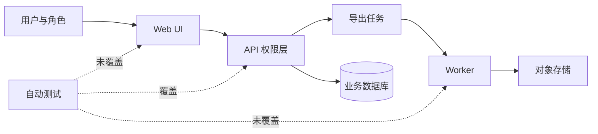

# 用例 01：从材料冲突中建立项目地图

> 类型：完全合成演示  
> 入口：`/review`  
> 重点：先理解项目，再发现问题；不把发现自动升级成需求

## 场景

虚构的 B2B 工作台 `AtlasDesk` 正准备发布 v0.3。README、PRD、代码和测试对角色权限与导出取消能力的描述不一致，负责人希望知道项目真实状态。

## 给 Agent 的输入

```text
mypm /review

请完整评审 AtlasDesk v0.3，先建立产品与工程地图，再判断当前是否具备发布条件。

已知材料：
- README 写明支持 owner/admin/member/viewer 四类角色。
- PRD 要求 viewer 只能查看，不能创建或导出。
- API 已实现四类角色校验。
- Web UI 只区分 admin/member，viewer 登录后仍能看到“新建”和“导出”。
- 导出任务状态为 pending/running/succeeded/failed/cancelled。
- cancel API 会写 cancelled，但 worker 没有读取取消标记。
- 自动测试覆盖 API 成功路径和角色拒绝；没有浏览器权限测试、取消中的 worker 测试或候选包验收。
- progress.md 将“权限闭环”和“导出取消”标记为完成。

只做只读评审，不修改文件，不生成 PRD，不提交。
```

## 代表性交付节选

### 项目地图



### 意图、实现与验证对照

| 对象 | 已确认意图 | 实际执行点 | 已有验证 | 状态 |
| --- | --- | --- | --- | --- |
| viewer 权限 | 只读，不可创建或导出 | API 已限制；UI 仍显示入口 | API 拒绝测试 | **实现偏离**：UI 未闭环 |
| 导出取消 | cancelled 后停止执行 | API 改状态；worker 不读取标记 | 未提供 | **实现偏离**：状态与执行脱节 |
| progress 状态 | 完成项应具备实现与验证证据 | 两项均标记完成 | 缺浏览器与 worker 证据 | **文档过期** |

### 评审结论

- 当前不能仅凭 API 测试判定 v0.3 可发布。
- viewer 问题属于已确认需求的实现偏离，应进入 Bugfix，而不是重新进入 `/idea` 或 `/prd`。
- 导出取消涉及状态合同错误，需要修复 worker 消费取消状态，并补并发边界测试。
- `progress.md` 应回退到“实现中/待验证”，但本轮没有写操作授权。

## 展示了什么

- 先交付产品、模块、数据和状态关系图，再给问题清单。
- 把“实现偏离”“文档过期”“验证缺口”分开，不混成模糊风险。
- 已确认需求的 Bug 不重新包装成新需求。
- 没有因为代码存在就宣称行为可用，也没有越权改文件。

## 可复测检查点

- [ ] 首个非空行明确入口为 `/review`。
- [ ] 输出项目或模块关系图。
- [ ] 保留四类角色和五个任务状态，不静默改写。
- [ ] 指出 UI 权限与 worker 取消的不同缺陷性质。
- [ ] 不生成 PRD，不声称已修改 progress，不判定发布通过。
