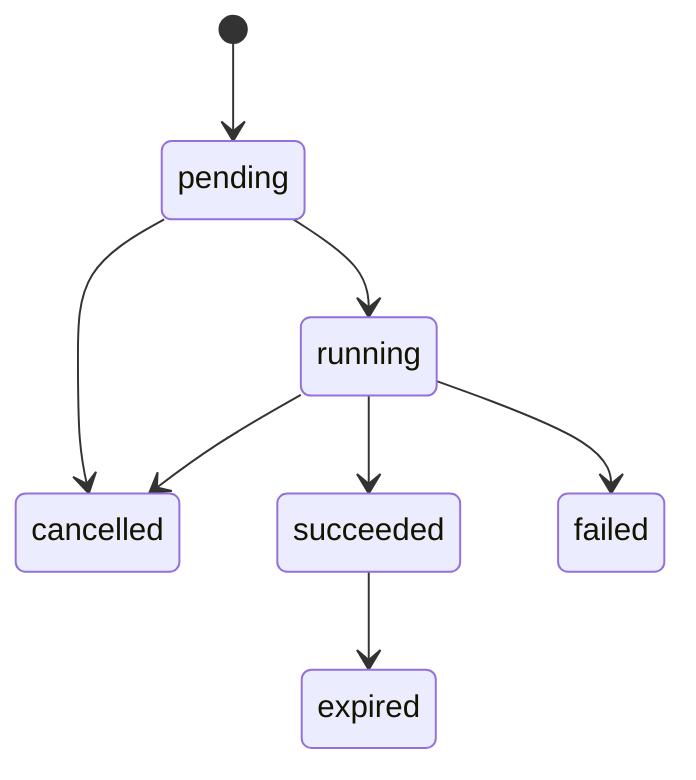

# 用例 03：把一个“导出按钮”写成可开发的完整 PRD

> 类型：完全合成演示  
> 入口：`/prd`  
> 重点：异步任务、权限、状态、数据、失败链路和影响范围

## 场景

虚构的多租户审计平台 `TraceHub` 需要支持管理员异步导出审计记录。关键业务规则已经确认，可以直接形成正式推进型 PRD。

## 给 Agent 的输入

```text
mypm /prd

为 TraceHub 编写“审计记录异步导出”正式 PRD。

已确认：
- 只有 tenant_admin 可以导出本租户数据。
- 可筛选时间范围、操作人和事件类型，最长跨度 180 天。
- CSV 最多 50,000 行；超过时拒绝创建任务，不自动截断。
- 每租户最多同时运行 2 个任务。
- 文件保存在现有对象存储，成功后保留 24 小时。
- 只做站内通知，不发送邮件。
- 用户可以在 pending/running 阶段取消。
- 复用 audit_events，不新增或修改其中的业务字段。
- 本版本不做定时导出、共享链接和跨租户导出。

请覆盖前端、后端、数据库、权限、状态、幂等、失败与重试、日志、测试、原型和开发前验收。
```

## 代表性交付节选

### 类型与范围

**正式推进型 PRD。** 已有明确对象、权限、限制、存储和非目标，可以进入完整需求定义；未经确认的 API 名称和表名在实施设计中锁定，不冒充业务事实。

### 核心状态合同



- `pending/running` 允许取消；终态取消请求返回当前状态，不重复执行副作用。
- 同一租户、同一用户、同一筛选条件与幂等键重复提交时返回原任务。
- worker 重试不能创建第二份任务记录；文件写入成功、状态更新失败时需要补偿清理或恢复确认。
- `expired` 后下载返回明确过期状态，不把对象存储 404 直接暴露给用户。

### 影响范围

| 类型 | 影响对象 | 要求 |
| --- | --- | --- |
| 前端/UI | 审计列表、导出弹窗、任务列表、站内通知 | 筛选摘要、进度、取消、下载、过期、失败与空状态 |
| 后端 | 创建、查询、取消、下载授权、worker | 租户隔离、2 任务并发、50,000 行预检、幂等和补偿 |
| 数据库 | 新增导出任务记录 | 保存租户、创建人、筛选快照、状态、行数、对象键、过期时间、错误码和时间戳 |
| 既有数据 | `audit_events` | 只读查询，不修改既有业务字段 |
| 基础设施 | 对象存储、任务队列 | 24 小时生命周期、失败重试、对象清理 |
| 日志与审计 | 创建、拒绝、状态变化、取消、下载 | 不记录 CSV 正文；记录租户、任务 ID、结果和错误码 |
| 测试 | 权限、租户、边界、状态、失败注入 | 覆盖 0/1/50,000/50,001 行、并发 2/3、过期和取消竞态 |

### 完整交互链

1. tenant_admin 在审计列表点击“导出”。
2. 弹窗继承当前筛选，可修改后确认；取消或关闭不创建任务。
3. 后端校验权限、租户、跨度、预计行数和并发数。
4. 创建成功后进入任务列表；创建失败保留用户筛选并显示可操作原因。
5. 成功后站内通知并开放下载；24 小时后状态为 expired。
6. 用户取消 pending/running 任务后，界面不得继续显示可下载成功态。

### 开发前验收样例

- 非 tenant_admin 无入口，直接调用也返回权限拒绝且不创建任务。
- 50,001 行请求被拒绝，不能静默截断成 50,000 行。
- 第 3 个并发任务被拒绝，已有两个任务不受影响。
- 取消与完成竞态只能落入一个合法终态，并有审计日志。
- 文件过期后不可下载；其他租户即使获得任务 ID 也不可访问。

## 展示了什么

- 从入口、取消、关闭一路写到下载和过期，不停在主成功路径。
- 把权限、状态、幂等、重试、对象存储和数据库影响连接起来。
- 精确保留 180 天、50,000 行、2 个任务和 24 小时。
- 非目标明确，避免实施时顺手扩成定时导出或分享系统。

## 可复测检查点

- [ ] 明确判断为正式推进型 PRD。
- [ ] 状态枚举和迁移完整，取消与终态边界清楚。
- [ ] 前端、后端、数据库、基础设施、日志和测试影响均出现。
- [ ] 覆盖保存/确认、取消、关闭、失败、过期和越权。
- [ ] 不修改 `audit_events`，不新增邮件、分享或定时导出。
