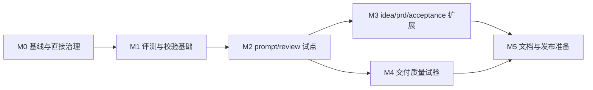

# dev_plan_v0.34

## 追踪信息

- 当前状态：M0 已通过，待进入 M1 实施
- 目标版本：`v0.34.0 Candidate`
- 上游来源：`notes/v0.34-governance-prd.md`；IDEA-001～IDEA-006、IDEA-009；FR-001～FR-009
- 下游承接：`notes/progress_v0.34.md`、`notes/dev_log_v0.34.md`、后续 `/acceptance`
- 当前事实源：PRD 定义范围与合同；本文定义实施顺序；progress 定义实时状态
- 冻结基线：`v0.33.0 Stable`，基线 HEAD `26e2e66491280470c1876d29544c826aa626d6d5`
- 最后更新：2026-08-10

## 1. 开发范围

### 1.1 版本目标

在不增加入口、PM 框架和外部工具硬依赖的前提下，为五个入口建立可复算的上下文预算、变化感知的评测门禁和模块化校验体系；先以 `/prompt`、`/review` 试点，证明关键合同无回退后再扩展其他入口。

### 1.2 本次包含

- 五入口最小、正式、扩展装配的机械基线与预算测量。
- description、入口文案和触发集变化后的 34 条双模型新鲜度门禁。
- 9 条固定核心、合同差量与相邻控制组成的动态发布面板。
- 合同清单数据化、严格校验模块化及旧 self-test 兼容。
- `/prompt`、`/review` reference 切片试点和 Deep Review 领域化装配。
- 试点通过后，按 `/idea`、`/prd`、`/acceptance` 单入口扩展。
- 8～10 个历史样本的交付质量配对评测。
- README、roadmap、backlog、CHANGELOG、evaluation history 与历史 notes 的事实源治理。

### 1.3 本次不包含

- 新增第六个入口、PM 框架、Strategy/GTM、Discovery、OCR 或产品功能。
- 把 Memory、Computer Use、Figma、数据库或其他插件改成硬依赖。
- 一次重写全部 reference，或默认运行多模型、多强度穷举回归。
- 自动补打 v0.32/v0.33 tag、移动历史 tag、提交、推送、创建 Release。
- 用字符数下降、综合总分或 Agent 模拟替代关键合同证据。

### 1.4 范围保护

1. `v0.33.0 Stable` 在 v0.34 全部门禁通过前保持稳定事实源，不修改其历史结论。
2. M0、M1 未通过前不得修改入口行为 reference；M2 未通过前不得进入 M3。
3. 每轮默认只实施一个里程碑；M3 每轮只处理一个入口。
4. 任一 critical 合同回退立即停止当前批次，恢复该批次文件，不以其他指标抵消。
5. PRD 中的 15% 是版本目标，不是删减合同的理由；冲突时保护合同并缩小压缩目标。
6. `agents/openai.yaml` 默认不修改；确需修改时重新打开 FR-003 触发门禁。

## 2. PRD 对照

| PRD 需求 | 开发模块 | 任务范围 | 验收对应 |
|---|---|---|---|
| FR-001 上下文预算 | M0、M2、M3 | 清单、测量脚本、基线与逐入口预算 | AC-001、AC-004、AC-005 |
| FR-002 分阶段切片 | M2、M3 | `/prompt`、`/review` 试点后逐入口扩展 | AC-004、AC-005 |
| FR-003 触发新鲜度 | M0、M1、M5 | 双模型 34/34、输入哈希与继承检查 | AC-002、AC-009 |
| FR-004 动态发布面板 | M1～M5 | 固定核心、差量、控制、范围升级 | AC-003、AC-009 |
| FR-005 交付质量评测 | M4 | 七维独立报告、盲评、viewer | AC-007 |
| FR-006 validator 模块化 | M1 | 合同清单、模块拆分、正负夹具 | AC-006 |
| FR-007 事实源与 tag | M0、M5 | 状态扫描、归档、发布口径 | AC-008、AC-009 |
| FR-008 Deep Review 装配 | M2 | 领域识别与 3～6 个适用维度 | AC-004 |
| FR-009 批次与回退 | 全批次 | 状态、门禁、证据、独立回退 | AC-001～AC-010 |

## 3. 文件与模块影响

| 批次 | 模块 / 文件 | 改动类型 | 说明 |
|---|---|---|---|
| M0 | `evals/context-budget.json` | 新增 | 保存文件清单、规范化方式、v0.33 基线和 v0.34 目标 |
| M0 | `scripts/measure-context-budget.ps1`、`scripts/test-context-budget.ps1` | 新增 | 只读测量入口及重复、缺失、重复路径、越界、未知入口/基线和覆盖写自测 |
| M0 | `evals/trigger-baseline.json` | 新增 | 保存候选 SHA、输入哈希、模型、有效数和正确数 |
| M0 | `notes/mypm-roadmap.md`、`notes/skill-improvement-backlog.md` | 修改 | 清除过期版本、eval 数量与阶段口径 |
| M1 | `evals/contract-registry.json` | 新增 | 合同、来源、入口、风险及稳定/挑战/触发用例映射 |
| M1 | `evals/release-panel-core.json`、`evals/release-panel.json` | 新增/迁移 | 固定核心与当前候选快照分离 |
| M1 | `scripts/build-eval-panel.ps1` | 修改 | 生成固定核心 + 差量 + 相邻控制，处理无映射和超限 |
| M1 | `scripts/validation/*.ps1` | 新增 | 公共、文档、eval、合同检查模块 |
| M1 | `scripts/validate-skill.ps1` | 修改 | 保持原命令与摘要，改为模块编排并保留对照期 |
| M1 | `scripts/test-skill-validation.ps1` | 新增 | 缺合同、错 ID、乱码、过期摘要等正负夹具 |
| M1 | `scripts/test-evaluation-pipeline.ps1` | 修改 | 增加动态面板和新 validator 的兼容回归 |
| M2 | `references/prompt.md`、`references/workflow-control.md`、`references/next-step-prompts.md` | 条件修改 | 降低 `/prompt` 正式装配重复，保持 L1 合同 |
| M2 | `references/review.md`、`references/deep-review.md` | 条件修改 | 降低 `/review` 重复并按领域装配 Deep Review |
| M2 | `SKILL.md` | 条件修改 | 仅在最小路由说明必须调整时修改，仍须不超过 5700 字符 |
| M2 | `evals/evals.json`、`evals/challenge-evals.json` | 条件修改 | 仅补真实新增合同缺口，不因实现方便修改期望 |
| M3 | `references/idea.md`、`references/prd.md`、`references/acceptance.md` | 条件修改 | 每入口独立切片与回归 |
| M3 | `references/tooling.md`、`references/capability-routing.md`、`references/data-analysis.md` | 条件修改 | 仅在引用重复被证实时治理，不改变能力边界 |
| M4 | `evals/delivery-quality-rubric.json` | 新增 | 七维指标、盲评规则、成本阈值和缺失值语义 |
| M4 | `scripts/regression-workspace.ps1`、`scripts/generate-eval-viewer.ps1` | 修改 | 保存有效性/时长并分开展示各维度 |
| M5 | `README.md`、`CHANGELOG.md`、`notes/mypm-roadmap.md`、`notes/evaluation-history.md` | 修改 | 同步候选状态、评测边界与发布事实 |
| M5 | `notes/archive/`、`notes/cases/` | 条件新增/移动 | 先生成引用表；只有链接迁移验证通过才移动历史资料 |

## 4. 实施顺序与依赖



- M0 和 M1 是行为文件修改的强制前置。
- M3 必须按 `/idea` -> `/prd` -> `/acceptance` 三个子批次推进，每个子批次单独通过或回退。
- M4 可在 M2 通过后与 M3 分离推进，但不能绕过 M5 的发布判断。
- M5 只准备 `/acceptance` 输入，不自动执行提交、推送、tag 或 Release。

## 5. 任务拆解

### M0：锁定基线与直接治理项

#### V034-M0-001 确认执行基线与工作树边界

- 目标：记录分支、HEAD、dirty 状态、v0.33 稳定事实和 v0.34 允许修改范围。
- 涉及文件：`notes/progress_v0.34.md`、`notes/dev_log_v0.34.md`。
- 实施要点：不得把本轮未跟踪承接文档误写成 v0.33 发布内容；实现前保存基线状态。
- 验证方式：`git status --short --branch`、`git rev-parse HEAD`、`git rev-parse origin/main`。
- 完成标准：事实源、当前状态、停止点可复核，且没有业务规则改动。

#### V034-M0-002 定义上下文预算清单

- 目标：为五入口定义 minimum、formal、named/extended 文件集合和统计规则。
- 涉及文件：`evals/context-budget.json`。
- 实施要点：UTF-8 无 BOM；根目录相对路径；文件排序、去重、越界路径处理明确；基线采用 LF + `.NET string Length`。
- 验证方式：JSON 解析、缺文件/重复/越界路径负向夹具。
- 完成标准：五入口均有完整配置，基线值与 PRD 一致。

#### V034-M0-003 实现可重复的预算测量脚本

- 目标：按相同输入连续两次生成除时间外一致的结果。
- 涉及文件：`scripts/measure-context-budget.ps1`、相应测试夹具。
- 实施要点：PowerShell 5.1；默认只读；输出路径显式；支持单入口和 JSON/Markdown。
- 验证方式：连续两次运行并比较规范化结果；注入缺失、重复和越界路径。
- 完成标准：AC-001 通过，输出含文件、字符、字节、差值和阈值。

#### V034-M0-004 冻结 v0.33 五入口预算基线

- 目标：将当前 v0.33 文件集的可复算结果写入预算清单。
- 涉及文件：`evals/context-budget.json`、临时评测输出。
- 实施要点：不得用估算值覆盖实测值；异常差异先核对规范化方式。
- 验证方式：对照 PRD 中五入口 minimum/formal/extended 数值。
- 完成标准：五入口基线均可从脚本重算，且差异为 0。

#### V034-M0-005 补齐 v0.33 触发行为新鲜基线

- 目标：为当前 description 和 34 条触发用例建立 Sol medium、Terra medium 双模型基线。
- 涉及文件：`evals/trigger-baseline.json`、临时评测证据。
- 实施要点：只保存摘要和输入哈希；缺失配置只重试一次；超时不记能力失败。
- 验证方式：两模型分别 34/34、有效返回 34/34，摘要哈希匹配当前输入。
- 完成标准：AC-002 当前基线可继承；任一失败则 M0 不通过。

#### V034-M0-006 治理 roadmap 与 backlog 当前事实

- 目标：移除“56 条 eval”“v0.33 尚未立项”等冲突口径，明确当前/后续/历史职责。
- 涉及文件：`notes/mypm-roadmap.md`、`notes/skill-improvement-backlog.md`。
- 实施要点：不移动历史文件；不提前宣称 v0.34 已实现。
- 验证方式：全仓搜索旧版本、旧 eval 数和阶段冲突。
- 完成标准：AC-008 的当前状态扫描通过。

#### V034-M0-GATE M0 门禁

- 必须证据：AC-001、双模型 34/34、文档状态扫描、严格静态校验、`git diff --check`。
- 通过后状态：`baseline_locked -> gate_ready`。
- 未通过处理：只撤销 M0 新增报告或文档治理；不得进入 M1。

### M1：建立评测与校验基础

#### V034-M1-001 建立合同注册表 schema

- 目标：把合同来源、入口、风险和 eval 映射转为结构化事实源。
- 涉及文件：`evals/contract-registry.json`。
- 实施要点：字段遵循 FR-006；合同 ID 唯一；source 和 eval 必须存在。
- 验证方式：合法清单通过；重复合同、缺文件、错 eval ID 均失败并点名对象。
- 完成标准：当前 critical 合同全部有至少一条有效评测映射。

#### V034-M1-002 提取 9 条固定核心

- 目标：覆盖五入口、数据、工具、Memory 和高风险证据冲突。
- 涉及文件：`evals/release-panel-core.json`、`evals/release-panel.json`。
- 实施要点：核心选择有明确合同理由，不沿用旧 13 条的偶然集合。
- 验证方式：ID 存在、无重复、九类覆盖完整、排序确定。
- 完成标准：固定核心可独立校验并被 builder 读取。

#### V034-M1-003 改造动态发布面板 builder

- 目标：根据基线/候选 diff 和 `affected_contracts` 生成核心、差量和控制集合。
- 涉及文件：`scripts/build-eval-panel.ps1`、`evals/release-panel.json`。
- 实施要点：最多 5 条相邻控制；默认 26 条上限；critical 不静默截断；无映射变化失败。
- 验证方式：确定性重复生成；未知合同、重复 selection、超过上限、`no_behavior_change` 夹具。
- 完成标准：输出包含 ref、selection、合同和原因，错误有最小修复动作。

#### V034-M1-004 回放 v0.33 已知变化

- 目标：证明动态面板能捕获历史回退 eval 36 和 eval 61。
- 涉及文件：测试夹具、临时面板输出。
- 实施要点：只回放真实差异，不反向硬编码两个 ID 到所有候选面板。
- 验证方式：使用 v0.33 对应基线/候选 ref 生成面板。
- 完成标准：eval 36、61 均由合同差量进入，核心/差量/控制无重复。

#### V034-M1-005 模块化严格校验

- 目标：保持 `validate-skill.ps1 -Strict` 外部命令与摘要兼容，分离内部职责。
- 涉及文件：`scripts/validation/common.ps1`、`validate-docs.ps1`、`validate-evals.ps1`、`validate-contracts.ps1`、`scripts/validate-skill.ps1`。
- 实施要点：新旧检查并行一个批次；先迁移 eval ID 和合同锚点；结果不一致时旧流程优先。
- 验证方式：同一仓库运行新旧路径，比较退出码与关键检查项。
- 完成标准：正常仓库结果一致，摘要保留版本、Skill 预算、三类 eval 数和文件数。

#### V034-M1-006 建立 validator 正负夹具

- 目标：把缺合同、重复 ID、失效路径、错误状态、非法 UTF-8、面板漏映射和触发摘要过期变成可重复测试。
- 涉及文件：`scripts/test-skill-validation.ps1`、隔离夹具目录。
- 实施要点：只写临时目录；结束后清理；不得修改真实 Skill。
- 验证方式：每个负向夹具返回非零并点名对象；正常夹具通过。
- 完成标准：AC-006 通过，现有 evaluation pipeline self-test 无回退。

#### V034-M1-GATE M1 门禁

- 必须证据：v0.33 回放捕获 36/61、旧/新校验一致、全部正负夹具符合预期、严格校验、pipeline self-test、`git diff --check`。
- 通过后状态：`gate_ready`，允许开始 reference 试点。
- 未通过处理：恢复固定面板和单体 validator，保留失败证据；不得进入 M2。

### M2：`/prompt`、`/review` 试点与 Deep Review 装配

#### V034-M2-001 冻结试点前基线与影响合同

- 目标：锁定试点文件、预算、关键用例、相邻控制和回退点。
- 涉及文件：progress、dev log、临时评测工作区。
- 完成标准：两入口的 allowed files、contract IDs、panel 和基线 ref 可复核。

#### V034-M2-002 治理 `/prompt` reference 装配

- 目标：减少 `prompt.md`、`workflow-control.md`、`next-step-prompts.md` 的正式装配重复。
- 涉及文件：上述 reference；必要时最小修改 `SKILL.md`。
- 实施要点：保留 L1 600 字限制、唯一代码块、入口判断、范围、验证、授权、停止和成功标准。
- 验证方式：预算测量、动态面板、相邻控制、受影响稳定/挑战用例。
- 完成标准：关键合同无回退，正式加载相对基线下降至少 10%。

#### V034-M2-003 治理 `/review` 与 Deep Review 装配

- 目标：减少 review 重复，并按对象领域选择 3～6 个适用根因维度。
- 涉及文件：`references/review.md`、`references/deep-review.md`；必要时最小修改 `SKILL.md`。
- 实施要点：保留项目地图、证据状态、意图/实现/验证对照和代码瘦身证据边界。
- 验证方式：UI、Skill、后端/数据库三类深度正例和一个普通控制用例。
- 完成标准：关键合同无回退，正式加载相对基线下降至少 10%，无无关维度填充。

#### V034-M2-004 执行跨模型试点回归

- 目标：验证两入口切片在 Sol medium、Terra medium 下稳定。
- 涉及文件：临时 benchmark/viewer；长期结论回写 `notes/evaluation-history.md`。
- 实施要点：稳定集与挑战集分开；只有触发 FR-009 条件才扩大全量。
- 完成标准：动态面板全部有效，critical 为 0 回退，成本变化可解释。

#### V034-M2-GATE M2 门禁

- 必须证据：两入口分别下降至少 10%、critical/控制 0 回退、严格校验与 pipeline self-test 通过。
- 通过后状态：`pilot_passed`，允许 M3 和 M4。
- 未通过处理：按入口独立恢复 reference；保留成功入口，不用一个失败否定另一个入口。

### M3：扩展 `/idea`、`/prd`、`/acceptance`

#### V034-M3-001 扩展 `/idea`

- 目标：治理价值判断、数据分析、压力测试和需求池装配中的重复。
- 实施要点：不削弱统计口径、承重假设、阈值证据和超过 2 项落盘合同。
- 验证方式：入口预算、动态面板、受影响用例、一个相邻控制。
- 完成标准：单入口门禁通过，否则独立回退并停止 M3。

#### V034-M3-002 扩展 `/prd`

- 目标：治理 PRD、数据/后端和原型条件加载中的重复。
- 实施要点：不削弱 3～7 个关键问题、影响范围、入口到出口、数据/状态、失败态、高保真原型和开发前验收。
- 验证方式：UI PRD、异步后端/数据库 PRD、方案收敛控制用例。
- 完成标准：单入口门禁通过，否则独立回退并停止 M3。

#### V034-M3-003 扩展 `/acceptance`

- 目标：治理验收、工具和多轨证据装配中的重复。
- 实施要点：不削弱对象身份、历史继承、四态结论、失败注入、手动验证文档和外部授权边界。
- 验证方式：部分通过、产物身份冲突、选择性证据和发布面拆分用例。
- 完成标准：单入口门禁通过，否则独立回退并停止 M3。

#### V034-M3-004 汇总版本上下文预算

- 目标：计算四个重入口正式加载平均变化和五入口单项变化。
- 验证方式：同一脚本、同一规范化方法连续运行两次。
- 完成标准：四个重入口平均下降至少 15%；任何入口增加不超过 5% 或有用户批准理由。

#### V034-M3-GATE M3 门禁

- 必须证据：每个入口独立门禁、AC-005、动态面板、相邻控制、严格校验。
- 通过后状态：`expanded_passed`。
- 未通过处理：保护已通过入口，恢复失败入口；必要时缩小 v0.34 范围，不删关键合同。

### M4：交付质量配对评测

#### V034-M4-001 定义七维 rubric

- 目标：正确性、决策清晰度、重复度、可执行性、字符数、完成时长、有效返回率分别定义。
- 涉及文件：`evals/delivery-quality-rubric.json`。
- 完成标准：不存在综合质量总分，缺失时长/Token 使用 `unavailable`。

#### V034-M4-002 选择并冻结 8～10 个历史样本

- 目标：覆盖五入口和至少两个复杂场景，优先同分或接近同分样本。
- 实施要点：隐藏版本映射；记录入选理由；不得只挑有利候选。
- 完成标准：样本与评分输入可复核，版本身份在评分阶段不可见。

#### V034-M4-003 执行配对盲评

- 目标：逐样本给出基线胜/候选胜/平及证据。
- 实施要点：禁止跨样本引用证据；正确性仍用正式断言。
- 完成标准：8～10 个样本全部有效，缺失只重试一次。

#### V034-M4-004 更新评测工作区和 viewer

- 目标：分开展示七维指标、证据、字符数、时长和有效性。
- 涉及文件：`scripts/regression-workspace.ps1`、`scripts/generate-eval-viewer.ps1`、必要测试。
- 完成标准：不默认展示综合总分；评分无串项；旧 viewer 输入仍兼容或有明确迁移。

#### V034-M4-GATE M4 门禁

- 必须证据：AC-007、成本边界、viewer 无品牌污染、pipeline self-test。
- 未通过处理：交付质量降级为观察项，不影响正确性门禁；记录不一致原因。

### M5：文档与发布收口准备

#### V034-M5-001 生成历史引用迁移表

- 目标：在移动任何 notes 前，列出所有入站引用、目标位置和验证方法。
- 完成标准：全仓引用可解析；不满足则不移动文件。

#### V034-M5-002 治理 notes 目录

- 目标：关闭版本记录进入 `notes/archive/`，真实案例进入 `notes/cases/`。
- 实施要点：只移动已确认资料；保留历史事实；不把临时评测工作区纳入仓库。
- 完成标准：移动后全仓链接和严格校验通过，否则恢复原路径。

#### V034-M5-003 同步版本事实源

- 目标：同步 README、roadmap、CHANGELOG、evaluation history 和 backlog。
- 实施要点：稳定/挑战结果分开；只宣称已测模型、样本和门禁；v0.33 在签核前仍为 Stable。
- 完成标准：AC-008、AC-009 的文档部分通过。

#### V034-M5-004 执行最终候选门禁

- 目标：汇总 AC-001～AC-010，并判断是否进入 `/acceptance`。
- 验证方式：严格校验、pipeline self-test、触发摘要、动态面板、预算、配对评测、链接扫描、`git diff --check`。
- 完成标准：所有阻塞标准通过或按 PRD 明确降级；状态仅更新为“待 Acceptance”，不写“Stable”。

#### V034-M5-GATE M5 门禁

- 通过后状态：`release_ready`（仅表示可进入 `/acceptance`）。
- 外部写操作：提交、推送、annotated tag、Release 分别等待用户授权。
- tag 规则：后续若发布 v0.34 Stable，tag 为 annotated `v0.34.0` 且固定指向通过发布门禁的提交；本批次不得自行创建。

## 6. 测试与验收

### 6.1 每批最低验证

```powershell
powershell -NoProfile -ExecutionPolicy Bypass -File .\scripts\validate-skill.ps1 -Strict
powershell -NoProfile -ExecutionPolicy Bypass -File .\scripts\test-evaluation-pipeline.ps1
git diff --check
```

M0 新增后补充：

```powershell
powershell -NoProfile -ExecutionPolicy Bypass -File .\scripts\measure-context-budget.ps1
```

M1 新增后补充：

```powershell
powershell -NoProfile -ExecutionPolicy Bypass -File .\scripts\test-skill-validation.ps1
```

### 6.2 行为验证策略

- 触发门禁：仅当 description、`agents/openai.yaml` 入口文案或 trigger 集变化时跑完整 34 条；M0 必须补一次新鲜基线。
- 日常候选：固定核心 + 本版差量 + 相邻控制，Sol medium 与 Terra medium。
- 全量升级：只在 FR-009 指定条件触发，稳定集和挑战集分开报告。
- max/其他模型：只补明确波动样本，不作为默认门禁。
- 原始 Agent 回答：保存在临时工作区，长期文档只保留可复核摘要。

### 6.3 人工检查

- 抽查 critical 合同到 eval 的映射是否准确。
- 抽查 reference 切片是否只是转移重复或增加导航成本。
- 抽查 Deep Review 三种领域输出是否选择了适用维度。
- 抽查 8～10 条盲评是否隐藏版本且证据未跨样本。
- 抽查 README、roadmap、CHANGELOG、evaluation history 的状态一致性。

### 6.4 回归范围

- 五入口显式路由和自动路由。
- 中文、事实/推断区分、证据、授权、停止条件与阶段出口。
- 数据分析、工具降级、Memory 冲突和高风险边界。
- 既有 validator 命令、摘要、退出码和 evaluation pipeline。
- viewer 中不得出现 Superpowers 或其他非 MyP-M-A 品牌标识。

## 7. 开发日志约定

- 需要独立 `notes/dev_log_v0.34.md`。
- 记录颗粒度：每个任务或紧密关联的 2～3 个任务一条记录；包含目标、实际改动、关键决策、命令、结果、未验证项和回退点。
- progress 只记录状态、checklist、阻塞、最近验证和下一步。
- bug 复现与修复过程进入后续 `notes/bugfix_log_v0.34.md`；技术 spike 进入独立 spike 文档，不回填 progress 流水账。
- 临时 Agent 输出、完整 benchmark 工作区和 debug 过程不长期写入 dev log，只记录正式证据路径和摘要。

## 8. 风险与回退

| 风险 | 触发信号 | 影响 | 回退 / 处理 |
|---|---|---|---|
| reference 切片遗漏合同 | critical 或相邻控制回退 | 入口判断失真 | 恢复该入口文件；保留失败样本；重新划分边界 |
| 合同映射错误 | v0.33 回放漏掉 36/61 或无映射变化 | 发布面板失真 | 阻塞行为修改；恢复固定面板；修注册表和负向测试 |
| validator 模块化不一致 | 新旧退出码或检查结果不同 | 静态门禁失效 | 继续使用旧主流程；撤销模块编排，不删除旧检查 |
| 预算目标诱导过度删减 | 字符下降但关键合同回退 | 能力回退 | 保护合同，缩小目标或版本范围，不改验收事实 |
| 质量盲评不稳定 | 评分方向随机或证据串项 | 无法解释体感差异 | 降级为观察项；正确性仍为硬门禁 |
| 回归成本失控 | 动态面板频繁超过 26 或多配置缺失 | 周期过长 | 升级受影响入口全量；不默认六配置穷举；缺失只重试一次 |
| 文档移动断链 | 全仓引用失败 | 知识库不可用 | 恢复原路径；先完善迁移表再重试 |
| 触发摘要过期 | 输入哈希变化 | 自动路由证据失效 | 阻塞 Stable；重跑双模型 34 条 |
| 外部能力不可用 | Memory/Computer Use 等未暴露 | 部分扩展证据缺失 | 按 AC-010 写待验证，不阻塞核心治理 |

## 9. 开放问题

- 当前无阻塞开放问题。
- 若 M2 或 M3 出现“预算目标与关键合同保护冲突”，按 PRD 默认保护合同并缩小治理范围，不需扩大需求。
- 若需要修改 `agents/openai.yaml`，必须在 progress 中显式重开 V034-M0-005 对应触发门禁。

## 10. 长期记忆建议

本版本预计跨多个批次和线程，适合在 M0 启动时创建 Memory 任务。只保存版本状态、正式文档路径、当前批次、阻塞和下一任务，不复制文档正文：

```text
用 memory-tasks 创建 MyP-M-A v0.34 开发任务。记录项目路径、PRD、dev plan、progress、dev log、当前批次、范围保护、验证命令、当前阻塞和下一任务；不要复制文档正文，不记录临时 Agent 输出、完整日志或凭据。
```

Memory 不可用时记录“未写入”，不阻塞 M0。
