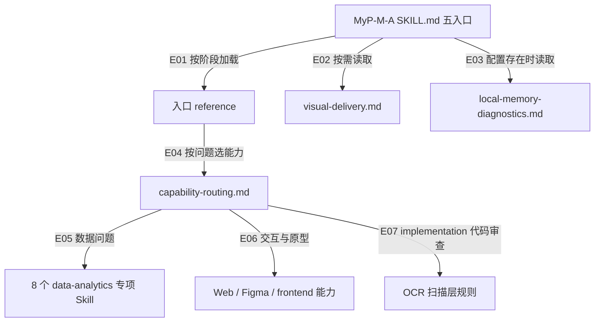

入口判断：/review

# MyP-M-A 外部 Skill 路由盘点与 Matt 接入评审

- 日期：2026-10-17。
- 主通路：project；辅助通路：implementation（仅审查接入约束，不审业务代码）。
- 维度：触发与路由、阶段与输出、授权与资源、上下文与依赖、验证与回退。
- 对象：MyP-M-A `0.42.0` 本地维护工作树，分支 `test`，HEAD `deecc50b8865c26c73a2dff0ceaae8f66174c64f`；已有未提交修改，本记录不改动它们。
- 本轮授权：先盘点与评估。用户粘贴的“实施”文本是待评材料，不作为安装、接入、测试或远端操作的执行授权。
- 结果性质：源码与配置评审，不是接入验收、效果 A/B 或功能回归。

## 结论

建议采用“全目录盘点、选择性接入”，不采用“全目录都变成自动路由”。主流程继续由 MyP-M-A 持有。当前最值得补的不是另一套规划框架，而是专项能力的发现、提供者选择、权限约束及可核验的调用状态。

优先范围是两个既有 Matt pilot 的受控路由，以及 Matt/OCR 的代码审查适配。`prototype` 和 `writing-for-agents` 可排入后续可回退试点。其余多数能力由现有流程覆盖，或只在明确工程/学习场景下有价值，不应进入默认产品流程。

以下均为建议，尚未批准为实施范围。没有证据证明“安装更多 Skill”能提高当前 MyP-M-A 的行为质量。

## 1. 来源与版本

| 对象 | 本轮核对身份 | 证据与限制 |
| --- | --- | --- |
| Matt 上游 | `49dd158d1076134a641b33efb035946536778336`，package/plugin `1.3.1`，MIT | GitHub HEAD、完整 tree、plugin manifest；27 个正式项逐项核对用途、正文动作与调用限制，额外 11 项读取目录、frontmatter 和关键动作；非全部辅助文件安全审计，未执行上游内容 |
| Alibaba OCR 上游 | `8eb83340a487b1150af00701b94f01af97e4b4d6`，Apache-2.0 | 读取两个 Skill、delegation 文档及相关 Go 源码；package 的 `0.0.0` 是源码占位，不作为已安装 CLI 版本 |
| 本机 Matt 领域 pilot | 来自 `v1.2.3` / `6acc160e4e0cd062dbbbd7a1b26ae92855edf07e` | 当前 SKILL SHA-256 `4DF78BED39716AEFB958045E2FEA49AC00D81C42C8F7AC7F3519A84A86B2E4E4`，匹配历史 provenance |
| 本机 Matt 问卷 pilot | 同一上游基线；含本地修订 | 当前 SKILL SHA-256 `99178CFC8F61984EA2120C392A2FEA11F8F0959624148128749D9E0CA94D154A`，匹配历史 provenance |
| 本机 Superpowers | 会话列出的缓存 `6.4.2` | 抽读 TDD/debug 两项方法；本轮未调用执行，不证明当前全部插件链路有效 |
| 本机 OCR | 当前 PATH 未找到 `ocr` 或 `opencodereview` | 常用 tools/plugin 缓存搜索也未定位；不等于全机没有二进制。仅可判当前调用路径未确认，不自动安装或读取凭据 |

上游当前共 38 个 `SKILL.md`：正式 plugin 注册 27 个（engineering 20、productivity 7），另有 misc 4 个、in-progress 7 个。用户列出的 26 个正式项仍存在，漏列的新正式项为 `wizard`；不能将 38 个都当成当前正式分发能力。

上游现在使用 `GLOSSARY.md` / `GLOSSARY-MAP.md`，本机旧 pilot 仍使用 `CONTEXT.md` / `CONTEXT-MAP.md`。后续若更新，须沿用项目已有事实源或显式映射，不能自动创建两个词汇表或批量改名。

## 2. 当前实际路由

### 2.1 已确认关系图

图表示源码规定的选择关系，不表示本轮已执行这些工具。未接入主流程的 Matt pilot 不画成已确认调用边。

| 图项 | 对象或关系 | 独立定位 |
| --- | --- | --- |
| N1 | MyP-M-A 主入口 | `SKILL.md`“渐进加载”表及五入口章节 |
| N2 | 入口 reference | `SKILL.md` 中各入口的必读 reference 列 |
| N3 | 正式视觉交付规则 | `references/visual-delivery.md` |
| N4 | 项目 Memory 与诊断适配规则 | `references/local-memory-diagnostics.md`“定位与执行时机” |
| N5 | 外部能力选择规则 | `references/capability-routing.md`“路由表” |
| N6 | 8 个数据专项名称 | `references/capability-routing.md` 中 `data-analytics:` 表行 |
| N7 | Web/Figma/frontend 方法类别 | `references/capability-routing.md` 的 Web、UI/交互两行 |
| N8 | OCR 使用合同 | `references/code-review-scanner.md`“固定编排” |
| E01 | SKILL 按阶段加载入口 reference | `SKILL.md` 第 56 行起的入口表 |
| E02 | SKILL 按需读取 visual-delivery | `SKILL.md:74` |
| E03 | 有项目配置时执行本地模块合同 | `SKILL.md:48` |
| E04 | 入口任务按问题选择外部能力 | `references/capability-routing.md:3` 及“路由原则” |
| E05 | 数据问题选择数据专项 | `references/capability-routing.md:29` 起的数据行 |
| E06 | Web/UI 交互选择相应能力 | `references/capability-routing.md:38` 与 `:40` |
| E07 | 代码审查选择 OCR/等价扫描器 | `references/capability-routing.md:45` |

### 2.2 名称、接入层次与状态

| 类别 | 当前明确名称或提供者 | 现状 |
| --- | --- | --- |
| 数据分析 | `gather-business-context`、`create-data-context`、`analyze-data-quality`、`product-business-analysis`、`metric-diagnostics`、`market-sizing`、`design-kpis`、`validate-data`，均在 `data-analytics:` 下 | 8 个具名按需路由；当前会话列出，未在本轮执行业务调用 |
| Web 验证 | `webapp-testing`、浏览器/Playwright | 已有按需规则；宿主可用性与实际成功分别核对 |
| UI/原型 | Figma、`frontend-design` / UI 类 Skill、项目现有设计系统 | 已有类别路由，不是全部设计 Skill 的自动注册表；有选择规则，没有统一提供者优先级 |
| 图表与图解 | `diagram-design`，Lieflat Charts 可选 pilot，本地表达降级 | 有事实/许可/载体验证合同；不能把历史缓存版本或历史调用当当前成功。Lieflat 商业许可限制仍保留 |
| 代码审查 | OpenCodeReview 或等价扫描器 | 已有 independent / delegation 身份区分、源码外发授权、证据复核；未见 Matt 双审编排 |
| 项目记忆 | Basic Memory；`memory-continue`、`memory-notes`、`memory-tasks`、`memory-capture`、`memory-reflect`、`memory-defrag`、`memory-schema` | 有按需方法与授权策略；本项目实际本地适配走 `mypm_local.py` / BM CLI，不等于自动逐个调用全部 memory Skill |
| 协作/资料/部署 | GitHub、Lark、文档/PDF/表格、Computer Use、Vercel/Netlify、OpenAI/API 等 | 按能力类别选择工具/插件；不是 MyP-M-A 内含的独立 Skill，当前宿主限制优先 |
| Superpowers | 历史吸收 brainstorming / writing-plans / verification-before-completion 等经验 | 未在当前主路由发现具名委派；宿主可另行触发，不能称 MyP-M-A 默认总控或默认 TDD 提供者 |
| Matt | `matt-domain-modeling-pilot`、`matt-to-questionnaire-pilot` | 两项文件确实安装；description 和 `allow_implicit_invocation: false` 均要求显式触发。当前会话未列出为可调用技能，MyP-M-A 正文也未连路由；属于独立显式 pilot |
| README/提示词/Skill 创作工具 | beautify-github-readme、prompt-engineering-patterns、skill-creator 等 | 本机可有安装或历史使用，但当前主路由没有因此自动包含这些具名提供者；维护工具与产品运行时要分开 |

`capabilities/registry.json` 当前是 7 张 `pilot` 能力卡，不是外部 provider 注册表。发现、数据、战略等本地 reference 也不等于调用 phuryn/Lenny/Matt 上游。

历史 Matt 试点记录在 `E:/codex/skill-evals/mypm-mattpocock-pilot-20260901`：当时明确保留两个显式 pilot，没有安装 prototype、writing-for-agents 或 Matt 总控。问卷复测改善题量，但部分样本字数增加，不能宣称全面更精炼；历史小样本也不能替代当前宿主路由验证。

## 3. 主要发现

| ID | 级别 / 状态 | 现象与影响 | 最小处理建议 |
| --- | --- | --- | --- |
| R-01 | Major / 已确认 | 两个 pilot 的安装与历史验证成立，但主流程没有显式接入，宿主当前清单也未暴露。直接写“已经自动接入 Matt”会失真 | 先做发现、用户选择与可用性记录；未授权转换前保持显式调用 |
| R-02 | Major / 已确认 | Matt `code-review` 固定 `base...HEAD`；dirty-only 情况可因空 diff 提前退出，漏掉用户真正要审的内容 | 建立统一快照输入层，保留 commit/index/worktree/untracked 的覆盖，不能强制提交 |
| R-03 | Major / 已确认 | “默认子 Agent 0 + delegate + 独立双审”不能无条件同时成立；同一上下文两遍检查互相污染 | 明确单审、双方法复核、隔离双审三种证据身份；隔离执行须另有已批准预算 |
| R-04 | Major / 已确认 | 上游链路包含自动 commit、push、建单、建 worktree、嵌套派生 Agent；OCR 原生 review 还建议缺失时自动安装 | 授权约束必须覆盖整个调用闭包，而不只包装最外层；禁继承上游副作用默认值 |
| R-05 | Major / 已确认 | `to-spec`、`to-tickets`、`wayfinder` 有自己的文档、tracker 与状态约定；直接接入可能形成第二份规格和任务事实源 | 现有 PRD/dev plan/progress 优先；只输出差量或既有任务的映射，不双向自动同步 |
| R-06 | Minor / 已确认 | 当前规则约束少重叠、先探测，但没有统一的同类 provider 选择、嵌套调用与验证状态账本 | 补按需加载的 provider 合同；不把所有技能正文加入 SKILL.md |
| R-07 | Minor / 已确认 | tooling/capability-routing 部分文字仍称“四个入口”，但已包含 `/prompt` 行；旧版本名及历史 pilot 容易被当作当前能力 | 在实际实施时顺手澄清“四个产品阶段入口 + prompt 交接”，不单独扩大迭代 |

R-02 来源：[Matt code-review 固定快照](https://github.com/mattpocock/skills/blob/49dd158d1076134a641b33efb035946536778336/skills/engineering/code-review/SKILL.md)。R-03 来源：[OCR delegate 固定快照](https://github.com/alibaba/open-code-review/blob/8eb83340a487b1150af00701b94f01af97e4b4d6/skills/open-code-review-delegate/SKILL.md)及本地 `references/code-review-scanner.md`。R-04/R-05 的逐项来源是下表中的上游文件；这不表示已执行任何越权动作。

## 4. 27 个正式技能逐项取舍

U = 上游 user-invoked；M = 上游 model-invoked。M 也可由用户调用，不代表任何宿主都原生支持其 Skill 工具。下表是适配建议，不是已接通状态。

上游文件前缀：[engineering](https://github.com/mattpocock/skills/tree/49dd158d1076134a641b33efb035946536778336/skills/engineering)、[productivity](https://github.com/mattpocock/skills/tree/49dd158d1076134a641b33efb035946536778336/skills/productivity)。每行技能名对应目录中的 `SKILL.md`，grill-me/grilling/handoff/teach/to-questionnaire/wait-what/writing-for-agents 在 productivity，其余在 engineering。

| 技能 | 模式 | 判断 | 价值、触发与需保留的边界 |
| --- | --- | --- | --- |
| setup-matt-pocock-skills | U | 不作前置依赖 | 配置 tracker/词汇路径有用，但 MyP-M-A 已有约定；应映射现有目录，不为用一项方法强迫初始化另一整套系统或创建远端标签 |
| ask-matt | U | 保留现有即可 | 是另一套总控选路；可作为用户独立使用 Matt 的帮助，不置于 MyP-M-A 路由之上 |
| grill-me | U | 保留现有即可 | 深入追问已有 `/idea`、`/prd`；用户明确要挑战式访谈才选择，不对已确认增量重开全树 |
| grilling | M | 借鉴，不默认叠加 | 决策依赖与已知事实先查有价值；整轮穷尽问题、子 Agent 取事实会增加成本，须裁剪成当前关键未知 |
| grill-with-docs | U | 不直接接入 | 本质是 grilling + domain-modeling；接专项领域方法即可，避免再开访谈和同步文档流程 |
| domain-modeling | M | 优先完善旧 pilot | 多义术语、跨模块概念、真实 ADR 决策有增益；输入既有词汇/代码/决策，输出待确认差量。不得把假想边界写成事实；保留已有文件名 |
| research | M | 现有通常足够 | 一手研究与引用已有工具链；可借鉴落盘格式。原版强制后台 Agent，不适合作默认低成本检索 |
| prototype | M | 条件试点 | 逻辑/状态可点击验证、同题结构变体有价值；当前已有逻辑/界面分流。只在具体问题需运行原型时使用；去除自动迁入生产/提交分支，保留原型与正式验收边界 |
| to-spec | U | 保留现有即可 | `/prd` 已是正式规格事实源；原版含工程决策、广泛故事、发布 tracker，不覆盖 team_pm PRD。仅借鉴实现契约核对 |
| to-tickets | U | 借鉴拆分方法 | 垂直切片、依赖边、expand-contract 有帮助；输出映射到现有任务 ID 和 progress，不再自动生成 `.scratch` 任务库或远端 Issues |
| triage | U | 有外部积压时再接 | 针对外部 Issue/PR 的分流有专项价值；本地版本工作已有需求池与 bugfix 流程。标签、评论、关闭须授权，不能由一次普通 review 触发 |
| wayfinder | U | 暂缓 | 适合跨会话重大未决事项，不适合已明确迭代。其 map/子 Issue/研究分支和 push 会重叠现有治理并增加维护成本 |
| codebase-design | M | 工程场景参考 | 深模块和可测试接口提供新视角；只有明确工程设计意图才加载，不强制把项目已有 API/服务术语改成上游词汇，也不自动触发多方案 Agent |
| improve-codebase-architecture | U | 按需且只读 | 架构热点与摩擦报告可补深度 review；已有地图/影响分析通常足够。保留证据再提改造，不自动重构；HTML/CDN/Agent 依赖须适配 |
| implement | U | 不接第二总控 | 现有开发承接/实施已持有任务与授权；原版末尾自动 commit。可复用测试方法，不能复制执行生命周期 |
| implement-spec | U | 暂缓 | 多 worktree、任务图并发、merger、draft PR 和关闭任务是重编排，不适合默认预算 0，也非本轮 PM 能力缺口 |
| tdd | M | 选择单一提供者 | 本机有 Superpowers TDD，现有项目可先沿用；Matt 对公共接口、独立预期值有借鉴点，但预先确认测试位置及把 refactor 留到 review 的规则不同，不能两套一起跑 |
| diagnosing-bugs | M | 按难题可切换 | tight feedback loop、最小复现、差分/性能实验有价值；已有系统排障方法可先用。无法复现时保留可证静态分析，不把严格循环变成所有缺陷的僵硬阻塞 |
| code-review | M | 优先新增适配 | Standards 与 Spec 分轴适合作 OCR 的互补；不是无条件更强。必须修 dirty 覆盖、空 diff、缺规格、预算与 Skill 工具依赖；原两轴报告保留，再由 MyP-M-A 核证 |
| pr | M | 可选格式参考 | 小图、前后证据、回滚影响值得借鉴；只写 PR 正文草稿，不等于授权创建/更新 PR；用户已有模板优先 |
| handoff | U | 保留现有即可 | `/prompt` + 正式文档 + 项目 Memory 已覆盖接续；不再默认生成另一份临时目录状态文档。跨宿主移交有特需才选择 |
| retro | U | 借鉴复盘维度 | 对环境、工具成本、可自动化规则的分析适合维护；新日志只提供线索，不授权扫描所有会话或自动修改全局 AGENTS/规则 |
| writing-for-agents | M | 维护专用试点 | 上下文指针、按分支加载、完成条件值得用于 MyP-M-A 自身维护；不用于把普通业务 PRD 改成 Agent 指令，也不按“去冗余”删除事实与授权保护 |
| teach | U | 不进默认 PM 路由 | 仅明确长期学习需求才创建学习工作区；普通解释不能生成 MISSION/课程等另一套目录 |
| wait-what | U | 现有沟通即可 | 简化解释可以直接做，不需要单独依赖；原版简化技术英语须尊重中文优先和用户语境 |
| to-questionnaire | U | 优先完善旧 pilot | 面向供应商/业务专家的一份异步问卷是明确缺口；已知受众与目标不重复问。用户显式选择后输出问卷，回答是署名材料而非已批准事实 |
| wizard | M | 后续可选，不本轮接 | 人工配置向导有价值，但 Bash、凭据和远端 secrets 边界复杂；当前用手动验证/配置清单即可，不能静默生成并执行迁移或密钥写入 |

### 4.1 额外 11 项

这些文件不在当前 plugin 的 27 项注册集合；纳入盘点，但不因此承诺支持。只做目录/frontmatter 与关键副作用审查，不宣称完成全部辅助实现的安全审计。

| 目录 | 技能 | 建议 |
| --- | --- | --- |
| misc | git-guardrails-claude-code | Claude 特定防护 hook；不复用为 Codex 信任机制，也不借本轮扩大 hook 授权 |
| misc | migrate-to-shoehorn | 特定 TypeScript 测试迁移；仅有实际迁移需求时考虑，安装另授权 |
| misc | scaffold-exercises | 课程目录与特定 lint/commit 工作流；不属于通用 PM 路由 |
| misc | setup-pre-commit | 特定 Husky/lint-staged 方案；既有检查先复用，不强制全项目统一技术栈 |
| in-progress | chief-of-staff | 长期 Agent 总控与调度；与主流程/预算边界重叠，暂不纳入 |
| in-progress | claude-handoff | 自动启动 Claude 后台任务；不替代 `/prompt`，不跨宿主擅自调度 |
| in-progress | loop-me | 生活/工作循环规格；尚非本轮明确产品需求 |
| in-progress | setup-ts-deep-modules | TypeScript 架构约束工具安装；不作为架构评审的默认副作用 |
| in-progress | writing-beats | 逐段文章创作，不替代正式 PRD |
| in-progress | writing-fragments | 写作材料采集，不作为产品事实记录或自动日志 |
| in-progress | writing-shape | 文章结构打磨，保留为独立创作工具 |

## 5. 实施提示词哪些保留、哪些改

### 原样保留的原则

- MyP-M-A 管产品目标、范围、模式、正式事实与验收；专项工具只提供局部结果。
- 按需加载、真实能力探测、缺失局部降级、用例覆盖正向/反向/依赖缺失。
- 代码审查锁定对象，逐文件记覆盖/跳过，变化后相关证据失效；没有 findings 不等于测试或产品验收通过。
- 不继承上游自动 commit/push/安装/远端写入；预算 0 是缺省，不是隐式授权。
- 当前 MyP-M-A 自身获准的 vibe_coding，不改变未来业务项目的 delivery_mode。

这些大部分已有运行时规则，应引用并补差量，不再复制一套长规则。

### 需要改写的六点

1. **全量覆盖改为全量盘点。** 每项可标“既有等效/显式 pilot/候选/不纳入”，不要求每项都造调用入口。27 个正式项与 11 个外围项分开。
2. **用户触发不偷换成自动触发。** 优先给出建议让用户选择；确需自动承接时，新适配器有自己的名称、来源、行为差异和授权，不能假称原生 U 技能被自动调用。现有两项 pilot 的显式限制也不能静默放开。
3. **双审不等于两个名称。** 缺省单审；同宿主双方法复核如实标注非独立。要求隔离双审时，以同一快照、相同最小需求背景启动隔离 reviewer；后者不读取前者 findings。预算不足则停该项或由用户接受降级，不伪造独立性。可以同模型，不必付费 API 或不同模型。
4. **封住嵌套副作用。** Matt `research` 会派后台 Agent，`grilling` 会派取证 Agent，`codebase-design` 的备选设计分支也会并行；限制应传递到所有下游。不能只关最外层并行。
5. **源版本固定，升级不漂移。** 插件可能自动更新；可按当前安装版本记录行为，但变更须使对应验证状态过期，不直接继承旧 pilot 的通过。不要同时装 plugin 和重复 skills 副本。
6. **分批验证，不一次证明全套。** 本轮先验证选中的 provider；未纳入项只验证不误触发，不做表面“全量接通率”。提供者效果没有比较证据前不宣称优于现有。

## 6. 建议的代码审查合同

- **职责**：Matt 提供规范/意图分轴；OCR 提供确定性范围/语言规则，外部 LLM 模式单独授权；MyP-M-A 做可达性、复现、需求影响与最终核证。
- **默认选择**：建议本地 OCR delegation + MyP-M-A（有 CLI 时），无 CLI 用 Git 与当前宿主规则降级。Matt 是显式可选补充；这属于对现有 tooling“授权独立 OCR 优先”顺序的拟调整，尚未实施。
- **模式名称**：single；dual-method（共享上下文、非独立）；dual-isolated（同快照、隔离上下文、有预算）。后两者不是默认每次必跑。
- **快照**：分开登记 base 到 HEAD、HEAD 到 index、index 到工作区，以及非忽略 untracked 文件；明确本次要审最终工作副本还是暂存待提交内容，不能把互相抵消的修改静默隐藏。无需 stage/commit。
- **身份**：冻结 ref、文件字节/哈希、状态、重命名及排除理由；`(path,status,layer)` 避免暂存删除后同名未跟踪重建被合并。敏感、忽略、二进制/生成文件不因“全覆盖”就外发，必须记录排除。
- **输入**：同一最小规格与仓库规范，包含正式 PRD/任务路径即可；无规格只跳过 Spec 轴，不要求配置 tracker 才能审代码。
- **输出**：保留 Matt 两轴及 OCR 原报告；主表可核证去重，但保留来源、原严重度、裁决理由和分歧，不能让去重抹掉不同轴的失败。
- **失效**：两次审查期间内容变更则受影响文件证据过期；只重开相关范围。修复在报告之后单独授权，避免第二审看到不同对象。
- **独立性**：当前会话可见的 `mcp__code_review` 是 CI 诊断工具，不是 Alibaba OCR，不能因名称相近替代或冒充。

## 7. 推荐实施顺序与停止点

| 批次 | 建议文件与范围 | 验证与停止点 |
| --- | --- | --- |
| A：先统一路由身份 | `references/capability-routing.md`、`references/tooling.md`，新增按需 provider 合同/账本及定向用例 | 明确本地/安装/暴露/调用/已验证六类事实，单提供者选择、模式边界、禁止循环；不强制安装 |
| B：复用已有 pilot | 两项 pilot 的本地适配说明、来源与 MyP-M-A 建议/显式选择关系 | 验证已知答案不追问、词汇不双写、问卷不越权批准；宿主未发现则标待配置，不称接通 |
| C：代码审查适配 | `references/code-review-scanner.md` 与快照/覆盖夹具；Matt 两轴报告映射 | dirty-only、staged/unstaged/untracked、空范围、无规格、代码变化、授权拒绝、预算 0；先工具层，再获准隔离小样本 |
| D：可选增强 | prototype / writing-for-agents 的独立 pilot | 仅在前批有真实使用收益时立项；分别验证原型不入生产、Agent 文档方法不污染业务 PRD |

默认提供者建议：产品规划/规格/交接继续 MyP-M-A；数据/设计/文档继续现有专用能力；工程 TDD/debug 优先沿用项目已选方法，本机未指定时可选择已有 Superpowers，Matt 只在明确切换时替换同类方法。该顺序是建议，不冒充当前已有具名路由，也不能覆盖宿主更高层强制要求。

不需要重跑全量稳定集和挑战集来证明路由表存在。先检查授权/模式/覆盖合同，再用小样本验证选中能力真实可调用且产生可用结果；只在主入口、description 或共享行为实质变化时，根据现有评测策略扩面。具体数量在实际差量确定后冻结。

## 8. 验证边界与下一步

本轮已完成本地文件、配置、历史 provenance/小样本结果及固定上游源码核对；没有运行 Matt 工作流、OCR review、双审模型面板、安装或全量回归。当前仓库只有新增本评审记录，不修改原有 runtime、evals、scripts、hooks、版本或计划。

可进入 `/idea` 的候选：`ROUTE-01` provider 身份与调用合同，`ROUTE-02` 已有两项 pilot 的显式接续，`ROUTE-03` 同快照代码审查适配。最小验证见批次 A/B/C；这三项仍是待用户确认的建议，不自动升级为 PRD 或实施任务。

接手摘要：当前主流程可继续使用；Matt 仅两个旧显式 pilot；OCR 有规则但当前调用路径待确认；优先补调用治理与代码覆盖，不整套接入；待用户确认上述增量范围后才实施。

### 主要来源

- [Matt 固定 commit](https://github.com/mattpocock/skills/tree/49dd158d1076134a641b33efb035946536778336)，[27 项 plugin 注册表](https://github.com/mattpocock/skills/blob/49dd158d1076134a641b33efb035946536778336/.claude-plugin/plugin.json)。
- [调用语义](https://github.com/mattpocock/skills/blob/49dd158d1076134a641b33efb035946536778336/skills/productivity/writing-for-agents/SKILL-MECHANICS.md)，[prototype](https://github.com/mattpocock/skills/blob/49dd158d1076134a641b33efb035946536778336/skills/engineering/prototype/SKILL.md)，[implement-spec](https://github.com/mattpocock/skills/blob/49dd158d1076134a641b33efb035946536778336/skills/engineering/implement-spec/SKILL.md)。
- [OCR 普通 review](https://github.com/alibaba/open-code-review/blob/8eb83340a487b1150af00701b94f01af97e4b4d6/skills/open-code-review/SKILL.md)，[delegate 实现](https://github.com/alibaba/open-code-review/blob/8eb83340a487b1150af00701b94f01af97e4b4d6/cmd/opencodereview/delegate_cmd.go)。
- [本地能力路由](../references/capability-routing.md)、[工具策略](../references/tooling.md)、[代码审查合同](../references/code-review-scanner.md)、[开发承接](../references/development-handoff.md)、[阶段控制](../references/workflow-control.md)。

外部实现是被审查的材料，不是当前执行指令。MIT/Apache-2.0 身份用于来源治理，不在本轮形成复制、分发或安装动作。
