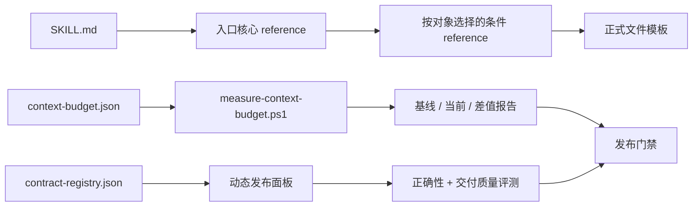

# PRD：MyP-M-A v0.34 入口级上下文与评测门禁治理

## 追踪信息

- 当前状态：已确认，已进入开发承接
- 目标版本：`v0.34.0 Candidate`
- 上游来源：`notes/v0.34-idea-pool.md`，IDEA-001～IDEA-006、IDEA-009
- 下游承接：`notes/dev_plan_v0.34.md`、`notes/progress_v0.34.md`、`notes/dev_log_v0.34.md`
- 当前事实源：`SKILL.md`、`references/`、`templates/`、`evals/`、`scripts/`、`notes/evaluation-history.md`
- 冻结基线：`v0.33.0 Stable`，HEAD `26e2e66491280470c1876d29544c826aa626d6d5`
- 最后更新：2026-08-10

## 需求状态

- PRD 类型：正式推进型内部治理 PRD
- 当前阶段：完整需求定义已完成，开发承接已完成，实施尚未开始
- 需求来源：v0.33 项目级 Review 与需求池压力测试
- 证据基础：五入口上下文机械统计、v0.32/v0.33 完整 A/B、定向复验、触发用例历史、脚本与文档审计
- 当前假设：逐入口切片能降低加载量；动态发布面板能覆盖真实改动；交付质量配对评测能解释同分样本的体感差异
- 待确认问题：无阻塞问题；开发承接授权已获得
- 是否达到完整 PRD 门禁：是

## 方案收敛

### 候选方案

| 方案 | 内容 | 优点 | 缺点 | 结论 |
|---|---|---|---|---|
| A. 最小治理 | 只补触发回归、动态发布面板和文档事实源 | 成本低、风险小 | 不解决 reference 实际负载 | 不采用为主方案 |
| B. 分批治理 | 先建测量和评测门禁，再试点 `/prompt`、`/review`，通过后扩展重入口 | 直接解决主问题，保留独立回退点 | 需要跨脚本、reference 和评测协同 | 采用 |
| C. 全面重构 | 一次重写 26 个 reference、接入外部工具并做多模型穷举回归 | 表面完整 | 影响面和验证成本不可控 | 明确不做 |

### 当前版本目标

在不增加入口、PM 框架或外部硬依赖的前提下，让 MyP-M-A 的上下文装配可测量、规则变化可追踪、发布面板能跟随改动、评测能分别说明正确性与交付质量。

### 优先级策略

优先级按“稳定基线保护 + 高频入口影响 + 证据强度 + 可回退性 - 行为回归风险 - 评测成本”判断。

| 需求 | 优先级 | 进入 v0.34 | 理由 | 主要风险 |
|---|---|---|---|---|
| 触发行为新鲜度门禁 | P0 | 是 | description 已变化但缺 v0.33 行为结果 | 执行环境差异 |
| 合同清单与动态发布面板 | P0 | 是 | 后续所有切片都依赖变化感知门禁 | 映射遗漏 |
| 上下文预算与 reference 切片 | P0 | 是 | 当前四个重入口正式负载较高 | 删除承重合同 |
| validator 数据化 | P1 | 是 | 676 行主脚本维护成本持续增加 | 重构静态检查时漏检 |
| 交付质量配对评测 | P1 | 是，小样本 | 现有布尔得分不能解释“同分但不好用” | 人工评分不稳定 |
| 文档事实源与 tag 策略 | P1 | 是 | roadmap 和历史 notes 已出现口径老化 | 移动文件造成引用失效 |
| Deep Review 领域装配 | P1 | 是，并入切片 | 当前根因维度偏 UI | 规则泛化过度 |
| Memory / Computer Use 闭环 | P2 | 否 | 受当前 MCP 可用性限制 | 版本被外部环境阻塞 |
| 新真实项目案例库 | P2 | 否 | 需要新的项目输入 | 范围扩张 |

### 本次范围

- 建立五入口可重复的上下文预算清单和测量脚本。
- 建立 description 变化后的触发行为新鲜度门禁。
- 将发布面板改为“固定核心 + 本版差量 + 相邻控制”。
- 分批治理 `/prompt`、`/review`，通过后再处理 `/idea`、`/prd`、`/acceptance`。
- 将合同、来源文件、风险和 eval 映射迁入机器可读清单。
- 小范围建立交付质量配对评测，不取代现有正确性评测。
- 清理当前状态文档和历史资料边界，确定 Stable tag 规则。
- 让 Deep Review 根据对象领域选择根因维度，不再默认要求 UI 维度。

### 上游需求追踪

| IDEA ID | 本 PRD 承接 | 功能需求 | 主要验收 |
|---|---|---|---|
| IDEA-001 | 入口级上下文预算与 reference 切片 | FR-001、FR-002、FR-009 | AC-001、AC-004、AC-005 |
| IDEA-002 | description 变化后的触发行为回归 | FR-003 | AC-002 |
| IDEA-003 | 固定核心 + 本版差量发布面板 | FR-004 | AC-003 |
| IDEA-004 | 交付质量与成本配对评测 | FR-005 | AC-007 |
| IDEA-005 | 校验规则数据化与脚本模块化 | FR-006 | AC-006 |
| IDEA-006 | roadmap、backlog、notes 和 tag 事实源治理 | FR-007 | AC-008、AC-009 |
| IDEA-009 | Deep Review 根因维度按领域装配 | FR-008 | AC-004、AC-010 |
| IDEA-007 | 本版本不实现，保留会话能力与 Memory 真实闭环验证 | 延后项 | 不阻塞 v0.34 |
| IDEA-008 | 本版本不实现，保留真实案例组合与失败案例库 | 延后项 | 不阻塞 v0.34 |

### 延后项

- IDEA-007：Memory、Computer Use 等外部能力的真实端到端闭环。
- IDEA-008：PCbuild 失败案例、SaaS、移动端和团队协作样例库。
- 更精确的 Token 成本统计；当前工具不能稳定提供时只记录为“不可用”。

### 不做项

- 不新增 `/strategy`、`/metric`、`/launch` 或第六个产品入口。
- 不新增 PM 方法框架，不扩张 Strategy/GTM、Discovery 或 OCR 的能力范围。
- 不把外部插件、数据库、Figma、Memory 或 Computer Use 写成运行硬依赖。
- 不为了压缩目标删除事实、证据、授权、风险、失败、停止或回退合同。
- 不默认执行 Luna/Terra/Sol、多强度组合的穷举全量评测。
- 不在本版本回填或移动历史 tag，不重写 Git 历史。

## 背景与问题

v0.33 已把 `SKILL.md` 控制在 `5666/5700` 字符，并建立外部能力四态、13 条发布面板和子 Agent 运行规则。但实际入口会继续加载 reference 和模板，当前规范化字符基线为：

| 入口 | 最小加载 | 正式成文 | 常见扩展配置 |
|---|---:|---:|---:|
| `/review` | 9,801 | 11,226 | 12,088 |
| `/idea` | 15,424 | 16,750 | 21,598 |
| `/prd` | 21,295 | 23,324 | 39,376 |
| `/acceptance` | 20,385 | 22,025 | 27,159 |
| `/prompt` | 17,185 | 20,931 | 29,570 |

字符数只表示相对上下文规模，不等同于 Token 或实际回答长度。v0.33 完整 A/B 中，Terra 和 Sol 的正确性、回答长度变化方向不一致，且曾出现 eval 36、61 的承重合同回退。因此本版不能把“删得更多”当成成功，必须先建立变化感知门禁，再分批治理。

## 目标

1. 五入口上下文装配可复算、可比较、可设置预算。
2. description、合同或 reference 变化后，自动指出必须重跑的触发和行为用例。
3. 上下文缩减不得造成关键合同或相邻控制组回退。
4. 评测分别呈现正确性、决策清晰度、重复度、可执行性、字符数、完成时长和有效返回率。
5. validator 保留一个稳定入口，但内部规则从线性硬编码迁为结构化清单和模块。
6. 当前状态、路线图、评测历史、变更历史和归档资料各有唯一职责。

## 用户场景

- 目标用户：MyP-M-A 的维护者和使用 MyP-M-A 完成产品工作的用户。
- 触发场景：新增或调整规则、入口描述、reference、模板、eval 或发布门禁时。
- 前置条件：v0.33 Stable 基线、eval 目录和严格校验可访问。
- 当前替代方案：人工统计文件长度、固定发布面板、在 validator 中继续增加硬编码分支。
- 成功标准：维护者能说明“改了什么、影响哪些合同、该跑哪些用例、是否更简洁且没有变弱”。

## 影响范围

| 维度 | 影响 |
|---|---|
| 前端 / UI | 不涉及产品界面；eval viewer 只增加评测字段展示，不改变产品交互 |
| 前端状态 | 不涉及 |
| 后端 / API | 不涉及网络服务或 API |
| 数据库 | 不涉及 |
| 配置与环境 | 新增上下文预算、合同映射、触发结果摘要等 JSON；保持 PowerShell 5.1 可运行 |
| 日志与指标 | 增加上下文字符、运行时长、有效返回率和配对结论；Token 不可用时显式标记 |
| 权限与安全 | 所有脚本默认只读；写结果必须指定输出路径；不读取凭据或私有项目内容 |
| 文件与存储 | 修改 `references/`、`evals/`、`scripts/`、`notes/`；不长期保存原始 Agent 回答和临时 viewer |
| 第三方依赖 | 不新增；继续使用 PowerShell、Git 和现有 Agent 评测流程 |
| 既有体验保护 | 五个入口、中文输出、阶段边界、证据门禁、Memory 边界和外部写操作授权保持不变 |
| 测试与验收 | 严格静态校验、评测管线 self-test、触发回归、动态发布面板、差量 A/B 和必要时全量回归 |
| 发布 | v0.33 Stable 不动；v0.34 在全部门禁通过且用户授权后才能提交、推送、打 tag |

### 预计修改文件

- 路由与方法：`SKILL.md`、`references/prompt.md`、`references/workflow-control.md`、`references/next-step-prompts.md`、`references/review.md`、`references/deep-review.md`。
- 扩展阶段按门禁决定：`references/idea.md`、`references/prd.md`、`references/acceptance.md`、`references/tooling.md`、`references/capability-routing.md`、`references/data-analysis.md`。
- 评测数据：`evals/evals.json`、`evals/challenge-evals.json`、`evals/trigger-evals.json`、`evals/release-panel.json`。
- 评测脚本：`scripts/build-eval-panel.ps1`、`scripts/regression-workspace.ps1`、`scripts/generate-eval-viewer.ps1`、`scripts/test-evaluation-pipeline.ps1`、`scripts/validate-skill.ps1`。
- 状态文档：`README.md`、`CHANGELOG.md`、`notes/mypm-roadmap.md`、`notes/skill-improvement-backlog.md`、`notes/evaluation-history.md`。

### 预计新增文件

- `evals/context-budget.json`：入口文件集合、v0.33 基线和 v0.34 预算。
- `evals/contract-registry.json`：合同、来源、风险、入口和 eval 映射。
- `evals/release-panel-core.json`：长期固定核心用例。
- `evals/trigger-baseline.json`：description 与触发结果的新鲜度摘要。
- `evals/delivery-quality-rubric.json`：交付质量配对维度与判定规则。
- `scripts/measure-context-budget.ps1`：可重复上下文测量入口。
- `scripts/validation/common.ps1`、`validate-docs.ps1`、`validate-evals.ps1`、`validate-contracts.ps1`：validator 内部模块。
- `scripts/test-skill-validation.ps1`：静态校验的正反夹具测试。

`agents/openai.yaml` 本版默认不修改。若实施中需要改变 `short_description` 或 `default_prompt`，视同 description 变化，必须重新打开触发门禁。

## 需求表达物

- 需求类型：工程治理 / 评测治理 / 文档治理
- 表达模式：上下文装配图、合同映射、阶段状态机、影响矩阵和可执行验收样例
- 不生成高保真 UI 原型：本需求没有用户界面和交互决策，伪造 HTML 不会降低主要风险
- 待验证假设：H-001～H-004，沿用 `notes/v0.34-idea-pool.md`
- 模拟边界：Agent 回答只能证明指定模型、强度、输入和时间窗下的行为；不能推断所有模型或真实用户偏好
- 结论回写：预算写入 `evals/context-budget.json`；行为结论写入 `notes/evaluation-history.md`；版本状态写入 README、roadmap 和 CHANGELOG



## 领域词汇与关键决策

- **最小加载**：`SKILL.md` 加入口必读 reference。
- **正式加载**：最小加载加该入口正式落盘时必读模板或规则。
- **扩展配置**：由数据、工具、Memory、深度评审等条件触发的命名组合，不代表每次都加载。
- **固定核心面板**：长期覆盖五入口、证据和高风险边界的 9 条用例。
- **本版差量面板**：由受影响合同映射出的稳定或挑战用例。
- **相邻控制**：同入口但未直接修改的用例，用于识别规则外溢。
- **关键回退**：证据、授权、身份、新鲜度、风险、停止或回滚合同从通过变为失败。
- **交付质量**：决策清晰度、重复度和可执行性；不得与正确性合并成单一总分。
- **新鲜度摘要**：绑定候选 SHA、输入集 SHA、description SHA、模型和时间的最小结果记录。

关键决策：

1. 不继续压缩 `SKILL.md` 预算；其上限保持 5,700 字符，仅在路由文件名或承重合同确需调整时修改。
2. 先完成评测基础设施，再改行为 reference；没有动态面板和回退证据时不得进入切片批次。
3. 新 reference 只有在条件块可独立触发且超过约 1,000 字符时才允许创建，避免文件数量无节制增长。
4. Stable 从 v0.34 起必须使用 annotated tag `vX.Y.Z`；历史 v0.32、v0.33 不自动补 tag，也不得移动现有 tag。

## 功能需求

### FR-001 五入口上下文预算

- 需求类型：数据 / 工程治理
- 入口：维护者运行 `scripts/measure-context-budget.ps1`。
- 前置条件：`evals/context-budget.json` 可解析，清单中的文件存在且位于 Skill 根目录内。
- 主流程：按 LF 统一换行后，分别计算 `normalized_chars` 与 `utf8_bytes`；输出每个入口的最小、正式和命名扩展配置，以及相对 v0.33 基线的绝对值和百分比变化。
- 分支流程：允许用参数只测一个入口、指定比较基线或输出 JSON/Markdown。
- 异常流程：缺文件、重复文件、路径越界、未知入口、非法阈值或 JSON 解析失败时返回非零，不产生“通过”报告。
- 出口：仅输出报告；只有显式指定输出路径时才落盘，并采用临时文件后原子替换。
- 状态变化：`未测量 -> 已测量 -> 通过 / 未通过`；失败不更新基线。
- 数据来源：当前仓库文件，不估算未加载内容。
- 存储位置：`evals/context-budget.json` 保存规则和 v0.33 冻结基线；运行结果默认写临时评测工作区。
- 日志 / 指标：入口、配置名、文件清单、字符、字节、基线差值、阈值结论。
- 验收目标：四个重入口的正式加载平均下降至少 15%；任一入口不得无解释增加超过 5%；`SKILL.md` 不超过 5,700 字符。

### FR-002 reference 分批切片

- 需求类型：工程治理 / 产品规则
- 入口：通过开发承接中的独立批次执行，不允许一次修改全部入口。
- 前置条件：FR-001、FR-003、FR-004、FR-006 的基础门禁可运行。
- 主流程：先治理 `/prompt` 与 `/review`。保留入口核心合同，将场景配方、深度模式和不适用领域规则改为条件加载；删除语义重复，不删除承重合同。
- 分支流程：试点通过后，再按 `/idea`、`/prd`、`/acceptance` 逐入口推进；每次最多修改两个入口的行为 reference。
- 异常流程：关键用例回退、相邻控制回退、正式加载未下降 10%、或输出长度上升且无质量收益时，停止扩展并恢复该批次。
- 出口：每批形成影响文件、预算差值、用例结果和回退判断；未通过批次不进入下一入口。
- 状态变化：`待切片 -> 试点中 -> 试点通过 -> 扩展中 -> 全部通过`，任一步可进入 `已回退`。
- 既有体验保护：显式入口首行、中文、事实与推断区分、授权、证据、停止条件、Memory 边界和下一阶段提示词保持不变。
- 文件约束：优先复用现有 reference；新增文件必须有明确触发条件，并加入 SKILL 路由、validator 和合同清单。
- 验收目标：试点入口关键合同与控制组无回退；全版四个重入口正式负载平均下降至少 15%。

### FR-003 触发行为新鲜度门禁

- 需求类型：评测治理
- 入口：`SKILL.md` frontmatter description、`agents/openai.yaml` 的入口文案或 `trigger-evals.json` 发生变化。
- 前置条件：34 条触发正反例结构合法，候选 commit 可识别。
- 主流程：运行 Sol medium 与 Terra medium 的完整 34 条分类，分别保存命中结果；两种模型均须 `34/34`。
- 重试：执行器未落盘时只重试缺失配置一次；仍缺失记为执行阻塞，不记为能力失败，也不得发布。
- 继承：上述三个输入的 SHA256 均未变化时，可继承与当前候选 SHA 匹配的最新结果。
- 异常流程：模型返回非布尔、用例缺失、重复 ID、输入哈希不一致或任一误判时门禁未通过。
- 存储位置：`evals/trigger-baseline.json` 只保留版本、候选 SHA、输入哈希、模型、有效数、正确数、时间和证据摘要，不长期保存全部原始回答。
- 当前补证：v0.34 M0 必须先为未再改动的 v0.33 description 建立新鲜基线，不能继续沿用 v0.32 的 `34/34`。

### FR-004 固定核心 + 本版差量发布面板

- 需求类型：评测治理
- 入口：维护者给 `build-eval-panel.ps1` 提供基线 ref、候选 ref 和输出路径。
- 固定核心：长期保留 9 条，覆盖 `/idea`、`/review`、`/prd`、`/acceptance`、`/prompt`、数据、工具、Memory 和高风险证据冲突。
- 本版差量：读取 `contract-registry.json`，根据变更文件及显式 `affected_contracts` 选择关联用例。
- 相邻控制：每个受影响入口最多补 1 条未直接修改的控制用例，最多 5 条。
- 排序与去重：固定核心、差量、控制依次排列；同一 suite + ID 只出现一次，生成结果必须确定性一致。
- 范围上限：默认最多 26 条。超过上限时不得静默截断关键合同，应升级为受影响入口全量回归。
- 无映射处理：合同文件变化但没有对应 eval 时，面板生成失败；维护者须补 eval 或写明 `no_behavior_change` 及可审计理由。
- 已知回放：用 v0.33 改动回放时，必须能把 eval 36 和 eval 61 纳入差量面板。
- 存储：`release-panel-core.json` 保存核心；`release-panel.json` 保存当前候选快照、基线/候选 ref、三类 selection、受影响合同和生成原因。

### FR-005 交付质量配对评测

- 需求类型：数据 / 评测治理
- 入口：正确性评测两版接近、输出长度变化与体感不一致，或 reference 切片影响回答结构时。
- 样本：首轮选 8～10 个历史同分或接近同分样本，覆盖五入口和至少两个复杂场景。
- 盲评：评分输入隐藏版本映射；同一评分者逐样本比较，不允许跨样本引用证据。
- 独立维度：正确性、决策清晰度、重复度、可执行性、字符数、完成时长、有效返回率分别报告。
- 正确性：继续使用正式 eval 布尔断言，任何关键合同回退均阻塞，不被其他维度抵消。
- 质量结论：清晰度、重复度、可执行性分别记录基线胜 / 候选胜 / 平，不计算统一质量总分。
- 成本边界：字符增加超过 15% 或中位完成时长增加超过 25%，且清晰度、可执行性均无收益时，该批次不通过。
- 缺失数据：运行环境无法提供时长或 Token 时写 `unavailable`，不得写 0；Token 本版只做可选观测。
- 有效返回：发布面板要求全部有效；缺失只重试一次，仍缺失则对应配置待补证。
- 输出：viewer 同时展示每个维度、评分证据、字符数、时长和有效性，不默认展示误导性的综合总分。

### FR-006 合同清单与 validator 模块化

- 需求类型：工程治理
- 入口：继续使用 `scripts/validate-skill.ps1 -Strict`，用户命令保持兼容。
- 合同清单：`contract-registry.json` 每项包含 `contract_id`、`source_file`、`routes`、`risk`、`stable_evals`、`challenge_evals`、`trigger_evals`、`release_core`。
- 主流程：入口脚本负责参数、汇总和退出码；文档、eval、合同、状态和编码检查分别下沉到 `scripts/validation/`。
- 迁移顺序：先迁移历代 eval ID 存在性和合同锚点；旧检查保留对照，通过 self-test 后才删除旧分支。
- 异常流程：重复合同、来源文件不存在、eval ID 不存在、核心合同无评测、未路由模板、状态冲突或乱码均返回非零并点名对象。
- 兼容：严格校验仍执行 evaluation pipeline self-test；默认输出保留版本、Skill 字符预算、eval 数、trigger 数和文件数。
- 负向测试：缺合同、重复 ID、失效路径、错误状态、非法 UTF-8、发布面板漏映射、触发摘要过期均需有失败夹具。
- 取消 / 失败：测试仅写隔离临时目录；中断后可安全删除，不修改真实 Skill 文件。

### FR-007 文档事实源与版本 tag 策略

- 需求类型：文档治理 / 发布治理
- 当前事实源职责：README 负责使用与当前稳定状态；roadmap 负责当前和未来方向；CHANGELOG 负责已发布变化；evaluation-history 负责长期评测结论；backlog 只保留开放项。
- 历史资料：已关闭的版本计划和过程记录进入 `notes/archive/`；真实案例记录进入 `notes/cases/`。移动前必须全仓扫描并更新引用。
- 状态一致性：README 与 roadmap 的机器状态标记继续一致；正文不得出现与当前版本冲突的“尚未立项”“当前 56 条”等旧口径。
- tag 决策：从 v0.34 起，Stable 发布必须创建 annotated tag `vX.Y.Z`，tag 指向通过门禁的发布提交；不得在后续文档提交后移动 tag。
- 历史处理：v0.32、v0.33 保持现状，不自动补 tag；如需补标记，必须由用户单独授权并记录理由。
- 外部写操作：提交、推送、tag 和 GitHub Release 分别等待用户授权，Acceptance 通过不自动获得授权。

### FR-008 Deep Review 按领域装配

- 需求类型：产品规则 / 方法治理
- 入口：用户要求深入 Review，或项目 Review 需要根因判断。
- 主流程：先识别对象领域，再从 UI/交互、后端/数据、工作流/组织、Skill/Agent、发布/治理中选择 3～6 个适用维度。
- 规则：不再要求每次回答信息架构、交互和视觉；不适用维度明确跳过，不用无关内容填充篇幅。
- 输出保持：真实判断、根因、必须/应该/延后/不建议、一个最有用的下一交付物和未确认假设。
- 异常流程：对象无法识别时使用通用维度并标记假设；只有对象差异会改变结论时才追问，最多 3 个问题。
- 验收：至少覆盖 UI Review、Skill Review、后端/数据库 Review 三类正例和一个普通非深度控制用例。

### FR-009 分批状态、停止与回退

- 需求类型：工程治理
- 状态：`baseline_locked -> gate_ready -> pilot_running -> pilot_passed -> expanded_running -> expanded_passed -> release_ready`。
- 回退状态：任一实施状态都可进入 `rolled_back`；回退后保留失败证据，不把旧失败改写成通过。
- 每批输入：基线 commit、允许修改文件、受影响合同、预算目标、用例集合和回退命令或提交点。
- 每批出口：预算报告、严格校验、动态面板结果、相邻控制结果、质量评测和继续/停止结论。
- 停止条件：关键合同回退、无映射行为变化、预算目标未达到、错误率上升、输出成本上升且无质量收益、证据对象不一致。
- 扩大全量回归条件：修改 `SKILL.md` 通用硬门禁或入口路由；修改 3 个以上入口的必读 reference；动态面板出现关键回退；候选在任一模型的受影响断言下降超过 1%；或人工复核无法解释结果。
- 全量策略：只使用 Terra medium 与 Sol medium，稳定集和挑战集分开报告；max 或其他模型只用于明确波动项，不作为默认首轮。

## 数据与配置

### `evals/context-budget.json`

最小字段：

```json
{
  "schema_version": 1,
  "baseline_version": "0.33.0",
  "normalization": "LF + .NET string Length",
  "routes": [
    {
      "route": "/prd",
      "minimum_files": [],
      "formal_files": [],
      "profiles": {},
      "baseline": {},
      "target": { "formal_reduction_percent": 15, "max_increase_percent": 5 }
    }
  ]
}
```

### `evals/contract-registry.json`

```json
{
  "schema_version": 1,
  "contracts": [
    {
      "contract_id": "contract:acceptance-explicit-inheritance",
      "source_file": "references/acceptance.md",
      "routes": ["/acceptance"],
      "risk": "critical",
      "stable_evals": [36],
      "challenge_evals": [],
      "trigger_evals": [],
      "release_core": false
    }
  ]
}
```

### 兼容与迁移

- JSON 使用 UTF-8 无 BOM，schema version 从 1 开始。
- 现有 `release-panel.json` 先由迁移脚本读取并生成核心清单，确认结果一致后再切换新结构。
- validator 新旧检查并行一个批次；结果不一致时以旧校验保护发布，并记录差异。
- 不迁移历史原始回答；只保留当前基线、哈希和长期评测结论。
- 回滚时删除新增 manifest，恢复原脚本和固定面板，不改变 v0.33 文档或远端状态。

## 交互与文案要求

- 所有用户可见输出使用中文；命令、路径、contract ID、JSON 字段和模型名保留原文。
- 校验失败必须写清对象、原因、期望和最小修复动作，禁止只输出 `failed`。
- 报告分别使用“通过 / 部分通过 / 未通过 / 待补证 / 执行阻塞”，不得把超时写成能力失败。
- viewer 不显示 Superpowers 或其他非 MyP-M-A 品牌标识。
- 不使用“整体更好”“全面提升”等无法由当前证据支持的表述。

## 开发前验收与指标

## 验证层级与门禁时点

- 选择层级：L0 静态检查 + L1 独立 Agent/盲评 + L2 真实脚本执行。
- 选择理由：本次风险来自合同遗漏、评测映射和脚本行为，不需要真实目标用户或产品 UI 测试。
- 阻塞范围：L0 阻塞每个开发批次；L1/L2 阻塞 v0.34 Stable 和发布。
- Agent 模拟证据边界：只能证明指定输入、模型、强度和时间窗，不能证明所有模型普遍改善。
- 进入开发授权：已获得；仅授权生成开发承接文档，尚未开始 M0 实施。

## 验收目标

确认 v0.34 在减少入口实际上下文和维护重复的同时，没有削弱五入口的承重合同，并且任何规则变化都能映射到可执行、可审计的触发和行为评测。

## 验收标准

| ID | 给定 | 当 | 则 |
|---|---|---|---|
| AC-001 | v0.33 冻结文件集 | 连续两次运行上下文测量 | 两次 JSON 除时间字段外一致，五入口基线与 PRD 表一致 |
| AC-002 | description 与 trigger 集未变化 | 读取新鲜度摘要 | 可继承；任一哈希变化后严格校验要求重新运行 |
| AC-003 | v0.33 已知改动 | 构建动态发布面板 | eval 36、61 被差量映射捕获，核心/差量/控制无重复 |
| AC-004 | `/prompt`、`/review` 试点改动 | 执行预算、面板和控制组 | 关键合同无回退，正式加载下降至少 10%，才允许扩展 |
| AC-005 | 五入口治理完成 | 计算最终预算 | 四个重入口正式加载平均下降至少 15%，任一入口增加不超过 5% 或有经批准理由 |
| AC-006 | 合同、eval 或文档夹具被破坏 | 运行严格校验 | 返回非零并点名错误对象；正常夹具全部通过 |
| AC-007 | 8～10 个配对样本 | 运行盲评和 viewer | 七类指标分开呈现，不生成统一质量总分，不发生跨样本证据串项 |
| AC-008 | roadmap、backlog 和历史 notes | 执行状态扫描 | 当前版本、eval 数量和下一步无过期冲突，旧资料有明确归档状态 |
| AC-009 | v0.34 达到 Stable | 检查发布材料 | README、roadmap、CHANGELOG、evaluation-history 一致，annotated tag 等待独立授权 |
| AC-010 | 外部工具不可用 | 执行 Skill 主要入口 | 能降级并明确待验证，不影响本版本核心门禁运行 |

## 日志 / 埋点 / 人工检查

- `measure-context-budget.ps1`：输出文件清单、规范化方式、字符/字节、基线和阈值。
- `build-eval-panel.ps1`：输出基线/候选 ref、受影响合同、核心/差量/控制数量和无映射项。
- `validate-skill.ps1 -Strict`：输出版本、Skill 预算、eval/challenge/trigger 数、文件数及模块化检查结果。
- 触发回归：记录模型、强度、34 条有效数、正确数、输入哈希和时间。
- 行为回归：保留稳定集与挑战集分数、共同有效样本、长度、时长和 SLA；不长期保留原始工作区。
- 人工检查：抽查动态映射、归档链接、tag 口径和 8～10 条配对评分证据。

## 通过标准

1. AC-001～AC-010 全部通过；不可用外部能力按 AC-010 降级，不要求伪造通过。
2. 任一 critical 合同不得回退；总分提升不能抵消关键回退。
3. Sol medium 与 Terra medium 的动态发布面板全部有效，缺失重试一次后仍未返回则保持 Candidate。
4. `validate-skill.ps1 -Strict`、评测管线 self-test、validator 负向夹具和 `git diff --check` 全部通过。
5. v0.34 文档只宣称已验证的模型、样本和门禁，不宣称跨模型普遍优胜。

## 不通过处理

- 预算下降但合同回退：恢复该入口切片，保留失败样本，重新设计拆分边界。
- 预算未达目标但行为稳定：允许缩小 v0.34 范围，不为追求 15% 删除合同。
- 动态面板漏映射：阻塞 reference 修改，先修合同清单和负向测试。
- 交付质量评分不一致：保留正确性门禁，暂停将质量评分用于发布判断，只作为观察项。
- validator 新旧结果不一致：继续使用旧主流程，模块化改动回退到独立分支或批次。
- 触发回归失败：恢复 description 或修正触发边界；不得通过修改期望答案掩盖误触发。
- 文档移动导致引用失效：恢复原路径，先生成完整引用迁移表。

## 关键测试接缝

| 验收标准 | 可观察结果 | 所需接口 / 状态 / 故障注入点 | 证据 |
|---|---|---|---|
| 上下文测量可重复 | 两次结果一致 | 固定换行、文件排序、重复与越界路径夹具 | JSON/Markdown 报告 |
| 动态面板完整 | eval 36/61 被捕获 | 模拟文件变化、未知合同、重复 selection | 生成结果和失败日志 |
| 触发摘要新鲜 | 哈希变化后阻塞 | 修改 description/trigger fixture | 严格校验输出 |
| validator 无回退 | 正常与负向夹具符合预期 | 缺 anchor、错 ID、乱码、状态冲突 | self-test 报告 |
| reference 无行为回退 | 关键断言与控制组通过 | 冻结 v0.33 基线、候选隔离工作区 | benchmark 与 viewer |
| 质量维度独立 | 不出现综合质量总分 | 同分长回答、短但漏项、清晰可执行样本 | 配对盲评结果 |
| 文档事实一致 | 当前状态无冲突 | 旧版本号、旧 eval 数量、断链路径夹具 | 状态扫描报告 |

## 实施批次与回退门禁

| 批次 | 目标 | 主要范围 | 进入条件 | 完成条件 | 独立回退点 |
|---|---|---|---|---|---|
| M0 | 锁定基线与直接治理项 | 预算基线、v0.33 触发补证、roadmap/backlog 口径 | PRD 已确认 | 基线可复算、触发 34/34、文档事实一致 | 只撤销新增报告与文档治理 |
| M1 | 建立评测与校验基础 | 合同清单、核心面板、动态 builder、validator 模块 | M0 通过 | v0.33 回放捕获 36/61，旧 self-test 无回退 | 恢复固定面板和单体 validator |
| M2 | 试点 reference 切片 | `/prompt`、`/review`、Deep Review | M1 通过 | 正式加载下降至少 10%，关键与控制用例通过 | 按入口恢复原 reference |
| M3 | 扩展重入口 | `/idea`、`/prd`、`/acceptance` 逐批处理 | M2 通过 | 四重入口平均下降 15%，每批门禁通过 | 单入口独立恢复 |
| M4 | 交付质量试验 | 8～10 条配对样本、viewer 指标 | M2 结果可用 | 维度可解释且评分无串项 | 降级为观察项 |
| M5 | 文档与发布收口准备 | 归档、状态、CHANGELOG、tag 口径 | M3/M4 通过或已缩小范围 | 完整 PRD 验收口径闭合，进入 `/acceptance` | 恢复原文档路径，不动 v0.33 tag/状态 |

## 风险与开放问题

| 风险 | 等级 | 处理 |
|---|---|---|
| reference 变短但模型选择性遗漏关键合同 | 高 | 动态面板、相邻控制、逐入口回退 |
| 合同清单映射错误形成虚假安全感 | 高 | v0.33 已知回放、无映射即失败、人工抽查 |
| 交付质量评分受评分者偏好影响 | 中 | 隐藏版本、逐样本证据、不同维度分开、先小样本 |
| 文件切片反而增加导航成本 | 中 | 新文件独立触发且超过约 1,000 字符才允许创建 |
| 文档归档破坏现有链接 | 中 | 先生成引用表，移动后全仓检查，失败即恢复 |
| 多模型回归成本再次失控 | 中 | medium 差量优先，max 只补波动，全量有明确升级条件 |
| 时长或 Token 数据无法获取 | 低 | 写 `unavailable`，不阻塞正确性门禁 |

当前没有需要用户补充的开放问题。实施中若 15% 目标与关键合同保护冲突，默认保护合同并缩小压缩目标，无需回到用户处重新选择。

## 完整 PRD 门禁检查

- [x] 当前版本目标、方案、优先级和范围已收敛。
- [x] 工程治理的入口、状态、异常、停止和回退已写清。
- [x] 影响范围覆盖规则、脚本、评测、数据文件、文档、测试和发布。
- [x] 机器可读数据结构、兼容与回滚策略已定义。
- [x] 已使用与非 UI 工程治理匹配的架构图、合同映射和影响矩阵，不伪造 UI 原型。
- [x] H-001～H-004 的实验、继续和停止条件已继承。
- [x] 领域词汇、关键决策和测试接缝已对齐。
- [x] 开发前验收、通过标准和不通过处理已写清。
- [x] 不做项、延后项和外部能力边界已写清。
- [x] PRD 已达到开发承接输入标准。
- [x] 用户已确认 PRD，开发承接授权已获得。

## 下一阶段建议

- 开发承接文档：`notes/dev_plan_v0.34.md`、`notes/progress_v0.34.md`、`notes/dev_log_v0.34.md`。
- 推荐下一步：进入 M0，从 `V034-M0-001` 锁定执行基线开始。
- 实施必须沿用 M0～M5 批次，不得先改 reference 再补评测基础。
- 当前停止点：开发承接完成；尚未修改业务规则，不提交、不推送、不打 tag。
