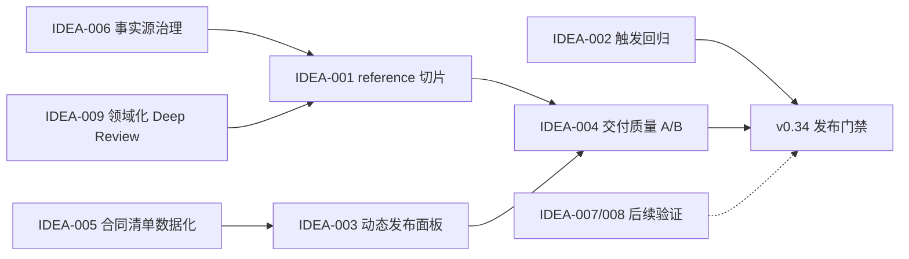

# /idea 需求池 - 2026-08-10

## 追踪信息

- 当前状态：`/idea` 已完成；PRD 已确认；已进入开发承接
- 目标版本：MyP-M-A `v0.34 Candidate`
- 上游来源：v0.33 项目级深度 Review、`notes/evaluation-history.md`、`notes/mypm-roadmap.md`
- 下游承接：`notes/v0.34-governance-prd.md` -> `notes/dev_plan_v0.34.md` -> `notes/progress_v0.34.md` -> 差量验证 -> 发布判断
- 当前事实源：`SKILL.md`、`references/`、`templates/`、`evals/`、`scripts/validate-skill.ps1`
- 最后更新：2026-08-11

## 总体判断

- 本次来源：v0.33 发布后的内部 Review，不是外部功能请求。
- 本版本主线：**入口级上下文与评测门禁治理**。在不增加入口和 PM 框架的前提下，降低各入口实际加载成本，提高触发、发布面板和校验体系的可信度。
- 为什么现在做：v0.33 已将 `SKILL.md` 控制在 `5666/5700` 字符，但 `/prd`、`/acceptance`、`/prompt` 的最小加载仍分别约为 21.3k、20.4k、17.2k 字符；完整 A/B 也未证明交付密度稳定改善。
- 为什么不是其他方向：当前没有证据支持继续新增入口、市场框架或产品功能；Memory、Computer Use 和更多真实项目样例受外部环境或样本准备限制，不应挤占本版主线。
- 进入 `/prd`：IDEA-001、IDEA-003、IDEA-004、IDEA-005、IDEA-009，合并为一个版本级治理需求。
- 已完成：IDEA-002、IDEA-006 已在 M0 完成；IDEA-003、IDEA-005 已在 M1 完成；IDEA-001、IDEA-009 的 `/prompt`、`/review` 试点已在 M2 通过，其他入口留给 M3。
- 继续验证：IDEA-007、IDEA-008。
- 暂不做：新增第六个入口、重写全部 26 个 reference、把外部工具写成强制依赖、六配置穷举式全量回归。

## 证据映射

| 来源证据 | 对应候选需求 | 证据等级 | 说明 |
|---|---|---|---|
| 五入口最小加载约为 9.8k / 15.4k / 21.3k / 20.4k / 17.2k 字符 | IDEA-001、IDEA-009 | 强 | `SKILL.md` 与当前路由必读 reference 的机械统计 |
| v0.33 修改了 frontmatter description；最后一次 34 条触发行为回归记录属于 v0.32 | IDEA-002 | 强 | 静态校验只检查触发用例结构和正反例数量，不执行语义分类 |
| 当前 13 条发布面板固定选取 ID；未包含 OCR、Discovery 的稳定与挑战用例 | IDEA-003 | 强 | `evals/release-panel.json` 可直接核对 |
| 完整 A/B 跨模型净变化很小，回答长度方向不一致 | IDEA-004 | 强 | `notes/evaluation-history.md` 已分别记录正确性和字符数 |
| `validate-skill.ps1` 为 676 行，包含历代 ID 段和大量硬编码合同锚点 | IDEA-005 | 强 | 当前脚本机械统计与代码检查 |
| roadmap 后半段曾出现旧的 56 条 eval 和“v0.33 立项前”等表述 | IDEA-006 | 强 | Review 时可稳定复现；已在 M0 修正并保留为来源证据 |
| 当前会话 Git/GitHub/Figma 可用，Memory 与 Computer Use MCP 未暴露 | IDEA-007 | 中 | 只代表本次会话，不能外推未来运行环境 |
| 真实使用仍主要来自 QuickRec、LetsMakeMoney；PCbuild 失败经验未形成独立案例 | IDEA-008 | 中 | 仓库有零散记录，但没有完整失败案例闭环 |
| `deep-review.md` 的根因维度偏 UI/体验 | IDEA-009 | 中 | 对 Skill、后端或流程治理 Review 时存在领域偏置风险 |

## 数据证据包

- 决策问题：v0.34 应优先增加能力，还是治理已有能力的运行和验证成本？
- 数据 / 来源：本地 Git、文件字符数、84 条稳定用例、21 条挑战用例、34 条触发用例、13 条发布面板、v0.32/v0.33 A/B 汇总。
- 统计对象与粒度：5 个入口、26 个 reference、11 个模板、6 个脚本、单条 eval 及其布尔检查项。
- 时间范围与新鲜度：仓库 HEAD `26e2e66491280470c1876d29544c826aa626d6d5`，2026-08-10 本地与 `origin/main` 一致；评测结论更新到 2026-08-08。
- 数据质量与代表性：结构、字符数、Git 和评分结果可复核；字符数不等于 Token，布尔得分也不等于用户主观好用程度。
- 关键发现：v0.33 的主要收益是治理可靠性，不是跨模型输出质量跃迁；继续压缩 `SKILL.md` 的边际收益已低于治理入口 reference 的收益。
- 反证 / 替代解释：较长 reference 可能保护复杂场景合同，直接删减可能重现 eval 36/61 的选择性遗漏。
- 不能推出的结论：不能仅凭字符数断言回答一定更短，也不能凭总分净增断言 v0.33 普遍优于 v0.32。
- 对价值与时机的影响：应立即做可回退、逐入口的上下文治理，同时加强变化感知型评测；不应一次重写全部规则。
- 最小补证或实验：先选 `/prompt` 和 `/review` 各做一轮 reference 切片，比较实际加载量、关键合同、输出长度和定向得分，再决定是否扩展到 `/prd` 与 `/acceptance`。

## 承重假设与最小实验

| 假设 ID | 承重主张 | 若何时失败 | 当前状态 | 最小实验 | 继续阈值 | 停止 / 转向阈值 |
|---|---|---|---|---|---|---|
| H-001 | reference 切片能降低负载而不丢合同 | 定向用例出现证据、授权或停止条件回退 | 部分支持 | 先处理两个入口并做冻结基线 A/B | 关键门禁无回退且形式加载量下降至少 10% | 任一高风险合同稳定回退，恢复原切片 |
| H-002 | 动态发布面板比固定 13 条更贴近版本风险 | 变化合同未被自动纳入，或面板频繁漂移 | 未知 | 用 v0.32、v0.33 变更记录回放面板生成 | 两版已知关键回退均被覆盖 | 漏掉 eval 36/61 等已知回退 |
| H-003 | 增加交付质量评分能解释“同分但体感不同” | 人工判断一致性过低，或只重复字符数指标 | 未知 | 选 8-10 个历史同分样本做配对盲评 | 能稳定区分重复、决策清晰度和可执行性 | 评分者方向随机或无法给出证据 |
| H-004 | 合同清单数据化能降低校验维护成本 | 迁移后静态校验覆盖下降或错误更难定位 | 部分支持 | 先迁移版本 eval ID 与文件锚点，不动核心检查 | 原 self-test 全通过且脚本职责明显减少 | 需要复制更多特殊分支才能保持覆盖 |

## 需求总览

| ID | 标题 | 类型 | 证据等级 | 压力测试分数 | 置信度 | 分档结论 | 依赖关系 | 建议去向 | 最小下一步 |
|---|---|---|---|---:|---|---|---|---|---|
| IDEA-001 | 入口级上下文预算与 reference 切片 | 架构治理 | 强 | 35/40 | 高 | 高价值 | IDEA-006、IDEA-009 | `/prd` | 冻结五入口加载基线，先试两个入口 |
| IDEA-002 | description 变化触发行为回归 | 质量门禁 | 强 | 37/40 | 高 | 高价值 | 无 | 已完成（M0） | Sol/Terra medium 均 34/34，摘要见 `evals/trigger-baseline.json` |
| IDEA-003 | 固定核心 + 本版差量发布面板 | 评测治理 | 强 | 35/40 | 高 | 高价值 | IDEA-005 | 已完成（M1） | 9 条核心、合同差量、相邻控制和超限升级已通过回放 |
| IDEA-004 | 交付质量与成本配对评测 | 评测增强 | 强 | 29/40 | 中高 | 中价值 | IDEA-003 | `/prd` 小范围试验 | 建立 8-10 条配对盲评样本 |
| IDEA-005 | 校验规则数据化与脚本模块化 | 工程治理 | 强 | 30/40 | 高 | 中价值 | 无 | 已完成（M1） | 29 条合同及 docs/evals/contracts 双轨校验通过 |
| IDEA-006 | roadmap、backlog 与 notes 事实源治理 | 文档治理 | 强 | 35/40 | 高 | 高价值 | IDEA-001 | 已完成（M0） | roadmap/backlog 已区分当前候选、稳定版与历史快照 |
| IDEA-007 | 会话能力清单与 Memory 真实闭环 | 外部能力 | 中 | 26/40 | 中 | 中价值 | 外部 MCP 可用性 | 继续验证 | 工具暴露时跑 capture -> continue -> 冲突测试 |
| IDEA-008 | 真实案例组合与失败案例库 | 产品验证 | 中 | 24/40 | 中 | 中价值 | 新项目材料 | 继续验证 | 先沉淀 PCbuild 项目终止案例 |
| IDEA-009 | 深度 Review 根因维度按领域装配 | 方法治理 | 中 | 30/40 | 中 | 中价值 | IDEA-001 | 并入 `/prd` | 将 UI 固定维度改成领域可选维度 |

## 评分说明

评分维度顺序统一为：痛点强度 / 场景清晰度 / 证据强度 / 紧迫性 / 核心目标贡献 / 替代方案 / 成本可控性 / 验证速度。

- IDEA-001：`5/5/5/4/5/4/3/4 = 35`。低分项是改动风险，需要逐入口回退门禁。
- IDEA-002：`4/5/4/4/5/5/5/5 = 37`。成本低且直接关闭发布门禁缺口。
- IDEA-003：`4/5/4/4/5/4/4/5 = 35`。需要先解决合同到用例的映射。
- IDEA-004：`4/4/4/3/5/3/3/3 = 29`。价值成立，但评分一致性尚未验证，只做小样本。
- IDEA-005：`3/5/5/3/4/3/3/4 = 30`。维护问题真实，但不宜与行为规则重写同时完成。
- IDEA-006：`3/5/5/4/3/5/5/5 = 35`。不影响运行，但执行快且能清理事实冲突。
- IDEA-007：`4/4/5/2/4/3/2/2 = 26`。受外部能力约束，不能承诺本版关闭。
- IDEA-008：`3/4/4/2/4/3/2/2 = 24`。长期价值明确，当前缺少新的真实样本。
- IDEA-009：`3/4/3/3/4/4/5/4 = 30`。适合作为 IDEA-001 的小范围修正，不单独扩版。

## 依赖关系

## 三档范围方案

| 档位 | 内容 | 适合阶段 | 风险 |
|---|---|---|---|
| 最小方案 | IDEA-002、IDEA-003、IDEA-006 | 快速修补当前治理缺口 | 没有解决入口实际上下文过重 |
| 推荐方案 | IDEA-001～006，加 IDEA-009；IDEA-004 只做小样本 | v0.34 | 需要逐入口修改并执行差量行为回归 |
| 过大方案 | 推荐方案 + Memory/Computer Use 适配 + 新案例库 + 全部 reference 重写 + 多模型多强度穷举 | 不适合当前版本 | 外部依赖、成本和回归面不可控 |

## 推荐方案的范围保护

- 不增加 `/strategy`、`/metric`、`/launch` 或其他入口。
- 不新增 PM 框架，不扩张 Strategy/GTM、Discovery 或 OCR 能力范围。
- 不把外部插件、Computer Use、Memory、数据库或 Figma 写成硬依赖。
- 不一次重写全部 reference；每批只处理一个或两个入口，并保留独立回退点。
- 不用字符数下降替代行为证据，不用总分抵消高风险合同回退。
- 不默认执行六配置全量回归；先做静态校验、受影响用例、动态发布面板和跨模型抽查，满足升级条件时再扩大全量。

## 建议成功标准

1. 五入口加载预算有可重复统计；四个重入口的正式加载总量相对 v0.33 基线平均下降至少 15%，单入口不得无解释上升。
2. 34 条触发用例分类全部符合预期；description 变化后该门禁不可跳过。
3. 发布面板由固定核心和本版变化项组成，能回放捕获 v0.33 已知的 eval 36、61 回退。
4. 入口高风险合同、相邻控制组和严格静态校验无回退；任何关键门禁回退均恢复对应批次。
5. 交付质量试验分别报告正确性、决策清晰度、重复度、可执行性、字符数、完成时长和有效返回率，不混成单一总分。
6. validator 的版本用例要求和合同清单从主流程中抽离，现有 evaluation pipeline self-test 继续通过。
7. roadmap 不再包含与当前版本冲突的待办描述；版本 tag 策略形成明确决策。
8. `v0.33.0 Stable` 在 v0.34 达到发布门禁前保持不变。

## 下一阶段建议

- PRD 已完成并确认：`notes/v0.34-governance-prd.md`。
- 开发承接已完成：`notes/dev_plan_v0.34.md`、`notes/progress_v0.34.md`、`notes/dev_log_v0.34.md`。
- 推荐下一步：从 `V034-M0-001` 开始 M0，先锁定基线；M0/M1 通过前不得修改入口行为 reference。
- 不需要再次讨论是否新增入口或 PM 框架，该方向已经排除。
