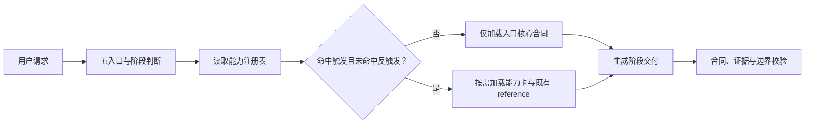

# PRD：MyP-M-A v0.36 能力架构与外部对标基础版

## 入口判断

- 入口：`/prd`
- PRD 类型：正式推进型内部治理 PRD
- 当前阶段：方案已收敛，等待 PRD 确认
- 稳定基线：`v0.35.0 Stable`，已同步远端
- 本版候选状态：Draft；未进入开发承接

## 追踪信息

- 上游需求池：`notes/v0.36-idea-pool.md`
- 本版承接：IDEA-001～IDEA-004
- 延后验证：IDEA-005～IDEA-009
- 明确不做：IDEA-010
- 目标使用者：MyP-M-A 使用者、维护者和未来贡献者
- 文档日期：2026-08-17
- 事实源优先级：本 PRD > v0.36 开发承接文档 > 实施状态文档；v0.35 行为事实仍以当前 `SKILL.md`、`references/` 和评测注册表为准

## 需求状态

- 当前结论：正式推进，但仅推进能力架构、试点、对标协议和公开案例规范。
- 证据基础：v0.35 本地架构与评测事实、真实项目使用记录、五个公开代表 PM Skill 项目的结构对标。
- 证据限制：尚未完成外部候选的同题行为对照，也没有独立人工 PM 评审，因此不预设 MyP-M-A 整体优于或弱于任一项目。
- 开发门禁：本 PRD 经用户确认后，才生成 `dev_plan_v0.36.md`、`progress_v0.36.md` 和 `dev_log_v0.36.md`。

## 方案收敛

### 候选方案

| 方案 | 范围 | 优点 | 风险 | 结论 |
| --- | --- | --- | --- | --- |
| A. 只做能力注册表 | 建 registry 和三张能力卡 | 改动小 | 不能验证对用户交付是否有意义 | 不采用 |
| B. 能力架构 + 外部对标 + 案例规范 | 注册表、三张试点卡、12 条面板、公开案例规范 | 能同时验证架构、行为和产品化基础 | 需要严格控制范围与评测公平性 | 采用 |
| C. 一次性建设 PM Skill Marketplace | 扩充几十种方法、连接器、案例和分发 | 覆盖广 | 上下文、维护、版权和回归成本不可控 | 不采用 |

### 当前版本目标

1. 给内部 PM 方法能力建立唯一、机器可校验、按需装配的注册合同。
2. 用 Discovery、数据分析、Strategy/GTM 三项既有能力完成最小试点，不改变五入口默认行为。
3. 用 12 条同题任务建立可复现的外部行为对标，而不是继续用仓库规模或框架数量替代质量证据。
4. 定义公开案例的授权、匿名化、证据和版本规范，为后续公开案例库做准备。

### 优先级策略

优先级按“稳定基线保护 + 真实缺口证据 + 后续扩展杠杆 + 可独立回退 - 行为回归风险 - 长期维护成本”判断。

| 需求 | 优先级 | 进入 v0.36 | 理由 |
| --- | --- | --- | --- |
| 能力注册表 | P0 | 是 | 是能力扩展、冲突检查和对标映射的基础 |
| 三张试点能力卡 | P0 | 是 | 用既有事实源低风险验证架构 |
| 12 条外部对标面板 | P0 | 是 | 当前最缺少的相对质量证据 |
| 公开案例规范 | P1 | 是 | 降低后续案例公开的隐私和证据风险 |
| 完整原子能力库 | P1 | 否 | 必须等待试点证明收益 |
| 企业连接器、Coach、跨平台分发 | P2 | 否 | 不阻塞本版目标 |

## 承重假设与决策门禁

| 假设 ID | 当前证据 | 最小实验 | 继续阈值 | 停止 / 转向阈值 | 阻塞阶段 | 回写位置 |
| --- | --- | --- | --- | --- | --- | --- |
| H-001 注册表能改善治理而不增加常驻上下文 | 现有能力散落、上下文预算已有机械测量能力 | 登记三张能力卡并测 minimum/formal 装配 | 默认入口装配不增加；按需场景增量可解释 | 注册表被常驻展开，任一入口无解释增加超过 5% | M2 | registry 报告、context budget |
| H-002 能力卡可保持 reference 单一事实源 | 三项能力已有稳定 reference | 卡片仅声明合同并指向原文 | 无重复长正文、无冲突规则、无断链 | 同一行为在卡片和 reference 出现两套正文 | M2 | 能力映射审计 |
| H-003 外部同题对标可以公平执行 | 当前仅有内部 A/B 和结构对标 | 冻结候选版本并跑 12 条单次面板 | 至少 10 条共同有效；输入、模型、强度一致 | 候选不可合法运行、输入不等价或共同有效少于 10 条 | M3 | benchmark summary |
| H-004 公开案例可在不暴露隐私的前提下保留证据价值 | 真实案例丰富但含路径、日志和配置 | 对一个内部样例执行脱敏 dry-run | 自动扫描和人工审计均无敏感信息；关键决策链仍完整 | 无法证明授权、脱敏破坏结论或第三方内容不可重分发 | M4 | case admission report |

## 背景与问题

MyP-M-A 已经具备五个稳定入口和一条较完整的产品工作流，但“入口”和“方法能力”仍没有彻底分层。当前 Discovery、数据分析和 Strategy/GTM 等能力通过 reference 按条件加载，维护者可以理解，机器却难以统一回答：有哪些能力、何时触发、何时不得触发、需要什么输入、产出什么、依赖哪些工具、由哪些用例保护。

公开头部 PM Skill 项目通常在方法覆盖、插件分组、案例展示或企业协作连接上更完整；MyP-M-A 则在真实项目 Review、完整 PRD、开发承接和证据验收上更深。当前比较主要依赖仓库说明和人工观察，不能证明同一任务下的真实差异，也不能指导下一批能力投资。

同时，QuickRec、LetsMakeMoney 等项目已经积累了比模板更有价值的真实链路，但原始材料包含本机路径、日志、截图和项目状态，缺少公开准入规范。若直接公开会产生隐私、授权和证据失真风险；若完全不公开，又无法展示 MyP-M-A 的核心优势。

## 目标

### 产品目标

- 保持 `/review`、`/idea`、`/prd`、`/acceptance`、`/prompt` 五入口不变。
- 建立可扩展但不常驻膨胀的原子能力层。
- 让外部对标可复现、可解释、可审计，结论不过度外推。
- 让未来公开案例在发布前有明确准入和退回规则。

### 成功标准

1. 注册表、三张能力卡和所有引用通过严格校验，无重复 ID、断链、交叉事实源或未映射状态。
2. 五入口默认装配相对 v0.35 不增加；只有命中能力卡的场景产生可解释增量。
3. 三张试点卡的受影响用例和相邻控制用例无关键合同回退。
4. 12 条外部对标任务全部具有冻结输入、候选身份、评分合同和无效样本规则；实际面板至少产生 10 条共同有效样本才允许给出比较结论。
5. 公开案例规范通过一个内部 dry-run，敏感信息扫描为 0，人工审计无未关闭项。
6. v0.35 在 v0.36 完成独立 `/acceptance` 前始终保持 Stable，Draft/Candidate 不覆盖稳定事实。

## 用户场景

### 场景 1：用户继续使用五入口

用户仍只需调用 `mypm /idea` 或描述任务。系统先确定入口和阶段，再根据注册表按需装配能力，不要求用户记忆能力卡名称。

### 场景 2：维护者新增一种 PM 方法能力

维护者先在 registry 中声明 ID、触发、反触发、输入输出、证据和评测映射，再增加能力卡。校验器拒绝重复、无评测、无反触发或指向不存在文件的能力。

### 场景 3：比较 MyP-M-A 与外部代表项目

维护者选择已冻结且许可允许的候选，在相同模型、强度、输入和时间窗下运行 12 条面板。结果按正确性、证据纪律、决策清晰度、完整性、可执行性、重复度、字符数、时长和有效返回率分别展示，不生成统一总分。

### 场景 4：准备公开真实案例

维护者复制案例模板，登记来源与授权，替换身份、路径、凭据和敏感截图，保留问题、证据、决策、交付、失败与修复链。只有自动与人工门禁全部关闭，案例才可标记为公开候选。

## 范围

### 本次包含

- 能力注册表 schema、目录规则和校验合同。
- Discovery、数据分析、Strategy/GTM 三张试点能力卡。
- 12 条外部对标任务、候选冻结清单、执行与评分协议。
- 公开案例规范、manifest、脱敏清单和内部 dry-run。
- 对应的 validator 模块、自测、文档和版本状态治理。

### 本次不包含

- 新增用户入口、slash command 或顶层路由。
- 批量新增 PM 框架、复制外部 Skill 文本或重新包装公开项目内容。
- 实现 Slack、Linear、Jira、Notion、Figma、PostHog 等连接器。
- 建设 PM Coach、市场化案例网站、Marketplace 安装包或跨平台分发。
- 修改 Memory 的存储产品或把外部工具改成硬依赖。
- 将外部候选的 Star、方法数量或自述能力合并成质量总分。

### 延后项

- v0.37：根据试点与面板证据扩展 Discovery、Research、Analytics、Strategy、GTM、Execution 能力族，并决定是否公开首批案例。
- v0.38：企业协作与数据工具适配层。
- v0.39：跨平台安装、公开案例与开源产品化。

## 上游需求追踪

| IDEA ID | 本 PRD 承接 | 功能需求 | 主要验收 |
| --- | --- | --- | --- |
| IDEA-001 | 能力注册表 | FR-001、FR-002、FR-003 | AC-001～AC-004 |
| IDEA-002 | 三张试点能力卡 | FR-004、FR-005 | AC-004～AC-006 |
| IDEA-003 | 12 条外部对标面板 | FR-006～FR-009 | AC-007～AC-011 |
| IDEA-004 | 公开案例规范 | FR-010、FR-011 | AC-012～AC-014 |

## 影响范围

### 预计新增文件

| 路径 | 用途 |
| --- | --- |
| `capabilities/registry.json` | 原子能力唯一注册表 |
| `capabilities/README.md` | 能力卡作者规范和单一事实源说明 |
| `capabilities/discovery/problem-validation.md` | Discovery 试点卡 |
| `capabilities/analytics/product-data-analysis.md` | 数据分析试点卡 |
| `capabilities/strategy/strategy-gtm-decision.md` | Strategy/GTM 试点卡 |
| `evals/external-benchmark.json` | 12 条任务、候选和评分合同 |
| `evals/external-candidates.json` | 外部候选来源、commit、许可和适配状态 |
| `examples/public-case-spec.md` | 公开案例准入规范 |
| `examples/case-manifest.schema.json` | 案例 manifest schema |
| `examples/dry-run/` | 不公开的脱敏 dry-run 样例与审计结果 |
| `scripts/validation/validate-capabilities.ps1` | 注册表与能力卡校验 |
| `scripts/validation/validate-external-benchmark.ps1` | 对标配置、输入和候选身份校验 |
| `scripts/validation/validate-public-cases.ps1` | 案例授权、匿名化和引用校验 |
| `scripts/test-v036-governance.ps1` | 正常与失败夹具 self-test |

### 预计修改文件

| 路径 | 改动边界 |
| --- | --- |
| `scripts/validate-skill.ps1` | 仅编排三个新 validator，保持现有参数和 self-test 兼容 |
| `evals/contract-registry.json` | 登记新增治理合同及相关用例，不改变既有唯一归属 |
| `evals/eval-lifecycle.json` | 记录新增任务的 draft/candidate/accepted 生命周期 |
| `evals/context-budget.json` | 增加三张能力卡按需装配测量场景，默认入口组合不变 |
| `README.md` | 仅在状态门禁通过时更新版本能力和证据边界 |
| `CHANGELOG.md` | 记录实际完成项，不提前写 Stable |
| `notes/mypm-roadmap.md` | 登记 v0.36 阶段、证据和后续分流 |
| `notes/evaluation-history.md` | 记录真实对标结果与限制 |

### 明确禁止修改

- M0～M2 试点通过前，不修改 `SKILL.md` 的五入口合同。
- 首轮试点不重写 `references/discovery.md`、`references/data-analysis.md`、`references/strategy-gtm.md`；它们保持内容事实源。
- 不修改 v0.35 历史结论、已冻结评测输出或 Git 历史。
- 不把仓库外评测原始输出批量提交到主仓库。

### 行为与兼容影响

- 默认用户路径：预期无变化。
- 命中试点能力的路径：只增加结构化能力声明的按需装配，不得改变入口阶段边界。
- 工具：仍按“证据需要时弹性调用”，注册表只能声明类别和降级，不得强制安装。
- Memory：沿用现有 capture/continue 边界，能力卡不得自行写入记忆。
- 外部写操作：继续需要用户授权，任何能力卡不得绕过。
- 评测：增加外部面板和治理用例，不替代稳定集、挑战集和触发集。

## 需求表达物

- 主要决策问题：如何在不增加用户入口和常驻上下文的前提下扩展 PM 原子能力，并以公平协议比较外部候选。
- 表达模式：能力装配图、JSON schema、候选状态机、影响矩阵和验收样例。
- UI 原型判断：本需求没有终端用户界面或视觉交互决策，不生成高保真 HTML。强行制作 UI 原型不能降低注册、评测和隐私风险。
- 替代表达物：`registry.json` 示例、能力卡模板、benchmark manifest、case manifest 和可执行 validator。



## 领域词汇与关键决策

- **入口**：用户调用的 `/review`、`/idea`、`/prd`、`/acceptance`、`/prompt`，本版不增加。
- **能力卡**：一个可复用 PM 方法或分析能力的轻量声明，不是新入口，也不复制完整 reference。
- **注册表**：能力 ID、触发、反触发、输入输出、证据、工具和评测映射的唯一机器事实源。
- **结构对标**：比较公开项目的覆盖、组织、工具和案例方式，不评价具体回答质量。
- **行为对标**：同一输入、模型和协议下比较实际输出。
- **共同有效样本**：所有被比较候选均返回可评分结果的同一任务。
- **公开案例**：通过授权、匿名化、证据和版本门禁，可对外分发的完整工作流样例。
- **核心决策**：能力卡首轮是声明与装配层，现有 reference 是内容事实源；不得形成双事实源。

## 功能需求

### FR-001 能力注册表 schema

注册表使用 UTF-8 JSON，根节点包含 `schema_version`、`generated_at`、`capabilities`。每项能力至少包含：

```json
{
  "id": "discovery.problem-validation",
  "name_zh": "问题与需求验证",
  "domain": "discovery",
  "status": "pilot",
  "card_file": "capabilities/discovery/problem-validation.md",
  "entrypoints": ["/idea", "/prd"],
  "stages": ["discover", "validate"],
  "triggers": ["存在未经验证的问题或需求"],
  "anti_triggers": ["只要求执行已确认需求"],
  "required_inputs": ["问题描述", "目标用户", "现有证据"],
  "outputs": ["证据判断", "承重假设", "最小实验"],
  "evidence_contract": "区分事实、推断与待验证项",
  "tool_categories": ["project-read", "web-research", "data-analysis"],
  "fallback": "工具不可用时明确证据缺口，不虚构结论",
  "references": ["references/discovery.md"],
  "eval_ids": {"stable": [83], "challenge": ["CH-20"], "trigger": [11]},
  "owner": "mypm",
  "introduced_in": "0.36.0"
}
```

规则：

- `id` 全局唯一且发布后不可复用；命名为 `<domain>.<capability>`。
- `triggers` 与 `anti_triggers` 均不能为空。
- `references`、`eval_ids` 必须存在且反向可追踪。
- `tool_categories` 只声明类别，不写本机路径、凭据或硬依赖。
- `status` 仅允许 `draft`、`pilot`、`active`、`deprecated`、`retired`。
- `deprecated` 必须给迁移目标；`retired` 仍保留历史 ID 和版本信息。

### FR-002 能力卡内容合同

每张能力卡只包含：定位、适用场景、反触发、必要输入、最小流程、输出合同、证据门禁、工具与降级、停止条件、reference 和 eval 映射。不得复制 reference 中的大段方法正文、完整模板或历史说明。

能力卡长度不是单独成功指标。若缩短导致关键合同丢失，应以行为正确性为准；若内容与 reference 重复超过约定阈值，validator 必须提示人工复核。

### FR-003 注册表校验与生命周期

validator 必须拒绝：

- 重复 ID、非法状态、缺少触发或反触发。
- 引用不存在的文件、用例或入口。
- 同一能力被两个 active ID 无解释覆盖。
- active 能力没有稳定或挑战评测映射。
- deprecated 能力没有替代路径。
- 卡片中出现凭据、绝对用户路径或未批准外部依赖。

生命周期变化必须写入 CHANGELOG；`pilot -> active` 需要定向行为回归和独立验收，不能只凭静态校验。

### FR-004 三张试点能力卡

本版只试点：

1. `discovery.problem-validation`：映射 `references/discovery.md`，服务 `/idea` 和原型验证型 `/prd`。
2. `analytics.product-data-analysis`：映射 `references/data-analysis.md`，服务涉及反馈、指标、日志、数据库和实验的 `/idea`、`/prd`、`/review`。
3. `strategy.strategy-gtm-decision`：映射 `references/strategy-gtm.md`，只在定位、ICP、商业模式、定价、市场进入或增长路径会改变决策时加载。

首轮不得新增新方法正文；只把既有能力转成统一声明。若试点没有改善可发现性、校验或装配，则停止扩展，不进入 IDEA-005。

### FR-005 按需装配与冲突处理

- 先确定入口与阶段，再读取 registry；能力卡不能反向改写入口。
- 同一请求可命中多个能力，但只加载当前决策所需的最小集合。
- 冲突优先级：安全与授权 > 证据合同 > 入口阶段合同 > 能力卡方法建议。
- 多卡冲突必须在输出前收敛，不向用户展示内部路由流水账。
- 普通请求不命中能力卡时，行为必须与 v0.35 基线一致。

### FR-006 外部候选登记与冻结

`external-candidates.json` 每个候选至少记录：仓库 URL、版本或 commit SHA、许可证、获取时间、运行方式、宿主兼容性、是否需要转换、允许比较的能力域、已知限制和 `eligible` 状态。

只有同时满足以下条件才进入行为对标：

- 许可证允许本地获取和评测。
- 能冻结到不可变 commit 或发布版本。
- 能在同一宿主、模型和强度下运行，或存在不改变语义的透明适配层。
- 不要求上传私有项目数据。

不满足者只进入结构对标，不把“无法运行”计为能力失败。

### FR-007 12 条外部对标任务

| ID | 任务 | 主要能力 | 硬门禁 |
| --- | --- | --- | --- |
| EB-01 | 从混合反馈、日志和 Review 结果判断真实问题 | Discovery | 证据与推断分开 |
| EB-02 | 对弱证据新想法做压力测试 | Discovery | 不伪造用户需求 |
| EB-03 | 分析反馈数据并锁定统计对象 | Analytics | 分母、去重、时间窗明确 |
| EB-04 | 设计 KPI 与数据合同 | Analytics | 来源、口径、异常和权限完整 |
| EB-05 | 比较 2～3 个互斥产品战略 | Strategy | 有取舍与排除项，不堆框架 |
| EB-06 | 形成竞品与市场判断 | Strategy/Research | 可核查来源与适用边界 |
| EB-07 | 为完整 UI 功能输出正式 PRD | PRD | 全链路、影响范围、高保真交付门禁 |
| EB-08 | 为异步后端任务输出正式 PRD | PRD/Data | 状态、幂等、权限、失败与数据库合同 |
| EB-09 | 深度 Review 一个真实结构化项目 | Review | 架构、主链、风险、证据状态 |
| EB-10 | Review PRD 与实现的一致性 | Review | 原目标、实现、测试和回归关联 |
| EB-11 | 验收候选发布包 | Acceptance | 身份、新鲜度、真实证据、阻塞判断 |
| EB-12 | 将阶段结论转成下一阶段提示词 | Prompt/Handoff | 不重做上一步、授权和停止点明确 |

每条任务必须提供中性输入、禁止候选专属术语、明确可用材料和统一输出目标。输入 fixture 不使用 MyP-M-A 私有项目原文。

`evals/external-benchmark-contract.json` 是本表的机器可读伴随合同；validator 必须逐项核对任务 ID、语义键、领域、标题、主要能力和硬门禁。`evals/external-benchmark.json` 只能引用该合同，不得用另一组同样为 12 条的任务替代。

### FR-008 对标执行协议

- 同一任务的所有候选使用相同模型、推理强度、工具权限、输入、超时和重试规则。
- 候选名称在评分阶段映射为随机编号。
- 每个候选每条任务默认单次执行；仅对失败、差异或不稳定任务补到三次。
- 超时、空文件、解析失败和工具不可用分开记录，不混入能力分。
- 长度和时长只用于成本报告，不能抵消关键合同回退。
- 外部候选更新后必须创建新快照，历史结果不可覆盖。

### FR-009 分维评分与结论边界

结果分别报告：

1. 正确性与硬合同。
2. 证据纪律。
3. 决策清晰度。
4. 场景完整性。
5. 可执行性。
6. 重复度与信息密度。
7. 字符数。
8. 完成时长。
9. 有效返回率。

不得把九项合并成单一总分。任一候选出现安全、授权、事实对象或关键证据回退时，该任务标记为关键失败，不能被其他维度抵消。最终结论只覆盖本次候选版本、模型、强度、任务和时间窗。

### FR-010 公开案例 manifest

每个案例必须登记：

- `case_id`、标题、产品类型和适用入口。
- 原始来源、所有者、公开授权和第三方内容授权状态。
- 匿名化策略和已删除信息类别。
- 输入摘要、阶段链、关键决策、交付物、验收证据和失败修复。
- MyP-M-A 版本、候选 commit、使用模型和工具类别。
- 可公开文件清单、不可公开文件清单和校验结果。
- 状态：`draft`、`reviewing`、`approved`、`published`、`withdrawn`。

### FR-011 公开案例准入与撤回

公开前必须通过：

- 授权：项目所有者与第三方内容边界明确。
- 匿名化：姓名、账号、凭据、本机路径、设备标识、私有 URL、日志中的敏感值和截图元数据已处理。
- 真实性：不能为了好看删除改变结论的失败、限制或未完成项。
- 可复现性：输入、版本、关键产出和证据关系可理解；无法公开的证据明确说明。
- 中文质量：默认中文，无乱码、无未经解释的英文合同状态。

发现授权撤回、匿名化遗漏或事实错误时，案例进入 `withdrawn`，保留审计记录但停止公开分发。

### FR-012 状态、停止与回退

- v0.36 状态依次为 `Draft -> Candidate -> Stable`，不得跳级。
- M1、M2、M3、M4 均可独立回退；回退不修改 v0.35 Stable。
- 出现以下任一条件立即停止扩展：默认上下文无解释增加超过 5%、关键合同回退、registry 与 reference 双事实源、对标输入不公平、外部候选许可不清、案例敏感信息未清零。
- 缩小范围时优先保留 registry 与规范，允许三张卡、面板或 dry-run 分别延后，不能伪装为全部完成。

## 数据与配置

### `capabilities/registry.json`

- 编码：UTF-8，无 BOM。
- schema 版本独立于 Skill 版本。
- 数组按 `id` 排序，避免无意义 diff。
- 时间使用 ISO 8601 UTC。
- 不存放运行结果、模型密钥或用户数据。

### `evals/external-benchmark.json`

- 保存任务合同、fixture 路径、候选快照 ID、执行协议和评分维度。
- 原始回答和评分存放仓库外评测工作区；仓库内只保留摘要、哈希和可复现配置。
- 每次运行记录候选 commit、Skill commit、模型、强度、工具状态、开始时间、结束时间和有效性。

### `examples/case-manifest.schema.json`

- manifest 只登记公开许可和脱敏后的元数据。
- 不允许绝对用户目录、凭据格式、私有仓库地址和未批准附件。
- 截图需经过元数据移除与人工目视审计。

### 兼容与迁移

- 新目录对 v0.35 是附加治理层，不迁移或删除现有 reference。
- registry 缺失或损坏时，运行时回退到 v0.35 入口逻辑；不得阻塞正常使用。
- 试点完成前 `SKILL.md` 不依赖 registry。
- 若未来启用运行时读取，必须另设 PRD 变更或在本版 M2 明确获得用户确认。

## 交互与文案要求

- 全部用户可见文档默认中文；技术键名和外部项目名保持原文。
- 能力卡名称应说明“要解决的决策”，不以框架名作为主要入口。
- 对标报告必须写明候选身份、共同有效样本、时间窗和限制。
- 禁止使用“全面领先”“行业第一”“全场景更强”等超出证据的表述。
- 公开案例不得出现“整理版”“AI 生成版”等削弱作品真实性的标签，应直接说明版本和证据边界。

## 开发前验收与指标

### 验证层级与门禁时点

| 层级 | 时点 | 证据 | 能证明什么 |
| --- | --- | --- | --- |
| 静态 schema | M1 起 | validator 与失败夹具 | 结构、引用和状态合法 |
| 装配预算 | M2 | context budget | 默认与按需装配成本 |
| 定向行为 | M2 | 受影响与控制用例 | 三张卡未引入可见回退 |
| 外部行为对标 | M3 | 冻结回答、评分、viewer | 指定候选和协议下的相对表现 |
| 案例 dry-run | M4 | 自动扫描、人工审计 | 规范能阻止明显隐私和授权问题 |
| 独立 Acceptance | M5 | 完整 diff、门禁证据 | 是否适合晋升 Stable |

Agent 模拟只能证明给定任务与协议下的行为，不能替代真实 PM 用户的长期使用评价。公开案例 dry-run 也不能证明所有未来案例都安全。

## 验收目标

在不改变五入口默认体验和 v0.35 Stable 事实的前提下，完成一套可校验的能力扩展基础、可复现的外部对标协议和可审计的公开案例准入规范。

## 验收标准

| AC | 操作 | 通过标准 |
| --- | --- | --- |
| AC-001 | 校验 registry schema | 所有必填字段合法，ID 唯一，顺序稳定 |
| AC-002 | 注入重复 ID、断链、非法状态 | validator 均按预期失败并给出中文定位 |
| AC-003 | 检查反向映射 | reference、eval、入口与能力卡不存在孤儿关系 |
| AC-004 | 测量五入口默认装配 | 相对 v0.35 不增加；差异必须为 0 或有批准解释 |
| AC-005 | 运行三张卡受影响用例 | 关键合同无回退，输出仍遵守入口阶段边界 |
| AC-006 | 运行相邻控制用例 | 普通 `/idea`、`/prd`、`/review` 不误加载策略或数据能力 |
| AC-007 | 校验 12 条任务 | 数量、领域、fixture、硬门禁和评分维度完整 |
| AC-008 | 校验外部候选身份 | 每个行为候选有固定版本、许可和可运行证明 |
| AC-009 | 执行对标面板 | 至少 10 条共同有效；无效原因独立记录 |
| AC-010 | 复核盲评 | 映射隐藏、逐任务证据完整、九项指标分开呈现 |
| AC-011 | 检查对标结论 | 无跨模型、跨版本或全场景外推，无统一总分 |
| AC-012 | 生成一个内部案例 dry-run | manifest、目录、授权和证据链完整 |
| AC-013 | 运行敏感信息与引用扫描 | 自动扫描 0 失败，人工审计无未关闭项 |
| AC-014 | 模拟撤回案例 | 状态转为 withdrawn，公开索引移除，审计记录保留 |
| AC-015 | 运行完整严格校验 | 既有 self-test、UTF-8、乱码、链接、JSON、PowerShell 和 diff 检查全部通过 |

## 日志 / 人工检查

- 机器证据：validator 结果、context budget、评测配置哈希、候选 commit、共同有效样本数、评分明细和 dry-run 扫描结果。
- 人工检查：能力卡与 reference 是否重复、12 条任务是否中立、评分证据是否串项、案例截图与文本是否仍泄露身份。
- 不记录：模型密钥、私有项目原文、本机用户目录、未脱敏日志和第三方受限附件。

## 通过标准

v0.36 只有同时满足以下条件才可晋升 Stable：

1. AC-001～AC-015 全部通过，无 P0/P1 未关闭项。
2. 三张能力卡通过定向与控制回归，默认上下文无增长。
3. 外部对标至少 10 条共同有效，且结论边界清楚；若没有合法可运行候选，M3 不得伪装通过。
4. 公开案例 dry-run 自动与人工门禁均通过，但本版不要求实际公开案例。
5. `validate-skill.ps1 -Strict`、评测 self-test、UTF-8、乱码、Markdown 链接、JSON/PowerShell 解析和 `git diff --check` 全部通过。
6. 独立 `/acceptance` 复核当前分支、HEAD、完整 diff、候选身份和证据新鲜度。

## 不通过处理

- registry 结构失败：只回退 M1 新增文件，不改 v0.35。
- 试点行为回退：回退对应能力卡和映射；其他卡可独立保留，禁止强行整体通过。
- 外部候选不可运行：降级为结构对标，M3 保持部分通过，不给行为优劣结论。
- 面板样本不足：补齐候选适配或缩小为研究记录，不晋升 Stable。
- 案例泄露或授权不清：立即撤回 dry-run 的公开候选状态，保留审计，不推进案例库。
- 上下文膨胀无收益：保持 registry 为离线治理工具，不接入运行时装配。

## 测试与回归重点

- registry 唯一性、排序、断链、非法状态和反触发缺失。
- 五入口普通样本不误加载能力卡。
- 数据分析能力不在无数据请求中展开统计合同。
- Strategy/GTM 不在普通功能 PRD 中无条件堆框架。
- Discovery 不把已确认实施任务重新拉回开放发散。
- 对标候选版本漂移、超时、空结果、评分映射泄露和跨样本引用。
- 案例中的 Windows 路径、邮箱、Token、私有 URL、截图元数据和日志值。
- 既有 85/21/34 目录与生命周期不被新面板覆盖或重复登记。

## 关键测试接缝

| 验收标准 | 可观察结果 | 所需接口 / 故障注入点 | 证据 |
| --- | --- | --- | --- |
| registry 拒绝重复能力 | 严格校验失败且指出两个 ID 位置 | 重复 ID 夹具 | self-test 输出 |
| 默认装配不增长 | 五入口预算与 v0.35 相同 | context budget 快照 | budget JSON |
| 能力卡按需加载 | 正例命中、反例不命中 | 三组正反 fixture | 定向评测 |
| 候选身份冻结 | 修改候选 commit 后校验失败 | 候选漂移夹具 | validator 输出 |
| 无效样本不冒充能力失败 | 超时单列，能力评分为空 | 超时/空文件夹具 | benchmark report |
| 敏感案例被拒绝 | 检出路径或凭据并阻止 approved | 脱敏失败夹具 | case validator |
| 撤回可执行 | 公开索引消失，审计仍在 | withdrawn 状态夹具 | case lifecycle test |

## 实施批次与回退门禁

| 批次 | 内容 | 前置 | 通过门禁 | 独立回退点 |
| --- | --- | --- | --- | --- |
| M0 | 冻结 v0.35 基线、文件范围、候选许可和输入边界 | PRD 确认 | 基线哈希、状态和范围清楚 | 删除 v0.36 承接文档，不动运行时 |
| M1 | registry、schema、validator 和失败夹具 | M0 | AC-001～003 | 移除新 registry 与模块 |
| M2 | 三张试点卡、装配预算和定向回归 | M1 | AC-004～006 | 逐卡撤回，不改 reference |
| M3 | 12 条面板、候选冻结、执行与评分 | M1 | AC-007～011 | 保留研究记录，移除发布门禁接线 |
| M4 | 公开案例规范和内部 dry-run | M1 | AC-012～014 | 删除 dry-run，保留规范草案 |
| M5 | 全量静态检查、状态同步和独立验收 | M2～M4 | AC-015 与通过标准 | 保持 v0.35 Stable，v0.36 不晋升 |

M2、M3、M4 可并行准备，但最终状态独立；任何一项失败不得被其他项成绩抵消。

## 风险与开放问题

| 风险 | 等级 | 处理 |
| --- | --- | --- |
| 能力卡与 reference 形成双事实源 | 高 | 卡片只存合同与指针，重复检测和人工审计 |
| 原子能力增加导致路由冲突和上下文膨胀 | 高 | 三张试点、反触发、默认预算零增长、逐卡回退 |
| 外部候选格式不同导致对标不公平 | 高 | 可运行资格、透明适配、同输入协议、结构与行为分开 |
| 评分器偏好影响结论 | 中 | 隐藏映射、逐维报告、人工抽查、不合并总分 |
| 外部仓库更新造成历史不可复现 | 中 | 固定 commit 与许可证快照，不覆盖历史结果 |
| 真实案例泄露隐私或第三方内容 | 高 | 授权、自动扫描、人工目视、withdrawn 生命周期 |
| 本版文档和工具过度膨胀 | 中 | 文件范围白名单、M1～M4 独立门禁、停止条件 |

当前没有必须由用户补充才能完成 PRD 的开放问题。候选外部项目的最终入选与运行资格在 M0 按许可和宿主兼容性核验，不在 PRD 中提前硬编码为全部可运行。

## 完整 PRD 门禁检查

- [x] 当前版本目标、方案、优先级和范围已收敛。
- [x] IDEA-001～IDEA-004 已映射到功能需求和验收。
- [x] 影响范围精确到新增、修改和禁止修改文件。
- [x] 注册表、能力卡、benchmark 和案例 manifest 数据合同已定义。
- [x] 五入口、v0.35 Stable、Memory 和外部写操作边界得到保护。
- [x] 本需求为非 UI 工程治理，已提供架构图、schema、状态和测试接缝，不伪造高保真 UI 原型。
- [x] 开发前验收、通过标准、不通过处理和逐批回退已写清。
- [x] 外部对标不使用统一总分，不把结构规模冒充行为质量。
- [x] 中文输出、隐私、授权和公开案例撤回规则已定义。
- [ ] 用户确认本 PRD 并授权进入开发承接。

## 下一阶段建议

用户确认本 PRD 后，生成：

- `notes/dev_plan_v0.36.md`：按 M0～M5 写实施顺序、精确文件、验证命令和回退。
- `notes/progress_v0.36.md`：只保留状态看板和最小可执行 checklist。
- `notes/dev_log_v0.36.md`：记录实际修改、命令、结果、偏差和回退，不混入 progress。

在用户明确授权前，不修改 `SKILL.md`、`references/`、`evals/`、`scripts/`，不提交、不推送、不打 tag、不创建 Release。
