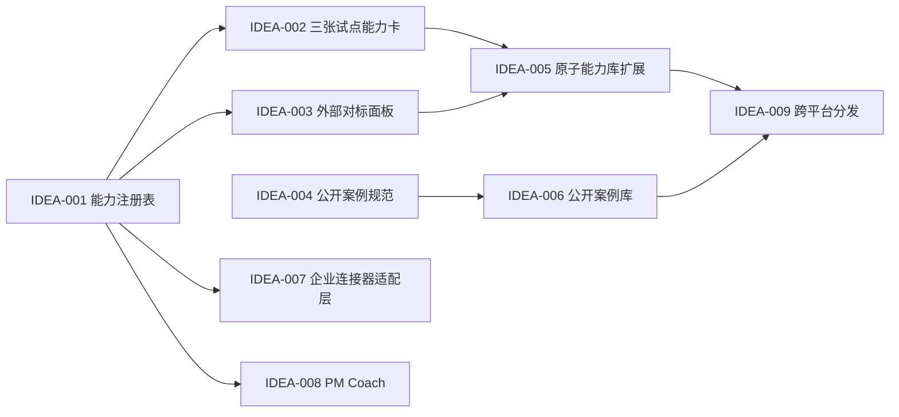

# /idea 需求池 - MyP-M-A v0.36

## 追踪信息

- 入口判断：`/idea`
- 产品：MyP-M-A
- 当前稳定基线：`v0.35.0 Stable`，已同步远端
- 需求池状态：已完成价值判断，待进入 `/prd`
- 判断日期：2026-08-17
- 输入来源：当前仓库审计、历史评测、真实项目使用反馈、公开 PM Skill 对标
- 证据边界：公开项目的数量与结构用于识别能力覆盖和产品化方式，不以 Star、项目自述或框架数量直接证明输出质量

## 总体判断

MyP-M-A 当前最强的不是“拥有最多 PM 框架”，而是把项目 Review、需求判断、完整 PRD、开发承接、真实验收、证据治理和 Memory 续接连成了一条可落地链路。它与公开头部 PM Skill 的主要差距集中在四处：

1. 原子能力缺少统一注册和按需装配合同，现有 Discovery、数据分析、Strategy/GTM 能力仍以 reference 为主。
2. 缺少与外部代表项目使用相同输入、相同模型和同一评分协议的可复现对标。
3. 缺少可以公开展示的匿名案例规范，真实项目证据丰富但不适合直接发布。
4. 企业连接器、教学模式、广覆盖方法库与多平台分发仍弱，但这些不应挤入 v0.36。

因此，v0.36 建议定位为 **能力架构与外部对标基础版**：不增加用户入口，不批量引入框架，不接入新的硬依赖；先建立能力注册表、试点三张能力卡、冻结 12 条外部对标面板，并定义公开案例的准入规范。

## 证据映射

| 来源证据 | 对应候选需求 | 证据等级 | 说明 |
| --- | --- | --- | --- |
| MyP-M-A 已有 `discovery.md`、`data-analysis.md`、`strategy-gtm.md`，但没有统一的机器可校验能力目录 | IDEA-001、IDEA-002 | 强 | 本地文件和装配关系可直接核对 |
| v0.35 已有 85 条稳定、21 条挑战、34 条触发用例，但没有统一的外部同题对标面板 | IDEA-003 | 强 | 本地评测事实源可直接核对 |
| QuickRec、LetsMakeMoney 等真实案例贯穿多阶段，但包含本地路径、验收证据和项目上下文 | IDEA-004、IDEA-006 | 强 | 真实使用价值明确，同时存在隐私与授权风险 |
| [phuryn/pm-skills](https://github.com/phuryn/pm-skills) 以原子 Skill、工作流和领域插件组织广覆盖 PM 能力 | IDEA-001、IDEA-005 | 中 | 可证明一种公开产品架构，不证明其行为质量高于 MyP-M-A |
| [Anthropic product-management plugin](https://github.com/anthropics/knowledge-work-plugins/tree/main/product-management) 强调与协作、分析和设计系统连接 | IDEA-007 | 中 | 证明企业工作流连接具有代表性，具体连接器价值仍需真实场景验证 |
| [deanpeters/Product-Manager-Skills](https://github.com/deanpeters/Product-Manager-Skills) 强调方法分层、辅导和可解释使用 | IDEA-008 | 中 | 说明教学层是差异方向，不证明当前用户需要立即加入 |
| [product-on-purpose/pm-skills](https://github.com/product-on-purpose/pm-skills) 提供大量输出样例、工作流和 CI 合同 | IDEA-003、IDEA-004、IDEA-006 | 中 | 对公开案例和合同校验有借鉴价值，不复制其内容 |
| [Kappaemme startup pressure test](https://github.com/Kappaemme-git/codex-startup-pressure-test-skill) 以单点压力测试形成鲜明定位 | IDEA-005 | 中 | 证明窄而深的能力卡有产品价值，MyP-M-A 已吸收其压力测试思想 |

## 数据证据包

- 统计对象：MyP-M-A 当前运行时、评测目录、公开代表项目的仓库结构与公开说明。
- 截止时间：2026-08-17。
- MyP-M-A 当前目录口径：85 条稳定用例、21 条挑战用例、34 条触发用例。
- 已知行为基线：v0.28/v0.35 Sol medium 26 条分层面板为 `218/220 -> 217/220`；两项定向修复为 `14/16 -> 16/16`。
- 不可比较项：不同项目的 Star、文件数、框架数和自述能力不能换算成统一质量分。
- 缺口：尚无同输入、同模型、匿名映射的外部项目输出对照，也没有独立人工 PM 复核样本。

## 需求总览

| ID | 标题 | 类型 | 证据等级 | 压力测试 | 置信度 | 分档结论 | 依赖关系 | 建议去向 | 最小下一步 |
| --- | --- | --- | --- | ---: | --- | --- | --- | --- | --- |
| IDEA-001 | 建立原子能力注册表 | 架构治理 | 强 | 35/40 | 高 | 高价值 | 无 | v0.36 `/prd` | 冻结 schema 与唯一 ID 规则 |
| IDEA-002 | 试点三张能力卡 | 能力治理 | 强 | 33/40 | 高 | 高价值 | IDEA-001 | v0.36 `/prd` | 从现有 reference 映射，不改入口行为 |
| IDEA-003 | 建立 12 条外部对标面板 | 评测治理 | 强 | 36/40 | 高 | 高价值 | IDEA-001 | v0.36 `/prd` | 冻结任务、输入、协议和分维评分 |
| IDEA-004 | 定义公开案例准入规范 | 产品化治理 | 强 | 34/40 | 高 | 高价值 | 无 | v0.36 `/prd` | 定义授权、匿名化、证据与目录合同 |
| IDEA-005 | 扩展完整原子 PM 能力库 | 能力扩展 | 中 | 27/40 | 中 | 小范围验证 | IDEA-001～003 | v0.37 | 先用三张试点卡验证架构收益 |
| IDEA-006 | 建立公开案例库 | 内容产品化 | 中 | 26/40 | 中 | 小范围验证 | IDEA-004 | v0.37～v0.39 | 先用一个内部脱敏样例试跑规范 |
| IDEA-007 | 企业连接器与协作适配层 | 工具集成 | 中 | 25/40 | 中 | 小范围验证 | IDEA-001 | v0.38 | 选 2 个真实企业协作任务做只读试验 |
| IDEA-008 | PM Coach 教学模式 | 使用体验 | 中 | 23/40 | 低 | 继续验证 | IDEA-001、IDEA-005 | 后续验证 | 先访谈或观察用户是否需要解释而非交付 |
| IDEA-009 | 跨平台安装与 Marketplace 分发 | 开源产品化 | 中 | 24/40 | 中 | 继续验证 | v0.36～v0.38 | v0.39 | 先确认平台格式与维护成本 |
| IDEA-010 | 大规模复制公开项目的方法库 | 范围扩张 | 弱 | 14/40 | 高 | 暂不做 | 无 | 不进入路线图 | 不复制，按真实失败样本增补 |

## 依赖关系

## 三档范围方案

| 方案 | 内容 | 优点 | 风险 | 判断 |
| --- | --- | --- | --- | --- |
| 最小方案 | 只新增能力注册表与三张试点能力卡 | 成本最低，可验证架构 | 仍无法回答与外部项目的真实差距 | 不足 |
| 推荐方案 | 注册表、三张试点卡、12 条外部对标面板、公开案例规范 | 同时验证架构、质量和公开产品化基础 | 需要严格控制对标协议与版权边界 | 采用 |
| 过大方案 | 一次性补齐几十种框架、连接器、案例库和跨平台发布 | 表面覆盖广 | 上下文膨胀、维护成本高、行为回归难定位 | 不采用 |

## 需求详情

### IDEA-001 建立原子能力注册表

- 原始来源：本地架构审计、公开 PM Skill 对标。
- 产品问题：现有方法能力分散在 reference 中，缺少统一 ID、触发边界、输入输出、证据、工具和评测映射，后续扩展容易重复或误加载。
- 用户价值：保持五入口简单的同时，让内部能力可发现、可按需加载、可校验、可独立回退。
- 不做后果：每增加一个方法都要手工修改多处路由，能力覆盖和评测生命周期继续依赖人工记忆。
- 替代方案：继续用 Markdown 目录和人工约定；成本低，但不能自动发现冲突、断链和未评测能力。
- 压力测试：35/40。证据 5、痛点 4、用户价值 4、目标匹配 5、替代不足 4、成本可控 4、风险可控 4、验证速度 5。
- 承重假设：结构化注册不会迫使运行时常驻加载全部能力卡。
- 最小实验：只登记三张既有能力卡，测量装配量、路由冲突和定向行为回归。
- 建议：进入 v0.36 `/prd`，P0。

### IDEA-002 试点三张能力卡

- 原始来源：`references/discovery.md`、`references/data-analysis.md`、`references/strategy-gtm.md`。
- 产品问题：已有能力有内容但缺少统一封装，无法证明“注册表 + 能力卡”比当前 reference 结构更好维护。
- 用户价值：用真实高价值能力验证架构，不等到大规模迁移后才发现装配或行为问题。
- 压力测试：33/40。主要扣分项是用户侧直接收益不立即可见，以及存在重复包装风险。
- 最小实验：保持原 reference 为事实源，能力卡只声明入口、触发、反触发、输入、输出、证据、工具和评测映射；首轮不改五入口正文。
- 停止条件：卡片与 reference 出现双事实源，或装配成本无收益。
- 建议：进入 v0.36 `/prd`，依赖 IDEA-001，P0。

### IDEA-003 建立 12 条外部对标面板

- 原始来源：用户要求与公开头部 PM Skill 比较、当前评测历史。
- 产品问题：现有评测善于防止自身回退，但不能回答同一任务下 MyP-M-A 与代表性外部项目各自强弱。
- 用户价值：从“看仓库规模”升级为“看同题交付”，为后续能力投资提供证据。
- 压力测试：36/40。成本与外部版本漂移各扣 1 分，其他关键闸门通过。
- 最小实验：12 个任务覆盖发现、数据、战略、PRD、Review、验收和协作；同模型、同强度、同输入，隐藏候选映射，指标分开报告。
- 停止条件：无法冻结外部版本、无法合法运行、输入不等价、共同有效样本不足 10 条。
- 建议：进入 v0.36 `/prd`，P0。

### IDEA-004 定义公开案例准入规范

- 原始来源：真实项目沉淀和公开项目样例库对标。
- 产品问题：真实案例有说服力，但包含本地路径、项目上下文、截图、日志、用户配置或第三方内容，不能直接公开。
- 用户价值：形成可审计的作品证明和使用范例，而不是只展示功能列表。
- 压力测试：34/40。案例整理成本和授权复杂度是主要低分项。
- 最小实验：定义目录、授权、匿名化、输入、决策、产出、证据、失败和版本映射合同；用一个不公开的脱敏样例自检。
- 建议：进入 v0.36 `/prd`，P0。

### IDEA-005～IDEA-009 后续候选

- IDEA-005 原子能力库：先证明三张试点卡确实改善维护或输出，再按真实缺口扩展 Discovery、Research、Analytics、Strategy、GTM、Execution 等能力族。
- IDEA-006 公开案例库：先通过准入规范和内部样例，后续再选择具有授权的案例公开，不追求数量。
- IDEA-007 企业连接器：优先验证 GitHub、协作文档、任务系统或产品分析中的两项真实只读链路，不把插件存在等同于业务价值。
- IDEA-008 PM Coach：仅当用户需要学习方法、理解取舍或复盘决策时启用，不让教学内容污染默认交付。
- IDEA-009 跨平台分发：在运行时结构、公开案例和维护边界稳定后再做，不让安装数量挤压产品能力。

### IDEA-010 大规模复制公开方法库

- 判断：暂不做。
- 原因：数量不是 MyP-M-A 当前主要瓶颈；直接复制会引入版权、重复、上下文、路由和评测负担，也会削弱真实项目工作流优势。
- 替代：借鉴架构与覆盖分类，不复制文本；每个新增能力必须由真实失败样本、目标场景或版本目标触发。

## 下一阶段建议

进入 `/prd`，将 IDEA-001～IDEA-004 收敛为 v0.36 正式内部治理需求。PRD 必须明确：

1. 注册表和能力卡 schema、唯一事实源及按需装配边界。
2. 三张试点卡不改变 v0.35 五入口默认行为的迁移策略。
3. 12 条外部对标任务、冻结方式、评分维度、无效样本和停止条件。
4. 公开案例的授权、匿名化、证据和版本追踪合同。
5. 实施批次、逐批回退点和 Stable 晋升门禁。

本需求池不授权修改 `SKILL.md`、`references/`、`evals/` 或 `scripts/`；待完整 PRD 确认后再生成开发承接文档。
