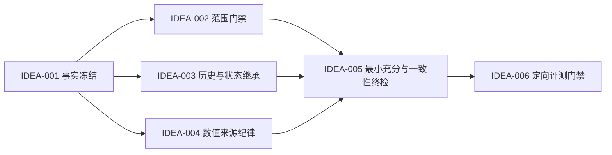

# /idea 需求池 - MyP-M-A v0.37

## 追踪信息

- 入口判断：`/idea`
- 产品：MyP-M-A
- 当前稳定版本：`v0.36.0 Stable（已同步远端）`
- 稳定基线 HEAD：`83e619c7ef7cd31cb782f142fa4b5ad65f01c115`
- 稳定运行时提交：`4bf426c4be8ed2781d660632870a7b2c089c6365`
- 需求池状态：IDEA-001～IDEA-006 已实现并通过最终独立验收；IDEA-007 保留后续验证
- 判断日期：2026-08-17
- 输入来源：v0.36 FR-007 对齐外部面板、独立 `/acceptance`、评测逐题证据和 v0.36 backlog
- 正式证据：`E:\codex\skill-evals\mypm-v036-external-benchmark-contract-aligned-20260817`
- 证据边界：12 条任务均为单次执行和单一评分器观察；关键事实冲突可用于缺陷治理，候选平均分不能外推为跨模型总体排名

## 总体判断

v0.37 的真实问题不是“PM 方法不够多”，而是 MyP-M-A 在追求完整交付时，偶尔改变已经明确的事实、范围、历史或状态。该问题已由 EB-08 和 EB-12 的 3 个关键违规直接证明，并在 EB-01、EB-02、EB-06、EB-10、EB-11 出现同方向的轻度表现。

- 这是真问题：**是**。错误会让详细 PRD 或交接提示词不可直接采用。
- 值得继续：**高价值**。事实保真是 `/prd`、`/acceptance` 和 `/prompt` 的承重合同。
- 现在该做：**是**。v0.36 已完成治理基础，v0.37 应先提高行为正确性，不继续扩张方法库。
- 压力测试：P0 项跳过数值评分。原因是已有明确反事实输出和关键违规，不需要用启发式总分再次证明；P1 项只以现有逐题证据决定是否纳入。
- 版本主线：**事实保真与最小充分交付**。
- 进入 `/prd`：IDEA-001～IDEA-006。
- 暂不做：更多能力卡、更多 PM 框架、全模型穷举回归和新的用户入口。

## 数据证据包

- 决策问题：为什么 MyP-M-A 在外部面板中的正确性低于代表候选，以及下一版本应修什么。
- 统计对象：FR-007 对齐后的 12 条任务，每个候选每题 1 份有效回答。
- 执行条件：`gpt-5.6-luna medium`，工具禁用；`gpt-5.6-sol medium` 单一匿名评分器。
- 数据新鲜度：2026-08-17。
- 有效性：36/36 回答有效，12/12 任务新鲜盲评；27 份语义等价运行按哈希继承，9 份重新执行。

| 候选 | 正确性合计 | 平均正确性 | 关键违规 |
| --- | ---: | ---: | ---: |
| MyP-M-A | 38/48 | 3.17 | 3 |
| phuryn | 45/48 | 3.75 | 2 |
| product-on-purpose | 39/48 | 3.25 | 4 |

关键发现：

1. MyP-M-A 与 product-on-purpose 只差 1 个正确性评分点，不能称为全面落后。
2. EB-08 为 1/4、EB-12 为 2/4，是平均正确性的主要拖累；移除两题后 MyP-M-A 为 35/40，介于 phuryn 的 37/40 与 product-on-purpose 的 33/40 之间。
3. MyP-M-A 在完整性、决策清晰度和可执行性上领先或并列领先，问题集中于“增加内容时越过事实边界”，不是无法分析复杂问题。
4. 单次面板不能证明跨模型稳定差异，但范围扩大和历史补造是可直接核对的反事实，不依赖统计显著性。

不能推出：

- 不能据此认定 MyP-M-A 整体弱于所有外部 PM Skill。
- 不能认定输出越短就越正确。
- 不能用修复 EB-08/12 代替完整稳定集、挑战集或真实项目验收。

## 证据映射

| 来源证据 | 对应需求 | 等级 | 说明 |
| --- | --- | --- | --- |
| EB-08 把“仅大于 5 万行异步”扩大为全部后台任务 | IDEA-001、IDEA-002 | 强 | 明确违反用户已确认范围，正确性 1/4 |
| EB-12 补造上一轮验收历史并改写待决策状态 | IDEA-001、IDEA-003 | 强 | 两个关键违规，正确性 2/4 |
| EB-01/02/06 输出启发式压力分或未确认阈值 | IDEA-004、IDEA-005 | 中 | 不全是事实错误，但增加伪精确和框架噪声 |
| EB-10 摘要称 3 项、正文列出更多偏差 | IDEA-005 | 强 | 文内可直接核对的一致性错误 |
| EB-11 重新打开已锁定候选身份并扩大补证 | IDEA-002、IDEA-005 | 中 | 降低最小充分交付和证据继承质量 |
| v0.36 正式面板与证据自检已可复用 | IDEA-006 | 强 | 可以低成本建立定向 A/B，不必重跑全部历史用例 |

## 需求总览

| ID | 标题 | 类型 | 证据等级 | 压力测试 | 分档结论 | 依赖 | 建议去向 |
| --- | --- | --- | --- | --- | --- | --- | --- |
| IDEA-001 | 建立显式事实冻结合同 | 运行时治理 | 强 | 跳过：真实关键失败 | 高价值 | 无 | v0.37 `/prd` |
| IDEA-002 | 增加范围变化门禁 | PRD/Review 治理 | 强 | 跳过：真实关键失败 | 高价值 | IDEA-001 | v0.37 `/prd` |
| IDEA-003 | 增加历史与状态逐字继承门禁 | Prompt/Acceptance 治理 | 强 | 跳过：真实关键失败 | 高价值 | IDEA-001 | v0.37 `/prd` |
| IDEA-004 | 收紧数值评分与阈值来源 | Idea/Strategy 治理 | 中 | 不重复评分 | 中高价值 | IDEA-001 | v0.37 `/prd` |
| IDEA-005 | 建立最小充分交付与文内一致性终检 | 全入口质量 | 强 | 不重复评分 | 高价值 | IDEA-001～004 | v0.37 `/prd` |
| IDEA-006 | 建立事实保真定向评测门禁 | 评测治理 | 强 | 跳过：已有评测基础 | 高价值 | IDEA-001～005 | v0.37 `/prd` |
| IDEA-007 | 同期扩充方法库或能力卡 | 能力扩展 | 弱 | 12/40 | 暂不做 | 无 | 后续真实缺口触发 |

## 依赖关系

## 三档范围方案

| 档位 | 内容 | 优点 | 风险 | 判断 |
| --- | --- | --- | --- | --- |
| 最小方案 | 只为 EB-08、EB-12 增加两条局部规则 | 改动小、验证快 | 不能覆盖数值、摘要和已锁定事实被重新打开的问题 | 不足 |
| 推荐方案 | 事实冻结、范围门禁、历史/状态继承、数值来源、最小充分终检和定向评测 | 修共同根因，同时保护完整性优势 | 需要控制规则重复和默认上下文 | 采用 |
| 过大方案 | 新增通用推理引擎、全入口重写、所有模型/强度全量回归 | 表面覆盖完整 | 上下文膨胀、成本高、难定位回退 | 不采用 |

## 需求详情

### IDEA-001 建立显式事实冻结合同

- 产品问题：现有流程要求区分事实、推断和未知，但没有在输出前锁定“不可改变的明确事实”。
- 最小合同：进入分析前提取明确范围、既有行为、状态、历史、版本、数值和待决策项；输出新增内容只能标为推断、建议或待确认。
- 非目标：不把事实冻结输出成冗长新章节；可以作为内部检查或一张最小事实表。
- 成功信号：EB-08/12 不再改写明确事实，普通任务不增加无意义复述。

### IDEA-002 增加范围变化门禁

- 产品问题：完整 PRD 倾向统一流程或补齐架构，可能把局部变更扩大为全量替换。
- 最小合同：任何新增、删除或扩大范围都必须与输入做差异比较；没有授权时保留既有路径，并把扩大方案写为候选而非需求事实。
- 覆盖入口：`/prd`、实现一致性 `/review`、发布 `/acceptance`。
- 成功信号：EB-08 保留 5 万行分流和既有同步体验。

### IDEA-003 增加历史与状态逐字继承门禁

- 产品问题：为了让下一阶段提示词完整，模型可能补造上一轮历史或把“待负责人决定”改写为新的选择。
- 最小合同：交接前建立 `来源事实 -> 输出位置 -> 是否逐字继承` 映射；不存在的历史保持“未提供”，待决策状态原样保留。
- 覆盖入口：`/prompt`、续测 `/acceptance`、开发承接和 Memory handoff。
- 成功信号：EB-12 不生成上一轮验收历史，不改写登录自启状态。

### IDEA-004 收紧数值评分与阈值来源

- 产品问题：内部压力测试量表可能被用户理解为业务事实，模型也可能在强证据场景中不必要地展开评分。
- 最小合同：仅在入口规则要求时使用启发式评分；明确标注“内部启发式”；业务继续/停止阈值必须来自用户、数据、正式文件或确认后的实验合同。
- 跳过条件：问题已被真实日志、反事实实现或验收证据明确证明时，直接治理，不重复用总分证明。
- 成功信号：EB-01/02/06 不再用无来源分数或阈值替代证据判断。

### IDEA-005 建立最小充分交付与文内一致性终检

- 产品问题：MyP-M-A 的完整性优势有时变成无关补证、重复表格和新的不一致。
- 最小合同：输出前检查每个新增章节是否改变决策、证据、授权或下一步；不改变则删除。摘要中的数量、状态和结论必须与正文机械一致。
- 保护项：正式 PRD 的影响范围、失败链路和开发前验收不能因“简洁”被删除。
- 成功信号：EB-10 计数一致，EB-11 不重新打开已锁定身份，重复度改善且完整性不回退。

### IDEA-006 建立事实保真定向评测门禁

- 冻结基线：v0.36 修正后的 12 条外部面板和现有内部合同。
- P0 稳定性：EB-08、EB-12 使用 Sol medium 各执行 3 次，所有回答必须保留明确范围、历史和状态，关键违规为 0。
- 跨模型抽检：EB-08、EB-12 使用 Luna medium 各执行 1 次，关键违规为 0。
- 相关用例：EB-01、02、06、10、11 单次定向验证，不得新增事实或范围违规。
- 保护性控制：EB-03、04、05、07、09 验证完整性、决策清晰度和可执行性不因压缩回退。
- 完整外部面板：上述门禁通过后，只为 v0.37 Candidate 新执行 12 条一次；v0.36 基线复用，不默认重跑多模型穷举面板。
- 内部回归：由合同映射生成发布面板；只有运行时合同影响扩大或控制项回退时才升级到更大范围。
- 报告：正确性、证据、清晰度、完整性、可执行性、重复度、字符、时长和有效返回率继续分开，不生成统一总分。

## 版本成功标准

1. EB-08、EB-12 的 P0 稳定性与跨模型抽检均无关键违规。
2. EB-01、02、06 不把启发式评分或未确认阈值写成业务事实。
3. EB-10 摘要数量与正文一致；EB-11 不重新打开已锁定事实。
4. EB-03、04、05、07、09 不出现关键回退，正式 PRD 和深度 Review 的完整性仍成立。
5. 不新增入口、能力卡或外部工具硬依赖；三张 v0.36 卡继续保持 `pilot`。
6. `SKILL.md` 不突破现有 5700 字符门禁，五入口默认正式装配不高于 v0.36；新增规则优先放入目标 reference 的单一事实源。
7. 完整稳定集与挑战集是否重跑由动态合同影响决定，不用总分掩盖关键失败。

## 停止与回退条件

- 为修复事实保真而删除影响范围、失败链路、验收或授权合同：停止并回退。
- 默认上下文超过 v0.36，且不能通过去重恢复：停止扩写。
- EB-08/12 任一关键违规仍可重复：不得晋升 Candidate。
- 规则只让输出机械复述全部输入、明显拉长普通任务：缩小为入口局部合同。
- 控制用例出现完整性或可执行性关键回退：回退对应批次，不用平均分抵消。

## 下一阶段建议

`/prd` 与开发承接已经完成，事实源为：

- `notes/v0.37-fact-fidelity-prd.md`
- `notes/dev_plan_v0.37.md`
- `notes/progress_v0.37.md`
- `notes/dev_log_v0.37.md`

M0～M5 的实现、两轮证据治理整改、受影响路由回归和最终独立 `/acceptance` 已完成；v0.37.0 当前为 Stable（本地待提交）。本需求池不自动授权提交、推送、tag 或 Release。
