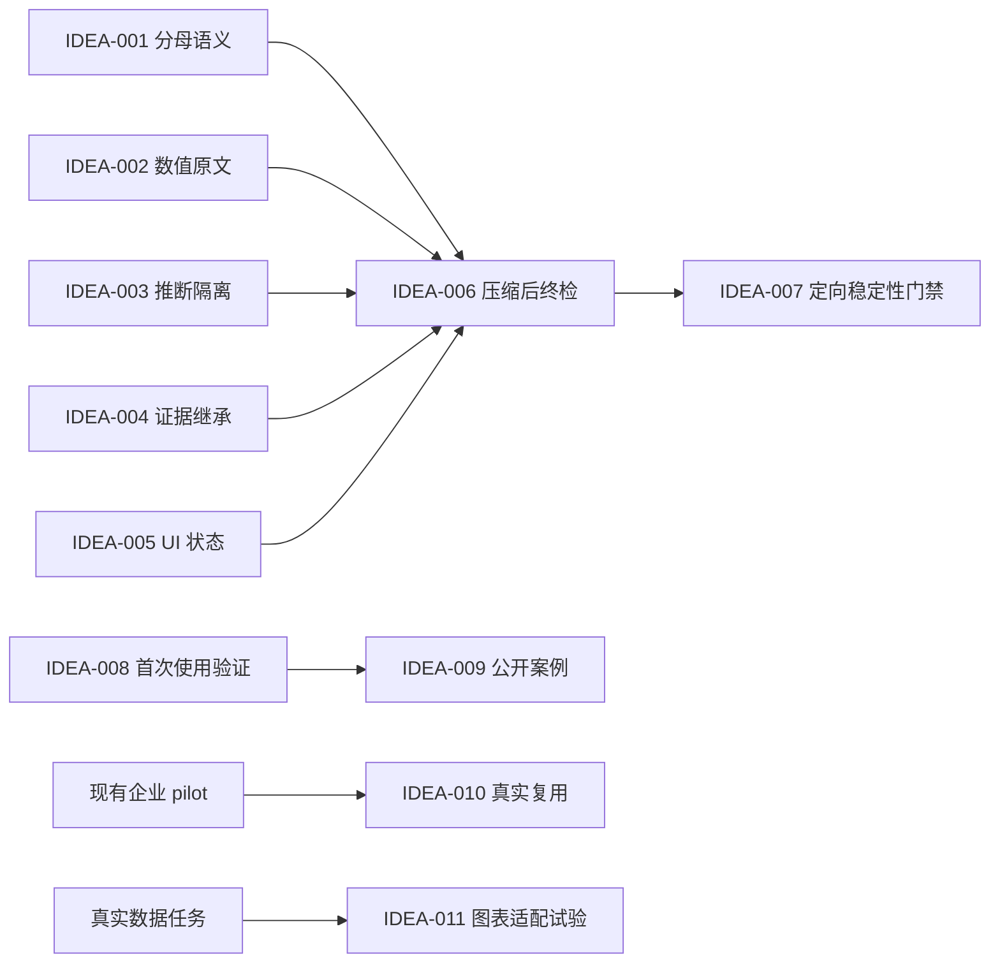

# MyP-M-A v0.39 需求池

## 追踪信息

- 当前状态：`/idea` 已完成；完整 PRD 草案已生成，等待确认
- 目标版本：v0.39
- 上游来源：`notes/pre-v0.39-product-comparison.md`
- 下游承接：`notes/v0.39-reliable-delivery-prd.md`
- 当前事实源：v0.38 四方同协议复测、EB-11 定向补测、现有 roadmap 与 backlog
- 最后更新：2026-08-18

## 总体判断

- 本次来源：v0.38 与 v0.37、phuryn/pm-skills、product-on-purpose/pm-skills 的 12 条冻结任务对比，以及历史版本路线复盘。
- 本版本主线：**事实终检与可靠交付**。先消除分母、数值、推断、证据继承和 UI 状态语义的可定位错误，再证明修复没有以恢复冗长输出为代价。
- 为什么现在做：v0.38 已把平均字符从 2182 降到 1919，精炼度从 7.3 提升到 8.3，但正确性从 9.0 降到 8.3；当前矛盾不是缺少新能力，而是压缩后事实保护仍不稳定。
- 直接进入 `/prd`：IDEA-001～IDEA-007；IDEA-008 作为发布前体验证据门禁；IDEA-011 作为按需加载的 Lieflat Charts 可视化适配试点。
- 现在直接做：冻结 v0.38 四方对比、失分归因和评测协议；不重跑无关完整历史面板。
- 继续验证：公开案例、企业只读适配器真实复用；Lieflat Charts 的决策增益仍需在 v0.39 试点中验证。
- 暂不做：Marketplace、跨平台安装、连接器大全、新入口、新 PM 框架、批量能力卡和教学模式。

## 证据映射

| 来源证据 | 对应候选需求 | 证据等级 | 说明 |
| --- | --- | --- | --- |
| EB-01 将统计口径压缩为可能误读的比率表达 | IDEA-001、IDEA-006 | 强 | 已定位到分母和统计对象保护不足 |
| EB-10 将 `5 万` 改写为 `50 万` | IDEA-002、IDEA-006 | 强 | 属于用户原始数值被静默改写 |
| EB-09 将架构关系直接写成事实 | IDEA-003、IDEA-006 | 强 | 应标记为推断并给核验动作 |
| EB-11 首次回答错误降低已通过的自动测试与迁移状态 | IDEA-004、IDEA-007 | 强 | 两次补测未复现关键错误，但结果仍有 4/4 与 3/4 波动 |
| EB-07 压缩后遗漏无变化行为并缩窄“保留值”语义 | IDEA-005、IDEA-006 | 强 | 属于交互合同在精炼过程中丢失 |
| v0.38 平均字符较 v0.37 减少约 12%，精炼度提高 1.0 | IDEA-006、IDEA-007 | 强 | 需要保护的已获得收益 |
| 当前公开案例为 0，安装和发现弱于外部产品 | IDEA-008、IDEA-009 | 中 | 结构证据明确，但尚无真实首次使用失败数据 |
| 企业适配器仍为 pilot，缺少真实重复使用 | IDEA-010 | 中 | 不能仅凭文档完整度晋升 |
| 用户明确要求 v0.39 接入 Lieflat Charts；该项目支持 Codex、输出交互 HTML，但采用 PolyForm Noncommercial 1.0.0 | IDEA-011 | 中 | 版本范围已确认；价值、许可适用性和真实决策增益仍需试点验证 |

## 数据证据包

- 决策问题：v0.39 应优先补产品化、企业连接，还是修复 v0.38 的事实正确性波动。
- 数据 / 来源：`E:\codex\skill-evals\mypm-v038-external-benchmark-20260818`；`notes/pre-v0.39-product-comparison.md`。
- 统计对象与粒度：12 条冻结任务，每个候选每题一次回答；Luna medium 执行、Sol medium 匿名评分；EB-11 另有两次同题补测。
- 时间范围与新鲜度：2026-08-18 新鲜复测；历史候选复用冻结回答并由同一评分器重新盲评。
- 数据质量与代表性：48/48 主面板回答有效；覆盖五入口的代表任务，但样本量小、只有一次主面板，不能推出长期胜率或统计显著性。
- 关键发现：v0.38 的证据纪律与完整性保持强势，输出更短；正确性净下降集中在 5 个可定位合同，不是全入口普遍退化。
- 反证 / 替代解释：EB-11 两次补测未复现关键错误，说明首轮结果可能包含模型波动；外部候选分数也不能代表真实项目长期表现。
- 不能推出的结论：不能称 v0.38 整体回退，也不能称任一外部 Skill 全面领先；不能据此证明 Marketplace、连接器或图表是下一版本必要能力。
- 对价值与时机的影响：正确性修复有直接证据、范围小且影响核心定位，应先做；产品化与企业扩张继续补真实使用证据。
- 最小补证或实验：对 EB-01/07/09/10/11 做同协议定向复测，再运行一次 12 条控制面板；另执行一次真实首次使用路径检查。

## 承重假设与最小实验

| 假设 ID | 承重主张 | 若何时失败 | 支持 / 反证 | 当前状态 | 最小实验 | 继续条件 | 停止 / 转向条件 |
| --- | --- | --- | --- | --- | --- | --- | --- |
| H-001 | 5 个失分点可由局部事实终检合同修复 | 修复必须重新扩写整套框架才能生效 | 失分均可定位到具体输入事实或状态 | 部分支持 | 每题 3 次定向复测 | 无关键事实违规，且控制题不回退 | 连续出现跨入口新回退，转为架构级治理 |
| H-002 | v0.38 的精炼收益可以保留 | 正确性恢复只能依靠明显增加正文 | v0.38 已证明可减少约 12% 字符 | 部分支持 | 比较同协议候选的字符与重复度 | 正确性恢复且输出成本无实质回退 | 正确性与精炼度持续互斥，优先正确性并缩小改动 |
| H-003 | 首次使用是当前产品化的主要缺口 | 真实使用者能无阻完成完整路径 | 竞品有成熟入口和案例，MyP-M-A 缺公开案例 | 未知 | 一次真实端到端任务观察 | 形成可复现摩擦清单 | 无关键摩擦则延后产品化版本 |
| H-004 | 企业适配器值得继续扩展 | 现有 pilot 无重复真实调用 | 当前只有治理合同和模拟证据 | 未知 | 1～2 个真实只读任务复用 | 同一适配器至少完成两次独立真实任务 | 无复用或维护成本过高则保持 pilot |

## 需求总览

本轮不生成缺少逐维量表映射的 40 分总分。IDEA-001～IDEA-007 有直接行为证据，使用证据闸门；其余候选按真实使用证据决定去向。

| ID | 标题 | 类型 | 证据等级 | 压力测试 | 置信度 | 分档结论 | 依赖关系 | 建议去向 | 最小下一步 |
| --- | --- | --- | --- | --- | --- | --- | --- | --- | --- |
| IDEA-001 | 统计对象与分母语义保护 | 正确性治理 | 强 | 跳过总分：有 EB-01 直接证据 | 高 | 高价值 | 无 | v0.39 `/prd` | 定义比率输出与终检合同 |
| IDEA-002 | 数值与实体原文一致性终检 | 正确性治理 | 强 | 跳过总分：有 EB-10 直接证据 | 高 | 高价值 | 无 | v0.39 `/prd` | 定义原值清单和差异阻断 |
| IDEA-003 | 事实、推断与待验证关系隔离 | 证据治理 | 强 | 跳过总分：有 EB-09 直接证据 | 高 | 高价值 | 无 | v0.39 `/prd` | 定义推断标记和核验出口 |
| IDEA-004 | 验收证据继承与新鲜度终检 | 验收治理 | 强 | 跳过总分：有 EB-11 直接证据 | 高 | 高价值 | 无 | v0.39 `/prd` | 固化逐项继承和失效规则 |
| IDEA-005 | UI 状态与退出链路最小充分合同 | PRD 治理 | 强 | 跳过总分：有 EB-07 直接证据 | 高 | 高价值 | 无 | v0.39 `/prd` | 固化保存、无变化、取消、关闭和保留值语义 |
| IDEA-006 | 压缩后事实一致性扫描 | 跨入口治理 | 强 | 跳过总分：由 5 个失分点共同支持 | 高 | 高价值 | IDEA-001～005 | v0.39 `/prd` | 设计最小扫描顺序，不重复加载框架 |
| IDEA-007 | 敏感任务定向稳定性门禁 | 评测治理 | 强 | 跳过总分：EB-11 有行为波动 | 高 | 高价值 | IDEA-001～006 | v0.39 `/prd` | 冻结敏感题、控制题和扩面条件 |
| IDEA-008 | 真实首次使用路径验证 | 产品化验证 | 中 | 证据闸门未关闭 | 中 | 待验证 | 无 | 纳入 v0.39 验收，不改运行时入口 | 执行一次真实端到端路径并记录摩擦 |
| IDEA-009 | 首个可公开完整案例 | 内容产品化 | 中 | 授权与隐私证据不足 | 中 | 待验证 | IDEA-008 | 延后 | 先确认案例授权或使用完全合成案例 |
| IDEA-010 | 企业只读适配器真实复用 | 企业能力验证 | 中 | 缺少重复真实调用 | 中 | 待验证 | 现有 pilot | 延后 | 完成两次独立真实只读任务 |
| IDEA-011 | Lieflat Charts 可选适配 | 可视化验证 | 中 | 范围已确认，效果闸门未关闭 | 中 | 小范围验证 | 真实数据任务、许可校验 | v0.39 pilot | 对同一数据做文本/表格与图表对照 |
| IDEA-012 | Marketplace、连接器和新命令扩张 | 范围扩张 | 弱 | 当前主线不匹配、成本高 | 高 | 暂不做 | IDEA-008～010 | 不进入 v0.39 | 保持 backlog，不实施 |

## 依赖关系

## 三档范围方案

| 档位 | 内容 | 适合阶段 | 风险 |
| --- | --- | --- | --- |
| 最小方案 | 只修 IDEA-001～005，并做 5 题定向复测 | 紧急正确性补丁 | 缺少统一终检和控制题，容易局部修复、跨入口复发 |
| 推荐方案 | IDEA-001～007 + IDEA-008 真实首次使用验收 + IDEA-011 可选图表 pilot | v0.39 | 事实治理仍是主线，图表层独立装配和回退 |
| 过大方案 | 推荐方案外加案例库、Marketplace、企业连接器和图表产品化 | 后续多个版本 | 主线混杂，证据不足，无法解释成败与回退 |

## 需求详情

### IDEA-001～IDEA-005 事实终检核心

- 产品问题：v0.38 在缩短输出时，偶发改变统计口径、用户数值、事实与推断边界、历史验收状态或 UI 行为语义。
- 目标用户 / 场景：使用 MyP-M-A 处理指标、Review、PRD 和 Acceptance 的产品经理及开发协作者。
- 当前替代方案：用户逐字人工比对输入与输出；成本高且容易遗漏。
- 证据盘点：EB-01、EB-07、EB-09、EB-10、EB-11 均有可定位失分。
- 价值判断：高。错误直接破坏 MyP-M-A 的“事实与交付治理”定位。
- 当前阶段：应进入 v0.39 `/prd`。
- 低分项：无真实长期失败率，不能把单次面板外推为普遍问题。
- 结论：继续，但必须局部修复，禁止重写全部入口。
- 最小下一步：为每类事实建立输入锚点、允许变化、阻断条件和输出终检，并映射到对应冻结任务。

### IDEA-006 压缩后事实一致性扫描

- 产品问题：单点规则可能分别修复失分，却继续在其他入口发生同类“更短但改了事实”的问题。
- 当前替代方案：每个入口重复加入长篇硬规则。
- 价值判断：高，但只能做轻量扫描，不得恢复到上下文膨胀路线。
- 承重假设：一个共享的最小终检顺序可以覆盖数字、状态、范围和推断，而不重复加载完整 reference。
- 结论：进入 v0.39 `/prd`。
- 最小下一步：定义“先冻结承重事实 -> 生成 -> 差异扫描 -> 只修冲突句”的最小合同及停止条件。

### IDEA-007 敏感任务定向稳定性门禁

- 产品问题：单次满分或单次关键错误都可能由模型波动造成，无法单独支持版本判断。
- 当前替代方案：每次运行耗时很长的全量多模型面板。
- 价值判断：高。它能用较低成本判断修复是否稳定，并避免无边界回归。
- 结论：进入 v0.39 `/prd`。
- 最小下一步：EB-01/07/09/10/11 各运行 3 次；EB-03/05/12 作为控制题。定向通过后只运行一次同协议 12 题面板。

### IDEA-008 真实首次使用路径验证

- 产品问题：MyP-M-A 的安装、发现、首次执行和跨线程续接是否真的阻碍使用，目前缺少直接证据。
- 当前替代方案：依据竞品目录和维护者体感推断。
- 价值判断：中。缺口可能真实，但不应抢占正确性修复主线。
- 压力测试：部分通过。产品化差距明确，真实使用影响未知。
- 结论：作为 v0.39 验收证据，不提前改入口或分发。
- 最小下一步：由真实使用者完成一次“发现 Skill -> 执行完整项目阶段 -> 恢复上下文 -> 生成下一任务”的路径，记录用时、卡点、误解和人工帮助。

### IDEA-011 Lieflat Charts 可选适配试点

- 产品问题：MyP-M-A 能形成数据判断，但缺少把已验证数据转换为可浏览、可复核图表的统一交付层。
- 用户决策：明确纳入 v0.39，但保持可选能力，不增加新入口或默认上下文。
- 外部事实：目标仓库为 `larashero3-dotcom/lieflat-charts`，支持 Codex 和单文件 HTML 图表/报告；许可证为 PolyForm Noncommercial 1.0.0，商业使用需另行授权。
- 价值判断：中。视觉交付能力明确，是否改善产品决策理解仍需对照验证。
- 压力测试：部分通过。适用场景与交付物清楚；本地尚未安装，真实数据保真、浏览器兼容和许可边界尚未验证。
- 结论：进入 v0.39 pilot，不复制外部模板，不成为硬依赖。
- 最小下一步：锁定来源 commit 和许可证；用一份允许使用的数据分别输出文本/表格与 Lieflat 图表，复核数值、单位、来源、交互、桌面/窄屏和离线限制；结果回写 PRD、评测历史和能力注册表。

### IDEA-009、IDEA-010、IDEA-012 后续候选

- 产品问题：案例、企业连接和分发都可能改善产品化，但当前证据不足或范围过大。
- 价值判断：存在潜力，不适合与正确性主线同版实施。
- 结论：IDEA-009、IDEA-010 继续验证；IDEA-012 暂不做。
- 最小下一步：只完成各自表格中的低成本证据动作，不改运行时。

## v0.39 建议门禁

以下为进入 `/prd` 后需要正式确认的门禁方向，不在 `/idea` 阶段擅自固定新的业务阈值：

1. EB-01/07/09/10/11 每题 3 次有效样本，不出现关键事实违规。
2. EB-03/05/12 控制题不得出现新的关键违规或已满足合同丢失。
3. 定向通过后运行一次 12 题同协议面板；正确性不得低于 v0.37 的同协议基线，精炼度不得低于 v0.38 的同协议基线。
4. 平均字符相对 v0.38 增幅不超过 5% 最初列为 `N4 建议阈值`；后续用户将其调整为非阻塞观察项，正式文档不设置通用字符上限。
5. 完成一次真实首次使用路径并保留观察记录；未发现问题时不得为了“产品化”强行增加入口、案例或安装能力。
6. 不新增入口、PM 框架、批量能力卡或外部工具硬依赖；仅允许新增 IDEA-011 对应的一张 `pilot` 能力卡，v0.38 保持可回退基线。
7. Lieflat Charts 只登记为 `pilot` 可选能力：来源 commit、许可证、数据契约、浏览器证据和不可用降级全部可追溯；商业任务没有单独许可时不得调用或分发其产物模板。

## 下一阶段建议

- 推荐下一步：进入 `/prd`，采用“推荐方案”，正式定义 IDEA-001～IDEA-008、IDEA-011 的范围、合同、影响文件、评测门禁与回退点。
- 需要准备的材料：本需求池、`notes/pre-v0.39-product-comparison.md`、四方 benchmark、现有 `references/idea.md`、`references/prd.md`、`references/review.md`、`references/acceptance.md`。
- 停止条件：若 PRD 无法用局部合同覆盖 5 个失分点，或必须显著扩张所有入口上下文，应退回重新拆分版本，而不是直接实施。
