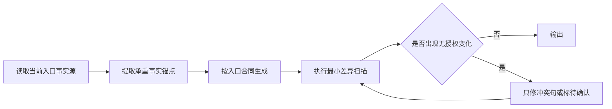

# MyP-M-A v0.39 事实终检与可靠交付 PRD

## 追踪信息

- 当前状态：完整 PRD 已确认，进入实施
- 目标版本：v0.39
- 上游来源：IDEA-001～IDEA-008、IDEA-011，`notes/v0.39-idea-pool.md`
- 下游承接：确认后生成 `notes/dev_plan_v0.39.md`、`notes/progress_v0.39.md`、`notes/dev_log_v0.39.md`
- 当前事实源：`notes/pre-v0.39-product-comparison.md`、v0.38 四方同协议复测及现有运行时/评测合同
- 稳定回退：v0.38.0 Stable 本地候选；实施前必须固化为不可变 commit 或等价快照
- 最后更新：2026-08-18

## 需求状态

- 入口判断：`/prd`
- PRD 类型：正式推进型内部治理 PRD
- 当前阶段：完整需求定义，尚未进入开发承接
- 需求来源：v0.38 外部同协议复测中的 5 个可定位失分，以及既有产品化路线复盘
- 证据基础：12 条冻结任务四方比较、48/48 有效回答、EB-11 两次定向补测、严格静态校验
- 当前假设：局部事实终检合同可以恢复正确性，同时保留 v0.38 的精炼收益
- 待确认问题：无；用户已确认本 PRD 和 Lieflat Charts pilot，后续已将 N4 输出成本门禁调整为非阻塞观察项
- 是否达到完整 PRD 内容门禁：是
- 进入开发授权：已获得；用户要求推进实现直至验收

## 已确认事实与范围变化

### 已确认事实

1. v0.38 与 v0.37 使用相同的 12 条冻结任务比较；v0.38 平均字符 `1919`，v0.37 为 `2182`。
2. v0.38 的正确性均值为 `3.33/4`，v0.37 为 `3.58/4`；v0.38 精炼度为 `3.33/4`，v0.37 为 `2.92/4`。
3. v0.38 的失分集中于 EB-01、EB-07、EB-09、EB-10、EB-11，分别对应统计语义、UI 状态语义、推断标记、数值原文和验收证据继承。
4. EB-11 首次出现关键错误；两次补测分别为正确性 `4/4`、`3/4`，关键错误均为 0，因此属于需治理的波动，不是已证实的稳定全面回退。
5. 当前 `SKILL.md` 严格校验结果为 `5688/5700` 字符；v0.39 不具备继续叠加默认上下文的空间。
6. v0.38 当前为本地未提交工作树，远端可定位回退仍为 v0.36；v0.39 实施前需要先形成不可变 v0.38 基线。
7. 用户已明确要求将 Lieflat Charts 图表能力加入 v0.39；本机当前未安装该 Skill。
8. Lieflat Charts 官方仓库支持 Codex 和交互式 HTML 图表/报告，采用 PolyForm Noncommercial 1.0.0，商业使用需要另行许可。

### 与上游需求池的差异

| 上游项 | 本 PRD 处理 | 变化类型 | 说明 |
| --- | --- | --- | --- |
| IDEA-001～IDEA-007 | 全部纳入 | preserve | 作为 v0.39 运行时和评测主线 |
| IDEA-008 | 纳入验收，不改运行时 | preserve | 只产生真实首次使用观察记录 |
| IDEA-011 | 从延后改为 v0.39 pilot | transition | 用户明确决定纳入；仍保持可选、独立验证和独立回退 |
| IDEA-009、IDEA-010 | 延后 | preserve | 证据不足，不与正确性主线混做 |
| IDEA-012 | 不做 | preserve | 不新增 Marketplace、连接器或命令扩张 |

本轮未扩大既有范围。

## 方案收敛

### 方案比较

| 方案 | 内容 | 用户价值 | 成本 | 风险 | 验证方式 |
| --- | --- | --- | --- | --- | --- |
| A. 单题补丁 | 只在 5 个失分入口追加对应句子 | 见效快 | 低 | 重复规则、跨入口复发、上下文增长 | 5 题定向复测 |
| B. 事实锚点 + 局部合同 + 终检 + 图表 pilot | 复用现有事实合同，补齐 5 类不变量；图表能力独立按需装配 | 高；兼顾可靠交付和可视化 | 中 | 终检过度或图表误导 | 静态反例、定向多次、控制题、一次全板、图表对照 |
| C. 产品化综合版本 | 同时做案例、安装、企业连接和图表产品化 | 方向多 | 高 | 无法归因，主线失焦 | 需要多类真实使用证据 |

- 推荐方案：B。
- 推荐理由：5 个问题共享“压缩后承重事实发生无授权变化”这一根因，但具体入口语义不同；共享终检负责发现差异，入口 reference 负责解释合法行为。
- 当前版本目标：在同协议下恢复 v0.37 的正确性基线，同时守住证据纪律与完整性；精炼度和成本只作独立观察，不得反向削弱正式交付物。
- 优先级策略：事实错误和状态误判为 P0；评测稳定性与首次使用证据为 P1；产品化扩张为 P2/P3。
- 最小方案：IDEA-001～005 + 5 题定向复测。
- 本次范围：IDEA-001～008、IDEA-011。
- 延后项：公开案例、企业适配器晋升、Lieflat Charts 商业化或默认装配。
- 不做项：新入口、新 PM 框架、批量能力卡、Marketplace、连接器大全、跨平台安装。

### 优先级表

| 需求 | 优先级 | 进入版本 | 理由 | 证据 | 成本 | 风险 |
| --- | --- | --- | --- | --- | --- | --- |
| FR-001～FR-006 事实终检 | P0 | v0.39 | 影响产品可信度和发布判断 | EB-01/07/09/10/11 | 中 | 规则重复或过度扩写 |
| FR-007 定向稳定性门禁 | P0 | v0.39 | 防止单次偶然结果放行 | EB-11 波动 | 中 | 评测成本 |
| FR-008 控制与扩面策略 | P1 | v0.39 | 保护未受影响入口 | v0.38 基线 | 中 | 过度回归 |
| FR-009 首次使用验证 | P1 | v0.39 验收 | 补产品化直接证据 | 产品对比 | 低 | 单人观察代表性有限 |
| FR-010 状态与回退治理 | P0 | v0.39 | 当前基线未提交 | Git 状态 | 低 | 版本事实混乱 |
| FR-011 Lieflat Charts 可选适配 | P1 | v0.39 pilot | 用户明确要求，补可视化交付层 | 用户决策 + 官方仓库 | 中 | 许可、数据失真、HTML 兼容 |

## 承重假设与决策门禁

| 假设 ID | 当前证据 | 最小实验 | 继续条件 | 停止 / 转向条件 | 阻塞阶段 | 回写位置 |
| --- | --- | --- | --- | --- | --- | --- |
| H-001 局部合同足以修复 | 5 个失分均可定位 | 5 题各 3 次 | 15/15 无关键事实违规 | 出现跨入口新回退或需重写全部 reference | 扩面评测 | `progress_v0.39.md` |
| H-002 非必要重复可控制 | v0.38 字符和精炼度改善 | 同协议字符、重复度复核 | 没有恢复重复框架 | 压缩开始删除承重事实或必要链路 | 观察 | `evaluation-history.md` |
| H-003 首次使用是实质缺口 | 竞品产品化更成熟 | 一次真实端到端操作 | 得到可复现摩擦或确认无阻塞 | 只有主观美观偏好、没有路径阻塞 | 后续产品化立项 | `notes/pre-v0.40-*.md` 或 backlog |
| H-004 图表改善决策理解 | Lieflat 有明确图表与报告交付能力 | 同一数据的文本/表格与图表对照 | 数据保真，至少一个预设决策问题更易核验 | 只改善美观、引入误读或许可不可用 | pilot 保留/晋升 | `notes/v0.39-chart-pilot.md` |

## 背景与问题

v0.38 通过去重和最小行动合同减少了冗长输出，但生成结果仍可能在压缩过程中改变承重事实。现有 reference 分别要求保留分母、数值、证据状态和事实/推断边界，却缺少一个明确的“生成后只检查承重差异”的统一出口；模型有时会为了让表达更顺，重新解释原值、状态或交互含义。

v0.39 不继续增加方法或工具，而是把这些分散规则变成可检查的不变量，并用较小的定向面板证明修复稳定。产品化问题只做一次真实路径取证，不提前建设。

## 目标

1. 用户提供的数值、单位、实体、范围条件和状态不会被静默改写。
2. 比率表达不会混淆事件、任务、用户和最终失败对象。
3. 架构或因果关系缺少直接证据时明确标为推断或待验证。
4. Acceptance 只按同一对象的新证据和失效规则迁移状态，不无依据升级或降级。
5. UI PRD 在保持精炼时仍覆盖原输入要求的状态、退出与值保留语义。
6. 正确性恢复不以显著增加重复文本、默认上下文或无关门禁为代价。
7. 用一次真实首次使用路径决定后续是否进入产品化版本。
8. 在不改变数据结论和五入口默认负载的前提下，提供可选的 Lieflat Charts HTML 图表交付。

## 用户场景

- 目标用户：使用 MyP-M-A 处理真实项目的产品经理、个人开发者和协作者；维护者负责版本评测与发布。
- 触发场景：输入包含统计数据、明确数值/条件、项目关系、UI 状态或历史验收证据时。
- 前置条件：目标入口已识别，相关 reference 已按渐进加载规则读取。
- 当前替代方案：用户人工逐字比对输入、上游文档和输出。
- 成功标准：输出可直接用于下一阶段，且承重事实没有未授权变化；发现冲突时明确停下而不是补造解释。

## 范围

### 本次包含

- 五类事实不变量：统计语义、数值/实体、事实/推断、证据状态、UI 行为语义。
- 一个跨入口的轻量终检顺序。
- 对应 stable/challenge fixture、合同映射和自测脚本。
- 5 个敏感任务的三次定向复测、3 个控制任务和一次 12 题候选面板。
- 一次真实首次使用路径检查与观察记录。
- 一张 `pilot` 图表能力卡、按需路由合同，以及一次真实或授权合成数据的图表对照验证。
- v0.38 基线固化、v0.39 Candidate/Stable 状态与回退治理。

### 本次不包含

- 新增 slash command、PM 方法或外部工具硬依赖；本版仅新增一张按需加载的图表能力卡。
- 修改外部 benchmark 的任务语义、fixture 或评分维度来提高候选得分。
- 重跑外部候选、全部历史版本、全部模型或全部强度。
- 自动改写用户输入、源文档或历史证据来“纠正”冲突。

### 延后项

- 公开案例和 Marketplace。
- 企业适配器从 pilot 晋升。
- Lieflat Charts 默认装配、商业模板分发、团队协作和持续事实源产品化。

## 事实终检流程

### 承重事实锚点

| 类别 | 必须保留 | 允许变化 | 冲突处理 |
| --- | --- | --- | --- |
| 对象与范围 | 产品、版本、角色、条件、互补区间、排除项 | 结构重排、简写 | 原样恢复或列范围冲突 |
| 数值与单位 | 数字、比较符、币种、百分比、时间、路径、ID | 仅可增加可复算结果并标 N2 | 原值不一致即阻断结论 |
| 证据与状态 | 对象、来源、时间、新鲜度、原状态、失效条件 | 同一对象有新证据时迁移 | 保留历史并标失效/待确认 |
| 关系与因果 | 直接证据、用户明确关系 | 可提出推断 | 必须标“推断”及核验动作 |
| UI 行为 | 入口、动作、状态、值语义、保存/取消/关闭、反馈 | 可合并同义步骤 | 不得删除原输入点名行为 |

## 功能需求

### FR-001 事实锚点最小集合

- 对应需求：IDEA-001～IDEA-006。
- 需求类型：运行时治理。
- 入口：五入口完成最小材料读取后、开始组织输出前。
- 前置条件：仅提取当前决策会用到的承重事实，不复制整个输入。
- 主流程：识别对象/范围、数字/单位、证据/状态、关系、UI 行为五类锚点；不存在的类别跳过。
- 分支：来源间冲突时同时保留双方、来源和待决责任人，不自行选边。
- 异常：材料不可读或对象不明时写“待确认”，不得生成替代事实。
- 出口：形成生成时必须继承的最小事实集合；不要求向用户展示内部清单。
- 状态变化：无持久业务状态变化。
- 影响范围：`SKILL.md` 只允许压缩替换现有终检描述，不增加新的默认加载文件。

### FR-002 统计对象与分母语义保护

- 对应需求：IDEA-001。
- 需求类型：`/idea` 数据判断治理。
- 入口：输出计数、比率、失败率、转化率或“多数/占比”结论时。
- 主流程：锁定统计对象、粒度、分子、分母、去重、时间窗和适用范围；事件数不得直接除以任务数后称为任务失败率。
- 分支：可复算但名称可能误导时，使用“每任务事件数”等准确名称并写 N2 公式。
- 异常：分母或时间窗缺失时只输出原始计数和补证动作，不输出比率。
- 出口：结论只引用已命名指标，不在后文用自然语言改写成另一统计对象。
- 影响范围：`references/idea.md`；复用 `idea-core-output`，必要时新增 `idea-ratio-semantic-preservation` 合同。

### FR-003 数值、单位与实体原文一致性

- 对应需求：IDEA-002。
- 需求类型：跨入口事实治理。
- 入口：输入包含数值、单位、比较符、版本、路径、ID、哈希、枚举或明确实体名时。
- 主流程：输出前逐项检查原值是否仍出现且语义一致；派生值必须可复算并与原值分开。
- 分支：格式可规范化，但不能改变数量级、比较符、币种、时区或适用对象。
- 异常：来源之间不一致时列冲突，不替用户选择“更合理”的数值。
- 出口：无冲突则输出；有冲突则限制相关结论并给核验入口。
- 影响范围：`SKILL.md`、`references/review.md`、`references/prd.md`、`references/prompt.md`；新增共享合同 `fact-anchor-terminal-scan`。

### FR-004 事实、推断和待验证关系隔离

- 对应需求：IDEA-003。
- 需求类型：`/review` 证据治理。
- 入口：输出模块关系图、因果链、依赖、所有权或风险根因时。
- 主流程：直接来源支持的边标事实；结构合理但未证实的边标推断；缺材料的关系标待验证。
- 分支：同一图中允许三种状态并存，图后只解释会改变判断的关系。
- 异常：不能为了画出完整架构图补造接口、依赖或调用方向。
- 出口：每个承重推断带最小核验动作或来源路径。
- 影响范围：`references/review.md`；扩展 `review-finding-evidence-source`，不新建重复方法库。

### FR-005 验收证据继承与状态迁移不变量

- 对应需求：IDEA-004。
- 需求类型：`/acceptance` 状态治理。
- 入口：续测、候选包验收或发布判断读取历史结果时。
- 主流程：按验收项记录对象、原状态、证据、时间/新鲜度、失效条件、当前影响；只有同一对象的新证据或责任人决定允许迁移。
- 分支：相关变化只失效受影响证据；未受影响的自动化、迁移、文档或人工证据继续继承。
- 异常：对象不明的“权限变化”等原词保留并标待确认；不得擅自解释成具体 ACL、角色或租户权限。
- 出口：汇总继承通过、新测通过、证据失效、待补证和阻塞；不得无依据降低已通过项。
- 影响范围：`references/acceptance.md`、必要时 `references/workflow-control.md`；复用 `acceptance-explicit-inheritance` 和 `acceptance-artifact-evidence-freshness`。

### FR-006 UI 状态与退出链路最小充分合同

- 对应需求：IDEA-005。
- 需求类型：`/prd` UI 合同治理。
- 入口：用户要求完整 UI PRD 或点名设置、弹窗、表单、Wizard 等交互对象时。
- 主流程：先从输入提取点名控件和行为，再覆盖正常、空、错、禁用、加载、保存成功、保存失败、无变化、取消、关闭、键盘及窄屏。
- 分支：原文“保留值”没有限定为已保存值时，不得自行缩窄；应明确分别讨论当前输入、已保存值和默认值。
- 异常：未知业务规则保留待确认，不用通用 UI 惯例冒充已决定行为。
- 出口：高保真原型门禁和验收条目逐项覆盖输入要求；未关闭时不得进入开发承接。
- 影响范围：`references/prd.md`、`templates/prd-template.md`；新增 `prd-ui-state-semantics` 合同。

### FR-007 压缩后事实一致性扫描

- 对应需求：IDEA-006。
- 需求类型：跨入口输出治理。
- 入口：答案完成、发送前。
- 主流程：按“范围 -> 数值 -> 状态 -> 推断 -> 用户点名行为”顺序检查；只修冲突句，不补写完整框架。
- 分支：短答案同样执行；没有对应事实类型时跳过。
- 异常：修复导致重复时，保留一次事实和一次行动引用，不多建表。
- 出口：承重事实一致且输出仍符合 `single-source-output`。
- 影响范围：`SKILL.md`、五入口 reference 的局部句子；不得新增默认 reference。

### FR-008 定向评测、控制项与扩面

- 对应需求：IDEA-007。
- 需求类型：评测治理。
- 入口：FR-001～FR-007 完成静态自测后。
- 主流程：
  1. EB-01/07/09/10/11 各执行 3 次，共 15 个候选样本。
  2. EB-03/05/12 各执行 1 次作为控制样本。
  3. 定向门禁通过后，运行一次 EB-01～12 同协议候选面板。
  4. 复用冻结 v0.37、v0.38 和外部候选证据，不重跑外部候选。
- 模型协议：默认沿用 `gpt-5.6-luna medium` 执行、`gpt-5.6-sol medium` 匿名评分；无效返回才重试。
- 扩面条件：定向结果方向矛盾、控制题关键回退或完整面板出现新关键错误时，只补跑受影响题；不自动启动全模型/全强度回归。
- 出口：分开报告正确性、证据纪律、决策清晰度、完整性、可执行性、精炼度、字符、时长、有效率和关键错误，不生成统一总分。
- 影响范围：评测 JSON、合同注册表、release panel、自测脚本和仓库外证据目录。

### FR-009 真实首次使用路径检查

- 对应需求：IDEA-008。
- 需求类型：产品化验证，不是运行时功能。
- 执行者：维护者或一名未参与本轮规则编写的真实使用者。
- 测试路径：从 README 找到入口 -> 在新任务中执行一个完整项目阶段 -> 根据结果进入下一阶段 -> 新任务恢复上下文 -> 生成下一任务提示词。
- 记录内容：每一步输入、可见入口、完成结果、卡点、误解、人工帮助、实际产物和停止原因。
- 证据边界：一次操作只能发现可复现摩擦，不能推出用户完成率、市场需求或普遍可用性。
- 出口：形成真实观察记录；问题进入后续 `/idea`，不在 v0.39 临时扩功能。
- 影响范围：新增 `notes/v0.39-first-use-observation.md`；不修改入口数量。

### FR-010 版本身份、状态与回退

- 对应需求：版本治理。
- 入口：进入 v0.39 实施前及每个批次结束后。
- 主流程：先将 v0.38 全部已验收文件固化为独立 commit 或只读候选快照；记录 HEAD、dirty、文件清单和评测证据路径。
- 分支：若 v0.38 尚未完成提交授权，只能生成开发承接文档，不能修改运行时。
- 回退：每个批次按文件组独立撤回；任何关键事实违规保持 v0.38 Stable，不晋升 v0.39。
- 出口：Candidate 只有在完整 Acceptance 通过后才能改写为 Stable；commit、push、tag、Release 分别等待授权。

### FR-011 Lieflat Charts 可选可视化适配

- 对应需求：IDEA-011。
- 需求类型：可选能力卡 / 外部 Skill 适配 / HTML 图表交付。
- 能力 ID：`visualization.decision-chart-adapter`，初始状态为 `pilot`。
- 适用入口：`/idea`、`/review`、`/acceptance`；只在结构化数据已经通过口径和质量检查，且图表能够回答明确决策问题时加载。
- 反触发：没有原始数据或统计口径、只为装饰、输出环境不能安全打开 HTML、商业任务没有 Lieflat 单独许可、当前结论用表格即可清楚表达。
- 外部来源：[`larashero3-dotcom/lieflat-charts`](https://github.com/larashero3-dotcom/lieflat-charts)；实施时锁定实际 commit、目录完整性和许可证原文。
- 许可合同：不得把外部模板、脚本或视觉 token 复制进 MyP-M-A；PolyForm Noncommercial 1.0.0 只允许符合其条款的使用。商业场景未获得单独许可时停止调用 Lieflat，降级为本地表格、Mermaid 或用户已有可商用图表能力。
- 输入合同：决策问题、源数据路径与 SHA-256、字段/粒度、分母与时间窗、单位、允许公开范围、目标读者、输出目录和许可用途。
- 主流程：
  1. 先由 MyP-M-A 锁定数据口径、可支持结论与不可外推边界。
  2. 探测 Lieflat 是否安装、可读取、来源 commit 与许可证是否匹配。
  3. 每张图只承载一个独立结论；只从当前锁定版本中已验证可用的图表类型与视觉风格中选择，没有合适图型时保留表格，不自行杜撰模板或风格名。
  4. 生成 HTML 后复核每个编码字段、标签、单位、来源、排序、聚合和交互。
  5. 用真实浏览器验证桌面与窄屏、控制台、资源加载、交互和截图。
  6. 图表只作为证据表达物返回当前入口；不得自行改变 MyP-M-A 的结论、状态或门禁。
- 试点数据：使用 `E:\codex\skill-evals\mypm-v038-external-benchmark-20260818\benchmark.json`。六个质量维度、平均字符、有效率和关键错误分开表达，禁止生成统一总分或双轴混合暗示。
- 试点输出：仓库外 `E:\codex\skill-evals\mypm-v039-chart-pilot-YYYYMMDD\`，至少包含 HTML、桌面/窄屏截图、数据/工具 manifest 和验证报告。
- 不可用降级：保留原分析和表格，明确“Lieflat 未调用”及原因；不得声称已生成图表。
- 出口：能力卡、路由合同和试点证据齐全后保持 `pilot`；是否晋升 `active` 留给后续真实重复使用，不由单次美观评价决定。
- 影响范围：`capabilities/registry.json`、`capabilities/README.md`、新增 `capabilities/visualization/decision-chart-adapter.md`、新增 `references/chart-delivery.md`、`references/capability-routing.md`、`references/tooling.md`、v0.39 eval/fixture/self-test。

## 影响范围

### 运行时文件

| 文件 | 预期变化 | 范围保护 |
| --- | --- | --- |
| `SKILL.md` | 压缩替换现有终检描述，加入事实锚点扫描入口 | 保持 `<= 5700` 字符，不新增默认加载依赖 |
| `references/idea.md` | 明确跨对象比率命名与后文引用不改语义 | 不扩充数据分析方法 |
| `references/review.md` | 强化关系图事实/推断/待验证标记 | 不增加新的 Review 通路 |
| `references/prd.md` | 补齐 UI 值语义、无变化和输入点名行为保护 | 不改变现有高保真五行门禁 |
| `templates/prd-template.md` | 让 UI 状态和值语义在正式 PRD 中有可检查位置 | 非 UI PRD 不被迫填充无关 UI 字段 |
| `references/acceptance.md` | 明确不得无依据降级有效证据 | 不降低产物身份和真实证据要求 |
| `references/prompt.md` | 交接前检查数字、状态和范围原样继承 | 保持 L1/L2/L3 长度合同 |
| `references/workflow-control.md` | 仅在状态迁移公共语义确需时修改 | 优先复用现有定义，避免重复 |
| `references/capability-routing.md` | 增加决策型图表的触发、反触发和结果回收 | 不把图表制作变成五入口默认步骤 |
| `references/tooling.md` | 增加 Lieflat 的 installed/callable/succeeded 与许可探测 | 不把“仓库存在”写成“当前可用” |
| `references/chart-delivery.md` | 新增按需图表数据契约、保真、浏览器和降级规则 | 不复制 Lieflat 的模板、目录或设计正文 |

### 评测与校验文件

- `evals/evals.json`：建议新增 stable eval 97～101，分别覆盖五类事实不变量；新增 stable eval 102，覆盖图表按需触发、输入合同和数据保真。
- `evals/challenge-evals.json`：建议新增 CH-29～CH-33，覆盖跨分母、数量级、推断边、状态误迁移和 UI 值语义反例；新增 CH-34，覆盖未安装、来源不符、许可不适用、错误聚合和安全降级。
- `evals/contract-registry.json`：优先扩展现有合同；只新增 `fact-anchor-terminal-scan`、`prd-ui-state-semantics` 等确有独立所有权的合同。
- `evals/release-panel.json`：把新增关键合同映射到固定核心或本版差量，不手填与合同无关用例。
- `evals/external-candidates.json`：增加 v0.39 候选身份和运行时快照。
- `evals/external-benchmark.json`：只增加 v0.39 candidate context；不得修改 12 条任务语义和 fixture。
- `evals/files/v039-*.md`：新增合成正反 fixture，不使用真实私有项目材料。
- `capabilities/registry.json`、`capabilities/README.md`：登记一张 `visualization.decision-chart-adapter` pilot 卡。
- `capabilities/visualization/decision-chart-adapter.md`：只保存触发、输入输出、证据、许可、工具降级和 eval 映射。
- `scripts/test-v039-reliable-delivery.ps1`：新增本版静态、自测和反例检查。
- `scripts/validate-skill.ps1`、`scripts/validation/rules.json`：注册新自测；只有通用检查确实需要时才改 validator 模块。

### 其他影响

- 前端 / UI：不涉及产品界面；只影响 UI PRD 的文字合同。
- 后端 / API：不涉及。
- 数据库：不涉及。
- 配置与环境：不新增配置；评测模型和证据根目录沿用现有工具约定。
- 日志与指标：不新增运行日志；评测报告记录样本身份、分维结果、字符、时长、有效率和关键错误。
- 权限与安全：不新增外部写入；仓库外评测证据不得混入凭据或私有项目内容。
- 文件与存储：新增本版 note、fixture、自测和仓库外评测目录。
- 第三方依赖：Lieflat Charts 是可选外部 Skill，不复制、不默认安装、不成为运行时硬依赖；实施时锁定 commit 与 PolyForm Noncommercial 1.0.0 许可证。若试点 HTML 实际引用 Chart.js、Apache ECharts、Inter 或其他资源，必须在 manifest 中登记来源、加载方式、许可证与离线限制；这些资源不并入 MyP-M-A 仓库或默认分发。
- 既有体验保护：五入口、中文优先、渐进加载、Memory 边界、外部写授权和 v0.38 企业 pilot 状态保持不变。
- 测试与验收影响：新增定向稳定性门禁；不要求重跑全部历史模型组合。

## 需求表达物

- 需求类型：工程治理 / 状态与证据合同 / 评测治理。
- 表达模式：事实锚点矩阵、终检流程图、证据迁移决策表和评测影响矩阵。
- 要回答的决策问题：如何在不恢复冗长输出的前提下，阻止模型静默改变承重事实。
- 待验证假设：H-001～H-004。
- 模拟边界：stable/challenge fixture 和 Agent 评分只证明指定合同；首次使用必须由真实使用者操作；Lieflat 单次试点只证明数据保真和交付可用，不证明普遍决策增益。
- 结论回写方式：静态结果写 progress/dev log；行为结果写 evaluation history；首次使用结果写独立 observation；图表试点写 `notes/v0.39-chart-pilot.md`；最终状态由 Acceptance 回写 README/CHANGELOG/roadmap/backlog。
- 文件路径：本 PRD、后续 `dev_plan_v0.39.md`、`progress_v0.39.md`、`dev_log_v0.39.md`。
- 原型交付：产品界面原型不适用。本需求不新增或修改产品 UI；FR-011 生成的 HTML 是数据证据表达物，不是产品高保真原型，必须按图表交付合同独立验收。

## 领域词汇与关键决策

| 术语 | 定义 |
| --- | --- |
| 承重事实 | 改变后会影响结论、范围、状态、权限、风险、验收或下一步的输入事实 |
| 事实锚点 | 当前入口生成前需要原样继承的最小承重事实集合 |
| 无授权变化 | 没有同一对象新证据、用户决定或明确计算依据，却改变事实语义 |
| 合法派生 | 有来源、公式、对象、单位和边界的 N2 计算或明确标注的推断 |
| 终检 | 发送前只比较承重事实差异的轻量扫描，不重新生成全文 |
| 关键事实违规 | 改变数值/范围/状态/证据或把推断写成事实，足以改变决策或发布判断 |

关键决策：

1. 不建立新的“全局事实数据库”或默认文件；事实锚点只存在于当前任务上下文。
2. 不通过重复原文保护正确性；同一事实仍只完整出现一次。
3. 不修改外部 benchmark 任务来适配 v0.39；候选必须适配冻结合同。
4. 单次关键错误和单次满分都不直接决定版本，敏感题使用三次样本。
5. 正确性、证据纪律和完整性是硬门禁；字符、时长和重复度只作观察，不能抵消硬门禁，也不能驱动删除承重内容。

## 数据与配置

- 数据来源：冻结 benchmark JSON、回答、评分、fixture、候选快照、首次使用观察和 Lieflat 试点 manifest。
- 表 / 字段 / 索引：不涉及数据库。
- JSON 关键字段：candidate、task、run、model、reasoning、valid、dimension scores、critical violation、characters、duration、evidence path。
- 配置项：沿用 `evals/context-budget.json` 与 `scripts/validation/rules.json`。
- 默认值：无新增运行时默认值。
- 兼容策略：现有 stable/challenge eval ID 和合同映射不删除；新增 ID 不重编号。
- 迁移策略：无需数据迁移；候选快照以新版本目录保存。
- 回滚策略：删除 v0.39 新增映射和 fixture，恢复对应 reference/模板批次，不改写旧评测证据。
- 图表输出合同：保存源数据 SHA-256、Lieflat commit、许可证用途、模板/图型、字段映射、变换、单位、时间窗、HTML/截图路径、浏览器结果和限制。

## 实施批次与回退点

| 批次 | 内容 | 允许修改 | 完成条件 | 回退点 |
| --- | --- | --- | --- | --- |
| M0 | 固化 v0.38 基线与 v0.39 影响映射 | 状态文档、快照 | 基线可定位且工作树边界清楚 | 不进入运行时 |
| M1 | FR-001～004 | SKILL、idea、review、prompt | 静态正反例通过，默认上下文不增长 | 按文件恢复 v0.38 |
| M2 | FR-005～007 | prd、template、acceptance、必要 workflow | UI/证据反例通过，无重复合同 | 撤回 M2，不影响 M1 |
| M3 | FR-008 静态评测治理 | eval JSON、fixture、registry、scripts | Strict 与本版 self-test 通过 | 撤回新增 ID 和脚本 |
| M4 | 5 题定向 + 3 控制题 | 仓库外证据、状态文档 | 满足定向门禁 | 失败则回退对应 M1/M2 文件 |
| M5 | FR-011 图表能力卡与 Lieflat 试点 | capability、按需 reference、仓库外试点证据 | 许可、数据保真、浏览器和降级门禁通过 | 整批撤回图表适配，不影响 M1～M4 |
| M6 | 首次使用 + 12 题候选面板 | 观察记录、仓库外证据 | 成本、质量和体验证据齐全 | 保持 Candidate，不晋升 |
| M7 | 独立 Acceptance | 状态文档 | 全部门禁关闭 | 回退 v0.38 Stable |

## 开发前验收与指标

### 验证层级与门禁时点

- L0：静态合同、JSON/PowerShell、fixture、上下文预算、能力注册、许可和文档一致性；阻塞 M4/M5。
- L1：Agent 定向行为评测和 12 题候选面板；阻塞 Stable。
- L2：真实首次使用路径和真实浏览器图表验证；首次使用只阻塞后续产品化判断，图表保真/许可失败会阻塞 FR-011 随 v0.39 发布。
- L3/L4：本版不适用；不据此声称真实用户采用或市场效果。

### 验收目标

- 5 类失真均有明确所有者、正例、反例和行为证据。
- v0.39 在冻结协议下恢复 v0.37 正确性，同时保留 v0.38 的其他质量基线。
- 默认上下文和回答长度没有因事实保护出现不可解释增长。
- 首次使用结果能够支持或否定下一轮产品化优先级。
- Lieflat 图表能够从同一冻结数据生成可追溯 HTML，并在不可用或许可不适用时安全降级。

### 验收标准

1. `validate-skill.ps1 -Strict`、本版 self-test、context budget、UTF-8、乱码、Markdown 链接、JSON/PowerShell 解析、敏感信息和 `git diff --check` 全部通过。
2. `SKILL.md <= 5700` 字符；五入口默认加载文件集合不增加。
3. EB-01/07/09/10/11 共 15 个有效样本，关键事实违规为 0。
4. EB-03/05/12 控制样本无新关键错误，原有最低合同没有丢失。
5. 定向通过后的 12 题面板有效率为 100%，关键事实违规为 0。
6. 12 题面板正确性均值不低于 v0.37 的 `3.58/4`。
7. 证据纪律不低于 v0.38 的 `3.83/4`，完整性不低于 `3.92/4`，可执行性不低于 `3.50/4`；决策清晰度和有效返回率按冻结协议分别检查。
8. 精炼度、重复度、平均字符和完成时长分别报告为观察项。正式 PRD、验收报告和深度 Review 不设置通用字符上限；只有用户明确要求摘要、短提示词或字符上限时，长度才可成为阻塞条件。
9. 完成一次真实首次使用路径，保留实际输入、步骤、产物和卡点；不得补造用户原话或成功率。
10. 不新增入口、批量能力卡、外部硬依赖、统一总分或未授权外部写入；只允许新增一张 Lieflat `pilot` 能力卡。
11. Lieflat 来源 commit、许可证原文和用途已锁定；外部代码/模板未复制进 MyP-M-A，商业用途无许可时按预期停止并降级。
12. 试点 HTML 中全部可见数值、单位、标签、排序和聚合与 `benchmark.json` 一致；六个质量维度不合并总分，字符与关键错误不与质量分使用误导性双轴。
13. 图表在桌面 `1440x900` 和窄屏 `390x844` 可读取，无横向溢出、脚本错误或控制台错误；依赖 CDN 或联网的模板必须显式记录，离线不可用时保留表格降级。
14. Lieflat 不可用、未安装、commit 不符或许可不适用的负向 fixture 均能安全失败，五入口原结果不受影响。

### 日志 / 指标 / 人工检查

- 机器证据：strict 输出、context budget JSON、self-test 输出、panel manifest、回答与评分文件、viewer。
- 人工检查：逐题复核 5 个敏感任务的原输入与候选输出；确认数字、范围、状态和关系标签。
- 首次使用：真实操作记录和产物路径；失败时记录具体步骤，不写“体验不好”等不可定位结论。
- 图表试点：记录源数据哈希、工具 commit、许可证、字段映射、浏览器截图、控制台结果、CDN/离线限制及有图/无图对照观察。
- 状态回写：`notes/progress_v0.39.md`、`notes/dev_log_v0.39.md`、`notes/evaluation-history.md`。

### 关键测试接缝

| 验收标准 | 可观察结果 | 接口 / 状态 / 故障注入点 | 证据 |
| --- | --- | --- | --- |
| 分母语义不漂移 | 事件、任务、用户和最终失败分别命名 | 混合计数 fixture | stable/challenge 输出 |
| 数值不变 | `5 万` 不变为 `50 万`，比较符和单位保持 | 数量级与单位反例 | v039 number fixture |
| 推断有标签 | 架构推断边明确标记 | 缺实现证据的模块关系 | Review 输出/关系图 |
| 状态不误迁移 | 已通过自动化不被无依据降级 | 旧 build 与新 build 混合证据 | Acceptance 状态表 |
| UI 语义完整 | 无变化、保留值、键盘、窄屏和退出链路存在 | 含模糊“保留值”的 UI fixture | PRD 输出 |
| 压缩不回退 | 质量门禁通过且字符在成本边界内 | 同协议 12 题面板 | benchmark/viewer |
| 首次使用可追踪 | 每步有入口、结果和卡点 | 新任务与上下文恢复 | observation 文档 |
| 图表数据保真 | 图中数值、单位、来源和聚合可回溯 | benchmark JSON 与 chart manifest | HTML、截图、验证报告 |
| 图表安全降级 | 未安装/许可不符时不调用且保留原结论 | 工具与许可证负向 fixture | self-test、能力调用记录 |

### 通过标准

- L0 全部通过后才能运行行为评测。
- M4 全部通过后才能运行 12 题面板；M5 可在 M4 后独立执行，失败时只撤回图表适配。
- 正确性、关键错误、证据、完整性、决策清晰度、可执行性和有效返回率分别满足对应门禁；不计算统一总分。
- 精炼度、字符或时长出现明显回退时记录并定位原因，但不能单独否决正式文档，也不得通过删事实强行改善观察值。
- 首次使用未发现阻塞时，只能说明本次路径可完成，不能直接立项 Marketplace 或案例库。
- Lieflat 对照只按正确性、数据保真、决策问题可核验性和交付成本分别记录，不以美观评分或统一总分决定晋升。

### 不通过处理

- 单一敏感题失败：停止扩面，只回退或修复对应 reference/合同并重跑该题。
- 控制题回退：回退最近批次，检查共享终检是否过度干预。
- 完整面板低于正确性基线：保持 Candidate，逐题归因；不以其他维度抵消。
- 字符或时长增长但硬门禁通过：先删除可证明的重复表达；若增长来自承重事实或必要链路，保留内容并记录成本观察。
- 首次使用阻塞：记录为后续 `/idea`，除非阻塞源于本版文档断链，否则不扩张 v0.39。
- Lieflat 许可、安装或数据保真失败：撤回 FR-011 能力卡和路由，保留失败证据；不得因此回退已通过的事实终检批次。
- 任何基线身份或评测证据不可追溯：停止版本判断，先恢复证据链。

## 测试与回归重点

- 数字相同但统计对象不同的语义冲突。
- 数量级、单位、比较符和互补范围变化。
- 关系图中未证实的调用和依赖。
- 同一候选与旧 build 证据混合时的选择性失效。
- 已通过、待补证、暂不验证和已接受风险的迁移边界。
- UI 当前输入值、已保存值、默认值之间的区别。
- 共享终检对 `/prompt` 简短交接和非数据任务的误伤。
- 失败后只修冲突句，不重新扩写整篇回答。
- 图表错误聚合、截断坐标、混合量纲、标签缺失、CDN 失败和移动端溢出。

## 风险与开放问题

| 风险 | 影响 | 控制 |
| --- | --- | --- |
| 为终检增加重复文本 | 精炼度回退 | 内部扫描不默认外显，单一事实只写一次 |
| 规则分散再次漂移 | 同类问题跨入口复发 | 共享不变量 + 入口语义，合同所有权唯一 |
| 评测对单一模型过拟合 | 真实使用不稳定 | 冻结协议、控制题；矛盾时才对受影响题做跨模型复核 |
| v0.38 远端身份未锁定 | 回退对象可能漂移 | M0 必须核对远端提交；当前已锁定 `80e6abe` |
| 首次使用只有单人样本 | 不能外推 | 只用于发现摩擦，不报告成功率 |
| 以字符阈值代替质量 | 必要事实被压缩 | 字符、时长和重复度只作观察；正式文档不设通用字符上限 |
| Lieflat 非商业许可证 | 商业任务或公开分发受限 | 不复制、不默认分发；用途不符时停止并降级 |
| 图表强化错误结论 | 视觉可信感掩盖数据问题 | MyP-M-A 先锁数据合同，图表后置，逐值复核 |
| HTML/CDN 或窄屏失败 | 交付物不可用 | 浏览器双视口验证，记录联网依赖并保留表格 |

开放问题：无。原平均字符 `<= 2015` 门禁已由用户后续决策撤销，保留为历史观察基线。

## 完整 PRD 门禁检查

- [x] 入口到出口和停止点已写清。
- [x] 失败、冲突、回退和状态迁移已写清。
- [x] 影响范围覆盖运行时、评测、配置、证据、测试和发布状态。
- [x] 数据来源、候选身份和成本基线已写清。
- [x] 非 UI 需求已提供事实矩阵、流程和评测表达物。
- [x] 承重假设、最小实验、继续与停止条件已写清。
- [x] 领域词汇、关键决策和测试接缝已对齐。
- [x] 开发前验收目标与不通过处理已写清。
- [x] 延后项、不做项和既有体验保护已写清。
- [x] Lieflat 的来源、许可、按需触发、数据合同、浏览器验证和独立回退已写清。
- [x] 用户确认 PRD；后续将 N4 成本门禁调整为非阻塞观察项。
- [x] 进入开发授权。

## 下一阶段建议

- 下一步：按 `notes/dev_plan_v0.39.md` 从 M0 开始实施，完成后进入独立 `/acceptance`。
- M0 已使用仓库外差量快照固化 v0.38；未获得独立提交授权，因此不创建 commit。
- 实施事实源：本 PRD、v0.39 需求池、v0.38 四方 benchmark、基线 manifest、dev plan 与 progress。
- 提交、推送、tag 和 Release 继续分别等待授权。
