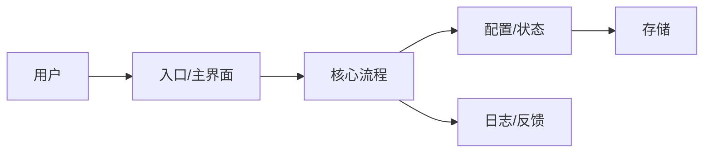

# /review 入口工作流

`/review` 是 MyP-M-A 的“项目理解 + 内部发现”入口。它用于评审项目、页面、PRD、方案或实现，帮助用户和模型快速理解对象脉络，并从中发现可进入 `/idea` 判断的候选问题。

`/review` 只有一个对外入口。不要要求用户记住 `/review project`、`/review page`、`/review prd` 或 `/review implementation`。根据用户提供的信息自动判断通路；如果材料不足，先说明当前只能做哪种轻量 review。

Review 的意义不只是挑问题。它必须先建立共同地图：这个对象是什么、怎么运转、核心路径在哪里、模块如何关联、哪些地方脆弱。然后再从这张地图里发现迭代点。

Project review 尤其不能只做工程结构审查。一个项目能否被用户和下一次模型顺利接手，取决于两张地图：一张是“产品地图”，说明它为谁解决什么问题、当前阶段为什么这样取舍；另一张是“工程地图”，说明代码、配置、数据、窗口、日志和发布链路怎么协作。

## 目录

- 自动识别通路
- 两阶段 Review
- 可视化与证据状态
- 分通路检查重点
- 默认输出结构
- 与 `/idea` 的关系
- 下一步分流与写作要求

## 自动识别通路

根据输入材料判断 review 类型：

| 输入线索 | 内部通路 | 主要看什么 | 输出去向 |
| --- | --- | --- | --- |
| 项目路径、仓库、文件树、README、运行日志、配置文件 | project | 项目目标、阶段、核心路径、模块架构、稳定性、体验债、技术债、缺失指标 | 生成候选迭代点，进入 `/idea` |
| 截图、页面、原型、UI 描述、交互反馈 | page | 信息层级、流程、控件、状态、可用性、视觉密度、产品气质 | 生成 UI/UX 问题池，进入 `/idea` 或 `/prd` |
| PRD、需求文档、用户故事、验收标准、路线图 | prd | 目标、范围、影响范围、原型、验收、数据、开放问题、可开发性 | 修 PRD 或补问题 |
| 代码、diff、实现说明、日志、测试结果、bug 复现 | implementation | 是否符合需求、边界、测试、日志、风险、可维护性、兼容性 | 生成 bug、风险或技术债 |
| release notes、tag、manifest、checksum、发布包、status/current、verification | release readiness | 版本事实、发布门禁、文档一致性、剩余验收项、回滚与发布说明 | 进入 `/acceptance` 或直接修文档 |

如果一个输入同时匹配多种通路，选择最能回答用户当前问题的主通路，并在“Review 范围”里说明副通路只做辅助观察。

## 两阶段 Review

### 1. 脉络理解

先梳理对象，而不是直接挑问题。根据类型输出：

- 目标：这个项目、页面、PRD 或实现想完成什么。
- 用户/使用者：谁会用，什么场景下用。
- 产品定位：它在当前阶段是什么，不是什么；如果有 Lite/Full、Beta/正式版、桌面/网页等产品线或阶段差异，要说明边界。
- 当前阶段目标：当前版本最该完成什么，什么是发布、验收或继续开发的成功标准。
- 核心路径：用户或系统最关键的流程。
- 主要模块：项目、页面、文档或实现的组成部分。
- 数据/配置/状态：关键数据来源、配置文件、状态变化、日志或指标。
- 依赖：外部系统、平台能力、第三方库、系统 API 或人工流程。
- 已知假设：哪些判断来自材料，哪些是推断，哪些未知。

脉络和架构关系至少按三类标注：`事实`（材料或工具直接支持）、`推断`（由命名、结构或业务路径合理推得）、`待确认`（当前证据不足）。这三类是对关系来源的说明，不替代发现表中的正式证据状态。

如果用户提供项目路径、GitHub 链接、exe、网页、日志、截图或 PRD 文件，按 `references/tooling.md` 选择最小必要工具来建立这张地图。例如桌面应用可用 Computer Use 观察窗口和交互，Web 页面可用浏览器/Playwright，仓库可用本地文件和 GitHub。工具不可用时，把相关结构或行为标为“待验证”。

### 2. 问题发现

在理解脉络后再找问题。每个发现必须包含：

- 现象：观察到什么。
- 证据：来自截图、文件、代码、日志、PRD、用户反馈，还是推断。
- 影响：会影响谁、哪个路径、什么结果。
- 严重度：Blocker / Major / Minor / Suggestion。
- 建议：最小可行动建议。
- 去向：进入 `/idea`、进入 `/prd`、修文档、修 bug、技术债、暂不处理。

Review 发现的问题默认只是候选点。除非有强证据，不要把 review 发现直接当成确定需求。

## 可视化要求

每次 `/review` 都应尽量输出至少一个可视化图。默认使用 Mermaid，因为它最轻、最适合 Markdown。

可选图类型：

- 项目架构图：适合 project review。
- 用户流程图：适合 page、product path、feature review。
- 数据/状态流图：适合配置、日志、保存、同步、计算等能力。
- PRD 结构图：适合 PRD review。
- 依赖网络图：适合 implementation review。
- mindmap：适合把项目模块、问题池或需求脉络快速展开。

图必须服务理解，不要为了画图而画图。图里不确定的关系要标注为“推断”或“待确认”。

架构图不能停留在孤立模块清单。只要材料出现 worker、对象存储、系统 API、第三方服务或人工流程，就要尽量画出模块到外部能力的方向关系。材料只确认内部模块、没有说明具体供应商时，可以使用“邮件服务（待确认）”“对象存储（待确认）”等中性节点，并把连线标为推断或待确认；不要为了补图虚构供应商、协议或已实现行为。

示例：



当用户明确要求 XMind 时，输出可转换为 XMind 的 mindmap 结构；如果当前环境支持生成文件，再创建 `.xmind` 或可导入的 Markdown/OPML。

## 证据状态

对每个发现标注证据状态：

- 已确认：有截图、日志、代码、PRD、用户反馈或可复现行为支撑。
- 高度可能：基于材料和经验高度可能，但还没有直接证据。
- 待确认：需要补充材料或验证。
- 主观判断：主要是审美、偏好或策略判断。

证据状态会影响后续去向：

- 已确认 + 高影响：可进入 `/idea` 并可能跳过部分压力测试。
- 高度可能：进入 `/idea`，但需要补证据。
- 待确认：先补材料或做验证，不要推进 PRD。
- 主观判断：只作为讨论参考，不能单独支撑开发。

## 严重度

- Blocker：不处理会导致核心路径不可用、数据错误、严重信任问题、无法验收或无法上线。
- Major：强烈建议本轮处理，影响核心体验、稳定性、理解成本或开发测试风险。
- Minor：有真实问题，但不阻塞当前目标，可排期。
- Suggestion：优化建议或体验打磨，价值需要再判断。

严重度不是优先级。优先级要在 `/idea` 或 `/prd` 中结合价值、证据、成本和阶段判断。

## 分通路检查重点

### Project Review

看项目整体是否容易被模型和用户理解：

- 产品定位、目标用户、核心使用场景是否清楚。
- 当前阶段目标和成功标准是否清楚，例如原型验证、Beta 测试、发布前验收、正式发布或长期维护。
- 产品线/版本边界是否清楚，例如 Lite/Full、v0.x/v1.x、测试分支/主线分支。
- 核心用户路径是否能跑通。
- 模块边界是否清晰。
- 配置、状态、日志、持久化和外部依赖是否能解释清楚。
- 是否有明显体验债、稳定性债、测试债、技术债。
- 是否缺少关键指标、debug 能力、验收路径。
- 多租户或多组织 SaaS 是否明确了租户上下文、资源归属和跨租户访问边界；材料不足时将其标为待确认风险，不得用一般“权限问题”含混代替租户隔离。
- 文档是否存在“当前事实源”，能否一眼判断当前版本、分支、阶段、发布产物、可信文档和历史文档。
- Review 结尾是否能给出下一步分流，而不是只给一组候选点。

Project review 必须输出项目架构图或模块网络图。

### Page Review

看页面是否让用户理解和完成任务：

- 信息层级：标题、分组、说明、主次操作。
- 流程：入口、主流程、保存、取消、关闭、返回。
- 控件：输入框、下拉、开关、按钮是否一致。
- 状态：选中、禁用、错误、加载、空状态、保存反馈。
- 可用性：是否符合用户心智，是否让用户记忆过多。
- 视觉密度：窗口大小、控件大小、间距、边框是否克制。
- 产品气质：是否贴合当前产品，而不是套通用后台模板。

Page review 应输出页面结构图或用户流程图。

### PRD Review

看 PRD 是否能让设计、开发、测试对齐：

- 目标和问题是否清楚。
- 用户、场景和证据是否明确。
- 范围、非目标、延后项是否清楚。
- 是否包含影响范围。
- 是否包含原型图或原型输出模式。
- 功能说明是否精确到入口、出口、保存、取消、关闭、异常、数据来源。
- 验收标准是否可测试。
- 指标、日志、验证方式是否能判断成败。
- 开放问题是否被标出。

PRD review 应输出 PRD 结构图或需求链路图。

### Implementation Review

看实现是否符合目标并可维护：

- 是否符合 PRD 或用户目标。
- 核心路径和边界情况是否覆盖。
- 是否有异常、空状态、失败态、回滚或兼容问题。
- 是否有测试和人工验收路径。
- 日志、debug、指标是否足够定位问题。
- 配置、状态、数据存储是否一致。
- 是否引入过度复杂、重复逻辑或难维护依赖。

Implementation review 应输出实现依赖图、数据流图或关键流程图。

### Release Readiness Review

当 review 范围包含 release notes、tag、发布包、manifest、checksums、verification、status/current 或 README 发布状态时，自动加入 release readiness 检查。它不是重新做发布验收，而是判断项目是否已经具备进入 `/acceptance` 或发布收尾的条件。

重点检查：

- Git 当前分支、远端状态、tag 是否与文档一致。
- `current/status` 是否仍停留在旧分支、未合并、未 tag、待发布等旧口径。
- 发布包是否存在，manifest/checksums 是否存在且文档可追踪。
- release notes 是否反映最新状态、已知限制和后续优化。
- verification/progress/status 是否对同一事项给出一致结论。
- checklist 是否仍有未关闭项；未关闭项是真阻塞，还是文档未同步。
- 哪些事项需要进入 `/acceptance` 实际验收，哪些只是事实性文档修正。

Release readiness review 的结论要优先分为：

- 进入 `/acceptance`：需要运行 exe、日志、截图、发布包、配置、CI 或人工验收支撑的事项。
- 直接修文档：分支、tag、发布状态、README、release notes、checklist 等事实不一致。
- 进入 `/idea`：已转为后续候选需求，需要判断价值、范围和阶段。
- bugfix/dev-log：开发过程、bug 修复过程、技术排查记录，不应留在 PM progress 主体。
- 暂不处理：不影响当前发布闭环，重写成本高于收益。

如果 review 判断“可进入验收”，结尾应给出一段用户可直接发送的 `/acceptance` 提示词，列明验收对象、构建产物、日志、配置和剩余手动项。

## 默认输出结构

```markdown
## Review 判断

- 自动识别类型：
- 本次 review 范围：
- 不覆盖范围：
- 总体判断：

## 使用工具与证据来源

- 本地文件 / 项目结构：
- GitHub / PR / Issue：
- Computer Use / 浏览器：
- 文档 / 截图 / 日志：
- 关键命令：
- 关键文件：
- 已执行验证：
- 未执行验证：
- 结论限制：
- 未能验证：

## 产品定位与用户场景

- 产品定位：
- 目标用户：
- 核心使用场景：
- 当前阶段目标：
- 成功标准：
- 非目标 / 当前不做：
- 产品线或版本边界：

## 对象脉络

- 目标：
- 用户/使用者：
- 核心路径：
- 主要模块：
- 数据/配置/状态：
- 外部依赖：
- 已知假设：

## 架构图 / 流程图

在这里放 Mermaid 图，例如 flowchart、mindmap、sequenceDiagram 或 graph。

## 关键发现

| ID | 问题 | 类型 | 严重度 | 证据状态 | 证据 | 影响 | 建议 | 去向 |
| --- | --- | --- | --- | --- | --- | --- | --- | --- |

## 值得保留

## 进入 /idea 的候选点

| 候选点 | 来源 | 证据强度 | 为什么值得判断 | 建议下一步 |
| --- | --- | --- | --- | --- |

## 下一步分流建议

| 去向 | 事项 | 理由 | 最小下一步 |
| --- | --- | --- | --- |
| 直接修 |  |  |  |
| 进入 /idea |  |  |  |
| 进入 /prd |  |  |  |
| 进入 /acceptance |  |  |  |
| 暂不做 |  |  |  |

## 暂不处理

## 建议下一条提示词

如果下一步应进入 `/acceptance`、`/idea`、`/prd` 或直接修文档，在这里给出一段可直接发送给下一窗口的提示词。

## 给下一次模型接手的摘要
```

## 与 /idea 的关系

`/review` 负责发现问题和建立项目地图，`/idea` 负责判断问题是不是真、值不值得继续、现在该不该做。

Review 输出进入 `/idea` 时，应保留：

- 原始发现。
- 证据状态。
- 严重度。
- 影响范围。
- 建议验证方式。

如果 review 发现超过 2 个候选点，建议直接生成 `/idea` 需求池 Markdown，或提示用户下一步使用 `/idea` 承接。

## 下一步分流

Review 结束时要帮助用户知道下一步怎么走。不要把所有发现都塞进 `/idea`。

- 直接修：文档状态不一致、README 过期、明显拼写/链接错误、低风险配置或 CI 覆盖缺口。
- 进入 `/idea`：需要判断用户价值、证据不足、范围可能过大、存在多种方案取舍的候选需求。
- 进入 `/prd`：价值和范围已由用户决策、既有 `/idea` 结论或直接证据基本明确，需要正式定义影响范围、原型、功能链路和开发前验收口径。仅由本轮 review 推断出的候选点，即使影响看起来很大，也先进入 `/idea` 或明确补证，不得跳过价值判断直接进 `/prd`。
- 进入 `/acceptance`：项目处于开发完成、测试分支、发布前或发布后，需要实际运行、日志、截图、CI、Computer Use、浏览器或人工验收。
- 暂不做：与当前阶段不匹配、破坏产品边界、成本明显过高或缺少基本证据的想法。

如果项目处于 Beta、测试分支或发布前阶段，主动列出最小 `/acceptance` 承接证据：构建产物、配置、日志、手动验证项、截图/录屏、CI 或发布包。

如果项目已经发布、打 tag 或生成发布包，但文档仍写旧分支、未合并、未 tag 或待发布，应把它标为“直接修文档”，不要进入 `/idea`。事实冲突不是需求发现。

## 写作要求

- 先讲清对象怎么运转，再讲哪里有问题。
- 不要只输出问题列表，必须输出脉络和图。
- 不要把推断写成事实。
- 不要把 review 发现直接当成确定需求。
- 要写出值得保留的部分，避免每轮都推倒重来。
- Positive/值得保留项可以出现在关键发现里，但不要让它们干扰问题池提取；最好在“值得保留”中单独收口。
- 工具证据要可审计：尽量列出关键命令、关键文件、已执行验证、未执行验证和结论限制。
- “关键命令”字段不得省略。若本轮没有执行命令，明确写“未执行”，并说明是缺少仓库、运行环境、授权还是当前任务无需执行；不要用空白字段或直接跳过来表达未执行。
- 架构图要呈现关键依赖方向。出现 worker、外部服务、对象存储、系统 API 或人工流程时，至少画出一条对应的输入或输出关系；证据不足时标注“推断/待确认”，不要把外部能力隐藏成孤立模块名。
- Project review 要先理解产品定位和用户场景，再理解工程架构。
- 结尾要给下一步分流建议，帮助用户决定是直接修、进 `/idea`、进 `/prd`、进 `/acceptance`，还是暂不做。
- 对个人项目默认保护可完成性，优先发现核心路径、稳定性、体验质感和维护成本问题。
